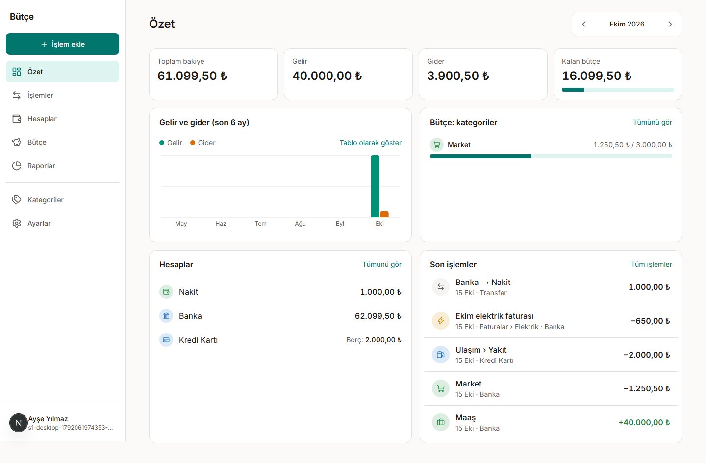

# Bütçe — Kişisel Bütçe ve Harcama Takibi

Gelir ve giderleri, hesapları, bütçeleri ve raporları tek yerde toplayan, telefonda ve bilgisayarda aynı rahatlıkla çalışan web uygulaması.

> Uygulamanın adı ve adresi henüz kesinleşmedi; ikisi de ortam değişkeninden okunur (`NEXT_PUBLIC_APP_NAME`, `NEXT_PUBLIC_APP_URL`).



## Özellikler (Faz 1 — `v1.0.0`)

- **Hesap:** e-posta ve şifreyle kayıt, e-posta doğrulama, giriş, şifre sıfırlama; sızmış şifre kontrolü ve deneme sınırı.
- **Özet:** toplam bakiye (net varlık), aylık gelir, gider ve kalan bütçe; hesap bakiyeleri, kategori bütçeleri, son işlemler, 6 aylık grafik.
- **İşlemler:** gelir, gider ve hesaplar arası transfer; ekleme, düzenleme, kopyalama, silme ve 10 saniye içinde geri alma.
- **Filtreleme:** tarih aralığı, kategori (alt kategoriler dahil), hesap, tür ve tutar; filtreye uyan tüm işlemlerin toplamları.
- **Hesaplar:** nakit, banka, kredi kartı (borç olarak), birikim; açılış bakiyesi, arşivleme, sıralama.
- **Kategoriler:** iki seviyeli ağaç, simge ve renk, arşivleme, birleştirme; Türkçe varsayılan kategoriler.
- **Bütçe:** aylık genel bütçe ve kategori bütçeleri; harcanan, planlı ve kalan; %80 ve aşım uyarısı.
- **Raporlar:** aylık gelir-gider grafiği, kategori dağılımı (alt kategoriye inme), tablo görünümü.
- **Ayarlar:** profil, e-posta ve şifre değiştirme, açık/koyu tema, saat dilimi, para birimi.
- **Gizlilik (KVKK):** verilerimi indir (JSON), hesabımı sil, aydınlatma metni ve koşullar.

Sonraki fazlar (tekrarlayan işlemler, kredi kartı ekstresi ve taksit, CSV içe aktarma, fiş okuma, bildirimler, iki adımlı doğrulama, ortak defter…) için: [docs/00-scope.md](docs/00-scope.md).

## Teknoloji

Next.js 16 (App Router) · TypeScript · PostgreSQL (Neon) · Drizzle ORM · Better Auth · Tailwind CSS · Radix · Recharts · Vitest · Playwright. Gerekçeler: [docs/06-tech-stack.md](docs/06-tech-stack.md).

## Yerel kurulum

Gerekenler: **Node.js 22+**, **pnpm 12** (`corepack enable`), **Docker** (yerel veritabanı ve entegrasyon testleri için).

```bash
# 1. Bağımlılıklar
pnpm install

# 2. Ortam değişkenleri
cp .env.example .env.local
# BETTER_AUTH_SECRET için rastgele bir değer üretin:
node -e "console.log(require('crypto').randomBytes(32).toString('base64'))"

# 3. Veritabanı (Docker'da PostgreSQL 17, port 5433)
pnpm db:up
pnpm db:migrate

# 4. Uygulama
pnpm dev
```

Uygulama http://localhost:3000 adresinde açılır. Yerelde e-postalar gönderilmez, `.dev-mail/` klasörüne yazılır; doğrulama ve şifre sıfırlama bağlantılarını **http://localhost:3000/dev/mail** adresinden açabilirsiniz.

## Komutlar

| Komut | Ne yapar |
|---|---|
| `pnpm dev` | Geliştirme sunucusu |
| `pnpm build` / `pnpm start` | Üretim derlemesi ve sunucusu |
| `pnpm typecheck` · `pnpm lint` · `pnpm format` | Tip denetimi, lint, biçimleme |
| `pnpm test` | Birim ve bileşen testleri |
| `pnpm test:integration` | Gerçek PostgreSQL ile entegrasyon testleri (Docker gerekir, Testcontainers kendi veritabanını açar) |
| `pnpm test:e2e` | Uçtan uca testler (S1 demo senaryosu, masaüstü ve telefon); çalışan sunucuyu kullanır |
| `pnpm check` | CI'daki kontrollerin uçtan uca testler dışındaki hepsi |
| `pnpm db:generate` | Şema değişikliğinden migration üretir (`src/server/db/migrations/`) |
| `pnpm db:migrate` | Migration'ları `DATABASE_URL`'deki veritabanına uygular |

Uçtan uca testleri ilk kez çalıştırmadan önce: `pnpm exec playwright install chromium`.

## Ortam değişkenleri

| Değişken | Zorunlu | Açıklama |
|---|---|---|
| `NEXT_PUBLIC_APP_NAME` | Hayır | Uygulamanın görünen adı (varsayılan "Bütçe") |
| `NEXT_PUBLIC_APP_URL` | Evet | Uygulamanın adresi; e-posta bağlantıları buna göre oluşur |
| `DATABASE_URL` | Evet | PostgreSQL bağlantısı (Neon'da havuzlu bağlantı adresi) |
| `BETTER_AUTH_SECRET` | Evet | En az 32 karakterlik rastgele değer; değişirse tüm oturumlar kapanır |
| `EMAIL_TRANSPORT` | Evet | `file` (yerel) veya `resend` (üretim) |
| `EMAIL_FROM` | Evet | Gönderen, ör. `Bütçe <no-reply@alanadiniz.com>` |
| `RESEND_API_KEY` | `resend` ise | Resend API anahtarı; gönderen alan adı Resend'de doğrulanmış olmalı |

Hepsi `src/env.ts`'te doğrulanır; eksik veya hatalı değer ilk istekte açık bir hatayla durdurur.

## Yayına alma (Vercel + Neon)

Servis hesapları müşteri adına açılacaktır. Adımlar:

1. **Neon:** Frankfurt bölgesinde proje açın; havuzlu (`-pooler`) ve doğrudan bağlantı adreslerini alın.
2. **Resend:** alan adını ekleyip SPF, DKIM ve DMARC kayıtlarını DNS'e girin.
3. **Vercel:** GitHub deposunu bağlayın; ortam değişkenlerini girin (`DATABASE_URL` = havuzlu adres). Bölge `vercel.json`'da Frankfurt'tur (`fra1`).
4. **GitHub:** depo gizli bilgilerine `PRODUCTION_DATABASE_URL` (doğrudan adres), `VERCEL_TOKEN`, `VERCEL_ORG_ID`, `VERCEL_PROJECT_ID` ve `PRODUCTION_URL` değişkenini ekleyin. Bundan sonra her `main` birleşmesinde önce migration'lar, sonra kod yayına alınır.
5. **Yedek:** `BACKUP_AGE_PUBLIC_KEY` ve R2 bilgilerini ekleyin; haftalık şifreli yedek kendiliğinden başlar.

Ayrıntılar: [docs/08-environments-and-deployment.md](docs/08-environments-and-deployment.md) · İşletim: [docs/09-operations.md](docs/09-operations.md).

## Belgeler

- [Kullanım kılavuzu](docs/guides/user-guide.md)
- [Belge dizini](docs/README.md): kapsam, sözlük, kullanım senaryoları, iş kuralları, veri modeli, mimari
- [Standartlar](docs/standards/README.md) ve [mimari karar kayıtları](docs/adr/README.md)
- [Proje planı](plan.md)

## Katkı

Dal düzeni, commit mesajları (Conventional Commits) ve PR akışı: [docs/standards/git.md](docs/standards/git.md). Bitti tanımı: [docs/standards/definition-of-done.md](docs/standards/definition-of-done.md). Commit kancalarını kurmak için `pnpm exec lefthook install`.
