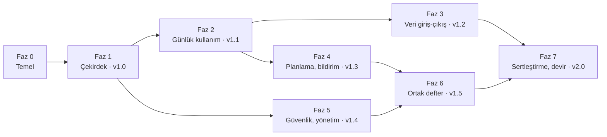

# Kapsam

> **Durum:** v1.0 · **Son güncelleme:** 2026-10-15
> **Kararlar:** [Kararlar](#kararlar)

Projenin kapsamı: müşterinin ilanı, kapsam haritası, kapsam dışı konular, demo senaryoları, teslimat, riskler ve kararlar.

## İlanın analizi

## 2.1 Müşterinin açıkça istedikleri

| No | İstek | İlandaki ifade | Karşılayan gereksinimler | Faz |
|---|---|---|---|---|
| İ-01 | Kullanıcı girişi | "E-posta ve şifre ile kayıt olma ve giriş yapma" | FR-AUTH-01…06 | 1 |
| İ-02 | Dashboard | "Toplam bakiye, aylık gelir, gider ve kalan bütçenin görüntülenmesi" | FR-DSH-01…05 | 1 |
| İ-03 | Gelir-gider yönetimi | "İşlem ekleme, düzenleme ve silme; işlem kategorisi, tutarı, tarihi ve açıklaması" | FR-TRX-01…06 | 1 |
| İ-04 | Kategori yönetimi | "Yemek, ulaşım, faturalar gibi kategorilere ayrılabilmesi" | FR-CAT-01…05 | 1 |
| İ-05 | Raporlama | "Aylık gelir-gider grafikleri ve kategori bazında harcama dağılımı" | FR-RPT-01…03 | 1 |
| İ-06 | Filtreleme | "Tarih aralığına ve kategoriye göre işlemlerin filtrelenebilmesi" | FR-TRX-07…09 | 1 |
| İ-07 | Güvenli veritabanı | "Kullanıcı verilerinin güvenli şekilde saklanması" | NFR-10…16, [security](standards/README.md) | 0–1 |
| İ-08 | Responsive tasarım | "Bilgisayar ve telefon ekranlarında düzgün çalışması" | NFR-01…04 | 1 |
| İ-09 | Tasarım dili | "Modern, sade, kullanıcı dostu ve profesyonel… gereksiz animasyonlardan uzak, okunabilirliği yüksek" | NFR-05…07, [ui](standards/README.md) | 0–1 |
| İ-10 | Teslimat | "Çalışan bir uygulama, kaynak kodları ve kurulum/kullanım talimatları" | [§15](00-scope.md#teslimat-paketi) | 1, 7 |
| İ-11 | Maliyet | "Ücretsiz veya düşük maliyetli bir hosting ve veritabanı çözümü" | [§6.5](08-environments-and-deployment.md#maliyet) | 0 |

**Teklifte istenenler:** kullanılacak teknolojiler, teslim süresi, bütçe kapsamında sunulacak özellikler, benzer projeler. Teknolojiler [§6](#6-teknoloji-ve-mimari)'da, özellik listesi [§3.2](00-scope.md#kapsam-haritası)'de hazırdır. Süre ve benzer projeler teklif aşamasında ayrıca yazılır.

## 2.2 Açıkça yazmasa da beklenenler

Müşteri bunları istemedi ama yokluklarını fark eder. Bu yüzden kapsamın çekirdeğine (Faz 1) alınırlar:

| Beklenti | Neden | Karşılayan |
|---|---|---|
| Şifremi unuttum | E-posta/şifre girişi olan her uygulamada beklenir; olmazsa ilk unutmada destek talebi gelir. | FR-AUTH-04 |
| E-posta doğrulama | Açık kayıtta yanlış yazılan e-posta, şifre sıfırlamayı imkansız kılar. | FR-AUTH-02 |
| Kullanıcı verilerinin kesin ayrımı | "Güvenli saklama"nın asıl anlamı: hiçbir kullanıcı başkasının verisini göremez. | BR-SYS-001, NFR-11 |
| Türkçe sayı ve tarih biçimi | 1.234,56 ₺ ve 15.10.2026; tutarın virgüllü girilebilmesi. | NFR-08, ui standardı |
| Hızlı işlem girişi | Uygulama ancak günlük kullanılırsa işe yarar; işlem girişi telefonda birkaç saniye sürmeli. | NFR-09 |
| Boş durumlar ve ilk kullanım | İlk girişte boş ekran yerine ne yapılacağını söyleyen ekran. | FR-ONB-01 |
| Verinin dışa alınabilmesi ve hesabın silinebilmesi | KVKK; kullanıcı güveni. | FR-PRV-01…02 |
| Yedekleme | Finansal veri kaybı kabul edilemez. | NFR-17 |
| Karanlık mod | Modern arayüz beklentisi; tasarım değişkenleriyle baştan kurulursa maliyeti düşük. | FR-SET-03 |

## 2.3 Belirsizlikler ve verilen kararlar

| İlandaki ifade | Olası yorumlar | Karar | Gerekçe |
|---|---|---|---|
| "Toplam bakiye" | (a) Gelir − gider toplamı; (b) hesapların bakiyeleri toplamı | **(b)** Tam hesap yönetimi: nakit, banka, kredi kartı, birikim hesapları; toplam bakiye = net varlık (K-03) | Gerçek hayatta para birden çok yerde durur. Kredi kartı harcaması o anda nakit eksiltmez; tek bakiye modeli bunu yanlış gösterir. |
| "Kalan bütçe" | (a) Bu ayın geliri − gideri; (b) belirlenen bütçe − harcanan | **(b)** Aylık bütçe limiti ve isteğe bağlı kategori limitleri. Bütçe tanımlanmamışsa (a) gösterilir (K-04). | "Bütçe" kelimesi bir plan ima eder. Fallback, bütçe tanımlamayan kullanıcıda da kartın anlamlı kalmasını sağlar. |
| Para birimi | Yazmıyor | Defter başına tek para birimi, varsayılan TRY, kullanıcı seçer (K-05) | Çoklu birim kur çevrimi ister; kişisel bütçede nadiren gerekir. |
| "Kayıt olma" | Yalnızca müşteri mi, herkes mi? | Açık kayıt, yönetici kapatabilir (K-11) | İlan kayıt istiyor; kapatma anahtarı müşteriye kontrol verir. |

## 2.4 Teklifte vurgulanacaklar

- İlanın istediği her şey ilk teslim noktasında (Faz 1 sonu) hazırdır; ekler bunun üzerine kurulur.
- Ücretsiz katmanlarda çalışan yığın: Vercel + Neon PostgreSQL. Tek ek maliyet bir alan adıdır (e-posta gönderimi için) ve isteğe bağlı fiş okuma kullanımıdır.
- Güvenlik: e-posta doğrulama, sızmış şifre kontrolü, iki adımlı doğrulama, oturum yönetimi, kullanıcılar arası kesin veri ayrımı ve bunun otomatik testleri, KVKK uyumlu veri indirme ve silme.
- Türkiye'ye özgü işlevler: taksitli alışveriş, kredi kartı hesap kesim ve son ödeme günü, banka ekstresinden CSV içe aktarma (Windows-1254 ve `1.234,56` biçimleri).
- Teslimde kaynak kod, kurulum ve kullanım kılavuzu ile tüm servis hesaplarının müşteriye devri.

## Kapsam

## 3.1 Ürün tanımı

Kişisel ve aile finansını tek yerden yöneten, telefonda ve bilgisayarda aynı rahatlıkla kullanılan bir web uygulaması. Kullanıcı paranın nerede durduğunu (hesaplar), nereye gittiğini (kategoriler, raporlar) ve ay sonuna ne kalacağını (bütçe, yaklaşan ödemeler, taksitler) bir bakışta görür. İşlem girişi hızlıdır; tekrarlayan ödemeler, taksitler, CSV içe aktarma ve fiş okuma elle girişi azaltır.

## 3.2 Kapsam haritası

"Kaynak" sütunu: **İlan** = müşterinin istediği, **Örtük** = istemediği ama beklediği, **Ek** = birlikte karar verdiğimiz profesyonel eklenti.

| Alan | Özellik | Kaynak | Faz |
|---|---|---|---|
| Kimlik | E-posta/şifre ile kayıt ve giriş | İlan | 1 |
| Kimlik | E-posta doğrulama, şifre sıfırlama, sızmış şifre kontrolü | Örtük | 1 |
| Kimlik | İki adımlı doğrulama (TOTP + yedek kodlar) | Ek | 5 |
| Kimlik | Google ile giriş | Ek | 5 |
| Kimlik | Aktif oturumları görme ve kapatma | Ek | 5 |
| Kimlik | Yeni cihazdan giriş bildirimi | Ek | 5 |
| Dashboard | Toplam bakiye, aylık gelir/gider, kalan bütçe | İlan | 1 |
| Dashboard | Hesap bakiyeleri, kategori bütçe çubukları, son işlemler | Ek | 1 |
| Dashboard | Yaklaşan ödemeler (tekrarlayan, taksit, kart son ödeme) | Ek | 2 |
| İşlemler | Gelir/gider ekleme, düzenleme, silme | İlan | 1 |
| İşlemler | Hesaplar arası transfer | Ek | 1 |
| İşlemler | Bölünmüş işlem (bir işlem, birden çok kategori) | Ek | 2 |
| İşlemler | Etiketler ve açıklamada metin arama | Ek | 2 |
| İşlemler | Çöp kutusu (30 gün) ve geri alma | Ek | 2 |
| İşlemler | Tekrarlayan işlemler | Ek | 2 |
| Kategoriler | Kategori ekleme, düzenleme, arşivleme | İlan | 1 |
| Kategoriler | Alt kategoriler (iki seviye), birleştirme, simge ve renk | Ek | 1 |
| Kategoriler | Otomatik kategori kuralları | Ek | 3 |
| Hesaplar | Nakit, banka, kredi kartı, birikim hesapları; açılış bakiyesi | Ek | 1 |
| Kredi kartı | Hesap kesim ve son ödeme günü, dönem borcu, asgari ödeme, kullanılabilir limit | Ek | 2 |
| Kredi kartı | Taksitli alışveriş | Ek | 2 |
| Bütçe | Aylık toplam bütçe ve kategori limitleri | Örtük (ilanın "kalan bütçe"si) | 1 |
| Bütçe | %80 ve %100 uyarıları | Ek | 4 |
| Hedefler | Birikim hedefleri | Ek | 4 |
| Raporlar | Aylık gelir-gider grafiği, kategori dağılımı | İlan | 1 |
| Raporlar | Yıllık özet, 12 aylık trend, ay karşılaştırması, tasarruf oranı, hesap bazında rapor | Ek | 4 |
| Filtre | Tarih aralığı ve kategori | İlan | 1 |
| Filtre | Hesap, tür, tutar aralığı, etiket, metin | Ek | 1–2 |
| Veri | CSV / Excel dışa aktarma, aylık PDF rapor | Ek | 3 |
| Veri | CSV içe aktarma (banka ekstresi) | Ek | 3 |
| Veri | Fiş/fatura ekleme (görsel, PDF) | Ek | 3 |
| Veri | Fişten otomatik okuma (AI) | Ek | 3 |
| Bildirim | Uygulama içi bildirim merkezi ve tercihler | Ek | 4 |
| Bildirim | Bütçe uyarısı, aylık özet, ödeme hatırlatma e-postaları | Ek | 4 |
| Paylaşım | Ortak defter (aile/eş), davet, roller | Ek | 6 |
| Geçmiş | İşlem geçmişi (kim, ne zaman, ne değişti) | Ek | 2 |
| Deneyim | Responsive tasarım | İlan | 1 |
| Deneyim | Karanlık mod | Örtük | 1 |
| Deneyim | Hoş geldin akışı | Ek | 2 |
| Deneyim | PWA (ana ekrana ekleme) | Ek | 2 |
| Deneyim | Demo hesabı | Ek | 5 |
| Deneyim | Türkçe / İngilizce | Ek | 5 (altyapı Faz 0) |
| Yönetim | Yönetici paneli, kayıt modu, davet, askıya alma | Ek | 5 |
| Gizlilik | Verilerimi indir (JSON), hesabımı sil, KVKK metinleri | Örtük | 1 |

## 3.3 Kapsam dışı

Aşağıdakiler bilerek kapsam dışıdır. İstenirse ayrı bir faz olarak planlanır.

| Konu | Neden dışarıda |
|---|---|
| Çoklu para birimi ve kur çevrimi | K-05. Kur kaynağı, geçmiş kurlar ve karma toplamlar karmaşıklığı belirgin artırır. |
| Banka entegrasyonu (açık bankacılık) | Türkiye'de bireysel geliştiriciye açık, ücretsiz bir API yok; CSV içe aktarma ihtiyacın çoğunu karşılar. |
| Yerel (native) mobil uygulama | PWA telefonda uygulama gibi çalışır; mağaza süreci ve ayrı kod tabanı gerekmez. |
| Çevrimdışı işlem girme | Senkronizasyon ve çakışma çözümü gerektirir. PWA yalnızca kabuğu önbellekler. |
| Yatırım, hisse, döviz ve altın portföyü | Fiyat verisi ve değerleme ayrı bir ürün alanıdır. |
| Web push bildirimleri | iOS'ta yalnızca ana ekrana eklenmiş PWA'da çalışır; e-posta ve uygulama içi bildirim yeterli. İleride eklenebilir. |
| Kullanılmayan bütçenin sonraki aya devri | Zarf bütçeleme (YNAB tarzı) ayrı bir modeldir. |
| Ücretli abonelik / ödeme alma | Ürün müşterinin kişisel kullanımı içindir. |

## 3.4 Varsayımlar

- Kullanıcıların büyük çoğunluğu Türkiye'dedir. Varsayılan dil Türkçe, saat dilimi `Europe/Istanbul`, para birimi TRY.
- Bir kullanıcının yılda birkaç bin işlemi olur. Tasarım, kullanıcı başına 50.000 işleme kadar yavaşlamadan çalışır (NFR-20).
- Müşteri, teslimde servis hesaplarının (Vercel, Neon, Resend, Cloudflare, Anthropic, Sentry, alan adı) kendi adına açılmasını kabul eder ([§15](00-scope.md#teslimat-paketi)).
- E-posta gönderimi için bir alan adı vardır ya da alınır (açık konu A-01).

## Fazlar ve demo senaryoları

## 13.1 İlkeler

1. **İlan önce.** Müşterinin istediği her şey Faz 1'de biter. Faz 1 sonu tek başına teslim edilebilir bir sürümdür (Teslim noktası 1, `v1.0.0`).
2. **Veri modeli baştan, arayüz sırayla.** Sonradan veri taşıması gerektirecek kararlar (defter kiracı modeli, işlem kalemleri, kuruş cinsinden tutar, işlem geçmişi kaydı) Faz 1'de uygulanır. Arayüzleri sonraki fazlarda gelir.
3. **Dikey dilim.** Her iş paketi veritabanı, eylem, ekran ve testleriyle birlikte biter. "Önce tüm sunucu, sonra tüm ekranlar" yapılmaz.
4. **Her faz bir sürümdür.** Faz sonunda bitti tanımının sürüm bölümü ([§14.6](standards/README.md)) uygulanır ve sürüm etiketlenir.
5. **Fazlar sıralıdır ama katı değildir.** Bir fazın işi bağımlılığı bittiyse öne alınabilir; bu durum değişiklik kaydına yazılır.

## 13.2 Faz 0 — Temel

**Amaç:** Tüm sonraki işlerin üzerine kurulacağı iskelet, araçlar, ortamlar ve standartlar.

| No | İş paketi |
|---|---|
| F0-01 | Depo: pnpm, Next.js, TypeScript katı ayarları, ESLint, Prettier; commit öncesi kontroller (lefthook: biçim, lint, commit mesajı, gitleaks). |
| F0-02 | Belgeler: bu planın `docs/` altına bölünmesi; standartların v1.0'ı ([§14](README.md)); ilk ADR'ler (ADR-0001…0014). |
| F0-03 | CI: PR hattı (tip denetimi, lint, biçim, birim ve entegrasyon testleri, derleme, migration tutarlılığı, gitleaks, bağımlılık denetimi); Dependabot; PR şablonu. |
| F0-04 | Ortamlar: Vercel projesi, Neon (üretim + PR başına veritabanı dalı), Sentry, açılışta Zod ile doğrulanan ortam değişkenleri, `.env.example`. |
| F0-05 | Veritabanı temeli: Drizzle bağlantısı, migration akışı, ortak kolon yardımcıları, UUID v7, `scoped(ctx)` yardımcısı, Testcontainers ile test veritabanı. |
| F0-06 | Uygulama iskeleti: `Result` tipi, hata kodları, eylem sarmalayıcısı (`ledgerAction`), `lib/money`, `lib/dates`, next-intl ve `tr.json`, tema altyapısı. |
| F0-07 | Tasarım sistemi: açık ve koyu tasarım değişkenleri, yazı tipi, shadcn/ui bileşenlerinin uyarlanması, yerleşim kabuğu (kenar çubuğu, alt çubuk), boş / yükleniyor / hata bileşenleri, tutar ve tarih giriş bileşenleri; yalnızca geliştirmede açılan bileşen örnek sayfası. |
| F0-08 | Uçtan uca test altyapısı: Playwright (masaüstü ve telefon görünümleri), axe, test verisi tohumlama. |
| F0-09 | Sağlık kontrolü uç noktası, yapılandırılmış log, Sentry istemci ve sunucu entegrasyonu. |

**Çıkış kriterleri**
- [ ] Önizleme ve üretim ortamında oturumsuz bir iskelet sayfa yayında; sağlık kontrolü yeşil.
- [ ] Örnek bir eylem tüm katmanlardan (form → eylem → veritabanı → `Result` → ekran) geçiyor; birim, entegrasyon ve uçtan uca testi var.
- [ ] CI'daki tüm kontroller zorunlu ve yeşil; `main` dalı korumalı.
- [ ] Standartlar v1.0 ve ilk ADR'ler yazılı.

## 13.3 Faz 1 — Çekirdek (ilanın tamamı) · Teslim noktası 1 · `v1.0.0`

**Amaç:** İlandaki her isteği eksiksiz karşılayan, yayında çalışan ve kılavuzlu ilk sürüm.

| No | İş paketi | Gereksinimler |
|---|---|---|
| F1-01 | Kimlik: kayıt, e-posta doğrulama, giriş, çıkış, şifre sıfırlama, profil, hız sınırı, sızmış şifre kontrolü; Resend ve e-posta şablonları | FR-AUTH-01…06 |
| F1-02 | Kişisel defter, kayıt sonrası kurulum, rol tabanlı yetki, kiracı yalıtımı testleri | FR-LDG-01, NFR-11 |
| F1-03 | Hesaplar ve bakiye hesaplama | FR-ACC-01…03 |
| F1-04 | Kategoriler, alt kategoriler, birleştirme, varsayılan kategoriler | FR-CAT-01…05 |
| F1-05 | İşlemler: ekleme, düzenleme, silme ve geri alma, transfer, kopyalama, hızlı ekleme. Veri modeli kalemlidir (bölme arayüzü Faz 2'de). | FR-TRX-01…06 |
| F1-06 | İşlem listesi, filtreler, toplamlar, adreste filtre | FR-TRX-07…11 |
| F1-07 | Bütçe: genel ve kategori limitleri, bütçe ekranı | FR-BUD-01…03 |
| F1-08 | Dashboard | FR-DSH-01…05 |
| F1-09 | Raporlar: aylık gelir-gider grafiği, kategori dağılımı, tablo karşılıkları | FR-RPT-01…04 |
| F1-10 | Ayarlar: tema, saat dilimi, para birimi | FR-SET-01…03 |
| F1-11 | Gizlilik: yasal metinler, verilerimi indir (JSON), hesabımı sil | FR-PRV-01…03 |
| F1-12 | İşlem geçmişinin kaydı (arayüzü Faz 2'de; kayıt şimdiden başlar ki geçmiş eksik kalmasın) | BR-AUD-001…003 |
| F1-13 | Boş durumlar | FR-ONB-01 |
| F1-14 | Haftalık yedekleme iş akışı ve uptime izleme | NFR-17, NFR-27 |
| F1-15 | README (kurulum, yayın), kullanım kılavuzu (Türkçe, ekran görüntülü) | İ-10 |
| F1-16 | S1 demo senaryosunun uçtan uca testi (aşağıda) | — |

**S1 demo senaryosu.** Faz 1'in bitti kanıtıdır; temiz bir veritabanında, masaüstü (1440 × 900) ve telefon (390 × 844) görünümlerinde Playwright ile otomatik çalışır. Tüm işlemler içinde bulunulan ayın tarihlidir.

1. Yeni bir kullanıcı kayıt olur ve e-postasını doğrular.
2. "Banka" hesabını 25.000,00 ₺ açılış bakiyesiyle ve "Kredi Kartı" hesabını 0,00 ₺ borçla ekler ("Nakit" hazırdır).
3. Bankaya 40.000,00 ₺ "Maaş" geliri ekler.
4. Giderler ekler: Market 1.250,50 ₺ (Banka), Ulaşım › Yakıt 2.000,00 ₺ (Kredi Kartı), Faturalar › Elektrik 650,00 ₺ (Banka).
5. Market giderini siler ve "Geri al" ile geri getirir; Elektrik giderinin açıklamasını düzenler.
6. Bankadan Nakite 1.000,00 ₺ transfer yapar.
7. Aylık genel bütçeyi 20.000,00 ₺, Market bütçesini 3.000,00 ₺ yapar.
8. Dashboard'da görür: **Toplam bakiye 61.099,50 ₺** (Banka 62.099,50 + Nakit 1.000,00 − Kart 2.000,00) · **Gelir 40.000,00 ₺** · **Gider 3.900,50 ₺** · **Kalan bütçe 16.099,50 ₺**.
9. İşlemleri bu ay ve "Ulaşım" kategorisiyle filtreler; tek işlem ve 2.000,00 ₺ gider toplamı görür.
10. Raporlarda bu ayın sütunlarında 40.000,00 ₺ gelir ve 3.900,50 ₺ gider; kategori dağılımında Ulaşım %51,3, Market %32,1, Faturalar %16,7 görür.
11. Bütçe ekranında Market için "Kalan 1.749,50 ₺" görür.
12. İkinci bir kullanıcı, ilk kullanıcının işlem ve hesap kimlikleriyle yaptığı tüm okuma ve yazma isteklerinde "bulunamadı" yanıtı alır.

**Çıkış kriterleri**
- [ ] S1 iki görünümde de otomatik geçiyor.
- [ ] İlandaki İ-01…İ-11'in her biri en az bir test veya belgeyle kanıtlanmış ([§2.1](00-scope.md#ilanın-analizi)).
- [ ] Üretim ortamında çalışıyor; README'deki adımlarla temiz bir makinede yerel kurulum yapılabiliyor.
- [ ] Kullanım kılavuzu hazır.

## 13.4 Faz 2 — Günlük kullanım · `v1.1.0`

**Amaç:** Uygulamayı her gün kullanılan bir araca dönüştüren otomasyon ve kredi kartı gerçekliği.

| No | İş paketi | Gereksinimler |
|---|---|---|
| F2-01 | Tekrarlayan işlemler, onay bekleyenler, günlük zamanlanmış iş ve uygulama açılışında telafi | FR-REC-01…03, BR-REC-001…007 |
| F2-02 | Kredi kartı ayarları, ekstre görünümü, "Borcu öde" | FR-CC-01…03 |
| F2-03 | Taksitli alışveriş ve taksit planı | FR-INS-01…03 |
| F2-04 | Dashboard'da yaklaşan ödemeler ve onay bekleyenler | FR-DSH-06 |
| F2-05 | Bölünmüş işlem | FR-TRX-12 |
| F2-06 | Etiketler ve metin arama | FR-TRX-13 |
| F2-07 | Çöp kutusu, işlem geçmişi sekmesi, toplu işlem | FR-TRX-14…16 |
| F2-08 | Hoş geldin akışı | FR-ONB-02 |
| F2-09 | PWA: manifest, simgeler, çevrimdışı ekranı, yükleme yönergesi | FR-PWA-01 |

**Çıkış kriterleri:** UC-04, UC-08 (çöp kutusu), UC-18…UC-23, UC-34, UC-38'in kabul kriterleri testli. Tekrarlayan iş iki kez çalıştırıldığında tek sonuç üretiyor.

## 13.5 Faz 3 — Veri giriş ve çıkışı · `v1.2.0`

**Amaç:** Elle girişi azaltmak (içe aktarma, kurallar, fiş okuma) ve verinin dışarı alınabilmesi.

| No | İş paketi | Gereksinimler |
|---|---|---|
| F3-01 | CSV içe aktarma: yükleme, kodlama tespiti, eşleme, önizleme, mükerrer kontrolü, geri alma; Türk bankalarından örnek dosyalarla test | FR-IMP-01…04 |
| F3-02 | Kategori kuralları | FR-CAT-06 |
| F3-03 | Dışa aktarma: CSV, Excel, aylık PDF rapor | FR-EXP-01, 02 |
| F3-04 | Ekler: R2 kovası, imzalı yükleme ve indirme, EXIF silme, küçültme | FR-ATT-01, 02 |
| F3-05 | Fiş okuma: değerlendirme seti (en az 30 gerçek fiş), Claude API entegrasyonu, kota, maliyet kaydı | FR-RCP-01, 02, A-04 |
| F3-06 | Verilerimi indir: ekleriyle ZIP | FR-PRV-01 |

**Çıkış kriterleri:** UC-17, UC-24…UC-27 testli. Fiş okuma değerlendirme setinde toplam tutar ve tarih doğruluğu ölçülmüş ve [§16](00-scope.md#riskler-ve-açık-konular)'ya yazılmış.

## 13.6 Faz 4 — Planlama, içgörü ve bildirimler · `v1.3.0`

| No | İş paketi | Gereksinimler |
|---|---|---|
| F4-01 | Bildirim altyapısı: bildirim tablosu, tekilleştirme, tercihler, bildirim merkezi | FR-NTF-01, 02 |
| F4-02 | E-postalar: bütçe uyarısı, ödeme hatırlatma, aylık özet; abonelikten çıkma bağlantısı | FR-NTF-03, FR-BUD-04 |
| F4-03 | Birikim hedefleri | FR-GOAL-01…03 |
| F4-04 | Gelişmiş raporlar: yıllık, trend, karşılaştırma, en çoklar, hesaplar | FR-RPT-05…09 |
| F4-05 | Dashboard eklentileri: geçen aya göre değişim, hedef ilerlemesi | FR-DSH-07 |

**Çıkış kriterleri:** UC-14, UC-16, UC-28, UC-29 testli. E-posta şablonları açık ve koyu e-posta istemcilerinde ve telefonda kontrol edilmiş.

## 13.7 Faz 5 — Hesap güvenliği, yönetim ve erişim · `v1.4.0`

| No | İş paketi | Gereksinimler |
|---|---|---|
| F5-01 | İki adımlı doğrulama | FR-AUTH-07 |
| F5-02 | Google ile giriş | FR-AUTH-08 |
| F5-03 | Aktif oturumlar ve yeni cihaz bildirimi | FR-AUTH-09, 10 |
| F5-04 | Yönetici paneli, kayıt modu, yönetici daveti, sistem durumu, yönetici günlüğü | FR-ADM-01…04 |
| F5-05 | Demo hesabı ve örnek veri üreteci | FR-DEMO-01 |
| F5-06 | İngilizce çeviri, dil ayarı, İngilizce e-posta şablonları | FR-SET-04 |

**Çıkış kriterleri:** UC-30, UC-31, UC-39…UC-41 testli. İngilizce arayüzde eksik çeviri anahtarı yok.

## 13.8 Faz 6 — Ortak defter · `v1.5.0`

| No | İş paketi | Gereksinimler |
|---|---|---|
| F6-01 | Ortak defter oluşturma ve defter değiştirici | FR-LDG-02, 06 |
| F6-02 | Davetler ve davet kabulü | FR-LDG-03, 04 |
| F6-03 | Üye yönetimi: rol değiştirme, çıkarma, ayrılma, sahiplik devri | FR-LDG-05 |
| F6-04 | Role göre arayüz (görüntüleyicide düzenleme düğmeleri gizli); işlemlerde "Ekleyen: Ayşe" | BR-SYS-002, 003 |
| F6-05 | Eşzamanlı düzenleme çakışma ekranı, defter etkinlik akışı | BR-SYS-005, UC-34 |
| F6-06 | Rol matrisi testleri: her eylem × her rol | §5.2 |

**Çıkış kriterleri:** UC-32, UC-33 testli. Rol matrisi testi her eylem için izinli ve izinsiz rolleri doğruluyor.

## 13.9 Faz 7 — Sertleştirme ve devir · `v2.0.0`

| No | İş paketi |
|---|---|
| F7-01 | Güvenlik denetimi: OWASP ASVS kontrol listesi, bağımlılık ve başlık taraması, yetki testlerinin gözden geçirilmesi. |
| F7-02 | Performans: 50.000 işlemli defterle ölçüm (NFR-20), Core Web Vitals (NFR-21), paket boyutu (NFR-22). |
| F7-03 | Erişilebilirlik: axe taramasına ek olarak elle klavye ve ekran okuyucu (VoiceOver, TalkBack) testi. |
| F7-04 | Tarayıcı ve cihaz testi: gerçek iPhone ve Android cihazda tüm demo senaryoları. |
| F7-05 | Geri yükleme tatbikatı: yedekten ayrı bir veritabanına geri yükleme ve doğrulama. |
| F7-06 | Belgeler: kullanım kılavuzu, yönetici kılavuzu ve işletim el kitabı güncel. |
| F7-07 | Devir: servis hesaplarının müşteriye aktarılması ([§15](00-scope.md#teslimat-paketi)). |
| F7-08 | S2 demo senaryosu: S1'e tekrarlayan işlem, taksit, ekstre ödemesi, CSV içe aktarma, bütçe uyarısı ve ortak defter adımlarının eklendiği uçtan uca test. |

**Çıkış kriterleri:** Bitti tanımının sürüm bölümü eksiksiz; `critical` ve `high` açık hata yok; S1 ve S2 tüm tarayıcılarda geçiyor.

## Teslimat paketi

İlan teslimatta üç şey istiyor: çalışan uygulama, kaynak kod, kurulum ve kullanım talimatları (İ-10).

## 15.1 Teslim noktaları

| Teslim noktası | Ne zaman | İçerik |
|---|---|---|
| **TN-1** | Faz 1 sonu (`v1.0.0`) | İlanın tamamı: yayında çalışan uygulama, kaynak kod, README, kullanım kılavuzu. Müşteri bu noktada uygulamayı kullanmaya başlayabilir. |
| Ara sürümler | Faz 2–6 sonları | Her faz yayına çıkar; kullanım kılavuzu güncellenir. |
| **TN-2** | Faz 7 sonu (`v2.0.0`) | Tam ürün, sertleştirme raporları (güvenlik, performans, erişilebilirlik), yönetici kılavuzu, işletim el kitabı, hesap devri. |

## 15.2 Teslim edilenler

- **Çalışan uygulama:** müşterinin alan adında üretim adresi, ilk yönetici hesabı.
- **Kaynak kod:** GitHub deposu, tüm geçmişiyle.
- **Belgeler:** `README.md` (yerel kurulum, ortam değişkenleri, yayın), `docs/guides/user-guide.md`, `docs/guides/admin-guide.md`, `docs/09-operations.md` ve `docs/` altındaki tüm tasarım belgeleri.

## 15.3 Servis hesapları

Hesaplar **müşteri adına açılacaktır**; hangi hesapların ne zaman açılacağı henüz belli değildir (K-18). Geliştirme yerelde (Docker'da PostgreSQL, dosyaya yazılan e-postalar) yapılır; uygulama bütün servis bilgilerini ortam değişkenlerinden okur, bu yüzden hesaplar açıldığında kod değişmez. Hesaplar açılırken geliştirici üye olarak davet edilir; devir, üyeliğin kaldırılmasından ibaret olur.

| Servis | Ne için | Devirde yapılacak |
|---|---|---|
| Alan adı | Uygulama adresi, e-posta gönderimi | Müşteri adına kayıtlı olduğu doğrulanır |
| GitHub | Kaynak kod, CI | Depo müşteriye aktarılır veya müşterinin organizasyonunda tutulur |
| Vercel | Barındırma, cron | Proje müşteri hesabında; geliştirici üyelikten çıkar |
| Neon | Veritabanı | Proje müşteri hesabında |
| Resend | E-posta | Alan adı DNS kayıtları (SPF, DKIM, DMARC) müşteri tarafında doğrulanır |
| Cloudflare | R2 depolama | Kova müşteri hesabında |
| Anthropic | Fiş okuma | Müşteri hesabında API anahtarı ve aylık harcama limiti |
| Google Cloud | Google ile giriş | OAuth istemcisi müşteri projesinde, onay ekranı yayında |
| Sentry | Hata izleme | Uyarı alıcıları müşteriye göre ayarlanır |
| Uptime izleme | Sağlık kontrolü | Uyarı alıcısı müşteri |

Devirden sonra geliştiricinin bildiği tüm gizli bilgiler döndürülür ve devir kontrol listesi işletim el kitabına işlenir.

## Riskler ve açık konular

## 16.1 Riskler

| No | Risk | Etki | Önlem |
|---|---|---|---|
| R-01 | Ücretsiz katman sınırları değişir veya aşılır | Beklenmeyen maliyet ya da kesinti | Sınırlar Faz 0'da tarihiyle belgelenir; yönetici panelinde kullanım görünür; ücretli plana geçiş adımları işletim el kitabında. |
| R-02 | Vercel Hobby planı ticari olmayan kullanım içindir | Uygulama ticarileşirse plan kuralına aykırı olur | Kişisel kullanımda uygun; ticarileşme kararıyla birlikte Pro plana geçilir. |
| R-03 | Neon kullanılmadığında küçülür; ilk istekte gecikme olur | İlk açılışta yavaşlık | Kabul edilir; sağlık kontrolü veritabanını belli aralıklarla uyandırır; NFR-20 "veritabanı uyanıkken" ölçülür. |
| R-04 | Vercel Cron ücretsiz planda günde bir kez ve kesin olmayan bir dakikada çalışır | Hatırlatma ve tekrarlayan işlemlerde saat kayması | Tasarım bu varsayımla yapılır (BR-REC-004, 005); gerekirse GitHub Actions zamanlayıcısı yedek tetikleyici olur. |
| R-05 | E-postalar spama düşer | Doğrulama ve sıfırlama çalışmaz görünür | Kendi alan adı, SPF, DKIM, DMARC; e-posta testleri farklı sağlayıcılarda (Gmail, Outlook, Yandex) denenir. |
| R-06 | Fiş okuma doğruluğu Türkçe fişlerde düşük kalır | Özellik işe yaramaz | Değerlendirme seti (F3-05); sonuç yalnızca öneri; düşük güvenli alanlar işaretli. |
| R-07 | Banka CSV biçimleri çok çeşitli | İçe aktarma bazı bankalarda zorlanır | Esnek sütun eşleme; yaygın bankalardan örnek dosya kütüphanesi ve bu dosyalarla testler. |
| R-08 | Kapsam büyük | Teslim gecikir | Faz 1 tek başına teslim edilebilir (TN-1); sonraki fazlar bağımsız sürümler. |
| R-09 | Ortak defter yetki karmaşıklığı | Veri sızıntısı riski | Defter modeli ve rol denetimi Faz 1'den beri var; rol matrisi testleri (F6-06). |
| R-10 | KVKK: servis sağlayıcıların çoğu yurt dışı şirketi; fiş okuma verisi ABD'de işlenir | Hukuki uyumsuzluk | Veriler AB bölgesinde; aydınlatma metni alt işleyenleri listeler; fiş okuma ayrı bilgilendirme ve onayla açılır; hukuki değerlendirme müşteri tarafında yapılır (A-02). |

## 16.2 Açık konular

| No | Konu | Kim karar verir | Ne zamana kadar |
|---|---|---|---|
| A-01 | Alan adı | Müşteri | Yayından önce. O zamana kadar adres ve gönderen e-posta ortam değişkeninden okunur (K-18). |
| A-02 | Aydınlatma metni, kullanım koşulları ve çerez metni: hukuki inceleme | Müşteri | Faz 1 sonu |
| A-03 | Uygulamanın adı, logosu ve vurgu rengi | Müşteri | Yayından önce. O zamana kadar geçici ad "Bütçe" kullanılır; ad tek bir ayardan (`NEXT_PUBLIC_APP_NAME`), vurgu rengi tek bir tasarım değişkeninden değişir (K-18). |
| A-04 | Fiş okuma modeli: `claude-opus-5-5` mi, değerlendirme setinde yeterli çıkarsa daha ucuz bir model mi? | Geliştirici, ölçüme göre; maliyet tercihi müşterinin | Faz 3 (F3-05) |
| A-05 | Kredi kartı asgari ödeme oranının varsayılan değeri | Geliştirici, güncel düzenlemeye bakarak | Faz 2 |
| A-06 | Servis hesaplarının açılması (müşteri adına; hangileri ve ne zaman henüz belli değil) | Müşteri | Yayından önce |

## Kararlar

"Kaynak" sütunu kararın nasıl alındığını gösterir: **Birlikte** = planlama sırasında birlikte verildi; **Plan** = planı hazırlarken teknik gerekçeyle alındı.

| No | Konu | Karar | Gerekçe | Kaynak |
|---|---|---|---|---|
| K-01 | Teknoloji yığını | Next.js + Neon PostgreSQL + Drizzle + Better Auth + Vercel | Tek kod tabanı, ücretsiz katman, taşınabilir veritabanı, eksiksiz kimlik özellikleri | Birlikte |
| K-02 | Faz sırası | İlanın tamamı Faz 1'de; Faz 1 tek başına teslim edilebilir | Müşteri istediğini erkenden alır; ekler çekirdeği riske atmaz | Plan |
| K-03 | Toplam bakiye | Tam hesap yönetimi; toplam bakiye = net varlık | Para birden çok yerde durur; kredi kartı harcaması o anda nakit eksiltmez | Birlikte |
| K-04 | Kalan bütçe | Aylık genel ve kategori limitleri; limit yoksa gelir − gider | "Bütçe" bir plan ima eder; limit tanımlamayan kullanıcıda da kart anlamlı kalır | Birlikte |
| K-05 | Para birimi | Defter başına tek birim, varsayılan TRY, kullanıcı seçer | Çoklu birim kur kaynağı ve karma toplamlar gerektirir | Birlikte |
| K-06 | Kiracı modeli | Veriler kullanıcıya değil deftere bağlı; Faz 1'den itibaren | Ortak defter (Faz 6) veri taşımadan eklenir; yetki tek soruya iner | Plan |
| K-07 | Kiracı yalıtımı | Uygulama katmanında `scoped(ctx)` ve her eylem için zorunlu test; RLS ertelendi (ADR-0004) | Sunucusuz havuzda RLS karmaşıklığı; testler aynı güvenceyi ölçülebilir biçimde verir | Plan |
| K-08 | Tutar tipi | Kuruş cinsinden `bigint` | Kayan nokta hatası yok; JavaScript'te kesin | Plan |
| K-09 | Zamanlanmış işler | Günlük iş + telafi + uygulama açılışında işleme; idempotent | Ücretsiz cron'un sınırları; kaçırılan gün veri kaybettirmez | Plan |
| K-10 | Dil ve adres | Adreste dil öneki yok; dil kullanıcı ayarından | Uygulama oturum arkasında; arama motoru görünürlüğü gerekmez | Plan |
| K-11 | Kayıt | Açık kayıt; yönetici kapatabilir veya davetli moda alabilir | İlan kayıt istiyor; anahtar müşteriye kontrol verir | Birlikte |
| K-12 | Dil | Belgeler Türkçe; kod, commit ve kod yorumları İngilizce | Ekosistemle uyum; belgeler müşteri ve geliştirici için okunur | Plan |
| K-13 | Ek kapsam | Tekrarlayan işlem, dışa ve içe aktarma, fiş ekleme ve okuma, hedefler, gelişmiş raporlar, etiketler, alt kategoriler, karanlık mod, PWA, hoş geldin akışı, demo, TR/EN, 2FA, Google girişi, oturumlar, giriş bildirimi, bildirimler, taksit, ekstre, bölünmüş işlem, kategori kuralları, yönetici paneli, ortak defter, işlem geçmişi | Profesyonel ve eksiksiz bir ürün hedefi | Birlikte |
| K-14 | Fiş okuma | `claude-opus-5-5`, yapılandırılmış çıktı, yalnızca öneri, aylık kota | Kullanıcı onayı olmadan veri oluşmaz; maliyet sınırlı | Plan |
| K-15 | Gider rengi | Gider normal metin renginde ve "−" ile; kırmızı yalnızca hata ve aşım için | Her harcamanın kırmızı görünmesi alarm yorgunluğu yaratır | Plan |
| K-16 | Gerçek olanı kaydetme | Eksi bakiye, limit aşımı ve bütçe aşımı reddedilmez, işaretlenir | Gerçekte olmuş bir harcamayı reddetmek veri kaybıdır | Plan |
| K-17 | Kişisel defter | Kişisel defter paylaşılamaz; paylaşım ayrı bir ortak defterle | Kişisel verinin yanlışlıkla paylaşılması önlenir | Plan |
| K-18 | Ayarlanabilir kimlik | Uygulama adı, adresi, gönderen e-posta ve servis bilgileri koda gömülmez; ortam değişkenlerinden okunur. Geliştirme servis hesabı gerektirmeden yerelde çalışır. | Alan adı, uygulama adı ve servis hesapları henüz belli değil; belli olduğunda kod değişmeden ayarlanır | Birlikte |
| K-19 | Next.js Cache Components | Kapalı (ADR-0014) | Ekranların neredeyse tamamı oturuma bağlı; statik kabuk kazancı az, her oturum okumasını Suspense sınırına alma zorunluluğu Faz 1'i yavaşlatır | Plan |

## Değişiklik kaydı

| Tarih | Versiyon | Değişiklik |
|---|---|---|
| 2026-10-15 | v1.0 | İlk sürüm; proje planından (plan.md v1.1) türetildi. |
