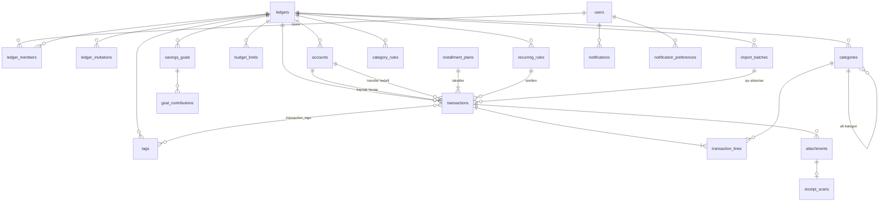

# Veri Modeli

> **Durum:** v1.0 · **Son güncelleme:** 2026-10-15

Kavramsal modeldir. Kolon tipleri, indeksler ve kısıtlar Faz 0'da `docs/04-data-model.md`'de ve [database standardında](standards/README.md) kesinleşir.

## 7.1 Temel kararlar

| Konu | Karar | Gerekçe |
|---|---|---|
| Kiracı anahtarı | Tüm finansal tablolarda `ledger_id` bulunur; kullanıcıya değil deftere bağlanır (K-06). | Ortak defter Faz 6'da geldiğinde veri taşımak gerekmez. Bütün yetki denetimi tek bir soruya iner: "bu kullanıcı bu defterin üyesi mi, rolü ne?" |
| Kimlik | UUID v7, uygulamada üretilir. | Sıralanabilir, indeks dostu; istemci ürettiği için çift gönderimde aynı kayıt tekrar oluşmaz (BR-SYS-004). |
| Tutar | `bigint`, para biriminin en küçük biriminde (kuruş): `amount_minor`. Her zaman pozitif; yönü işlem türü belirler. | Kayan nokta hatası olmaz. JavaScript `number` kuruş cinsinden 90 trilyon TL'ye kadar kesindir. PostgreSQL `numeric` sürücüden metin olarak gelir, her yerde dönüştürmek gerekir. |
| Para birimi | Defterin özelliği (`ledgers.currency_code`, ISO 4217). İşlemde tekrar saklanmaz. | Bir defterde tek birim (K-05). |
| İşlem tarihi | `occurred_on date` (takvim günü, kullanıcının saat diliminde). | "15 Ekim'deki market alışverişi" bir andır değil bir gündür; UTC dönüşümünde ay sınırında kayma olmaz. |
| Zaman damgaları | `created_at`, `updated_at` `timestamptz` (UTC). | — |
| Eşzamanlı düzenleme | Düzenlenebilen tablolarda `version integer`; güncelleme `WHERE version = :v` ile yapılır. | Ortak defterde iki kişinin aynı işlemi düzenlemesinde sessiz ezilme olmaz (BR-SYS-005). |
| Silme | İşlemler `deleted_at` ile yumuşak silinir (çöp kutusu, 30 gün). Diğer kayıtlar arşivlenir (`archived_at`) veya kısıtla korunur. | Geri alma; işlem geçmişinin bütünlüğü. |
| İşlem geçmişi | `audit_events` tablosu: varlık, kimlik, eylem, değişen alanların önceki ve sonraki değerleri (`jsonb`), kim, ne zaman. | — |
| Kategoriler | Her işlem en az bir **kalemle** (`transaction_lines`) kategoriye bağlanır; bölünmüş işlemde birden çok kalem. | Raporlar her zaman kalemler üzerinden toplanır; bölünmüş işlem özel durum olmaz. |

## 7.2 Varlık ilişkileri

## 7.3 Tablolar

**Kimlik (Better Auth'un yönettiği):** `user`, `session`, `account` (OAuth bağlantıları; adı Better Auth'tan gelir, finansal "hesap" ile karışmasın diye kodda `authAccount` diye anılır), `verification`, `two_factor`. Ek alanlar: `user.role` (`user` / `admin`), `user.banned`, `user.locale`, `user.time_zone`, `user.theme`.

| Tablo | Önemli kolonlar | Not |
|---|---|---|
| `ledgers` | `name`, `currency_code`, `kind` (`personal` / `shared`), `created_by` | Kişisel defter kayıtta otomatik açılır. |
| `ledger_members` | `ledger_id`, `user_id`, `role`, `joined_at` | `(ledger_id, user_id)` benzersiz. |
| `ledger_invitations` | `ledger_id`, `email`, `role`, `token_hash`, `expires_at`, `accepted_at`, `invited_by` | Token yalnızca özeti olarak saklanır. |
| `accounts` | `ledger_id`, `name`, `type`, `opening_balance_minor`, `opening_on`, `include_in_total`, `color`, `icon`, `sort_order`, `archived_at`, `version` | Kredi kartı alanları: `credit_limit_minor`, `statement_day`, `due_day`, `min_payment_percent`. |
| `categories` | `ledger_id`, `parent_id`, `kind`, `name`, `icon`, `color`, `sort_order`, `archived_at`, `version` | Alt kategorinin `kind`'i üstününkiyle aynıdır (BR-CAT-002). |
| `transactions` | `ledger_id`, `type`, `account_id`, `to_account_id` (yalnız transfer), `amount_minor`, `occurred_on`, `description`, `note`, `installment_plan_id`, `installment_no`, `recurring_rule_id`, `recurring_on`, `import_batch_id`, `import_hash`, `created_by`, `updated_by`, `deleted_at`, `version` | `CHECK (amount_minor > 0)`; transferde `to_account_id` dolu ve `account_id`'den farklı. |
| `transaction_lines` | `transaction_id`, `category_id`, `amount_minor`, `note` | Kalemlerin toplamı işlem tutarına eşit (BR-TRX-004). Transferde kalem yok. |
| `tags`, `transaction_tags` | `ledger_id`, `name` / `transaction_id`, `tag_id` | — |
| `budget_limits` | `ledger_id`, `category_id` (boş = genel), `amount_minor`, `effective_from` (ayın ilk günü) | Bir limit yeni bir kayıt gelene kadar sonraki aylarda geçerlidir (BR-BUD-003). |
| `recurring_rules` | `ledger_id`, işlem şablonu (tür, hesap, kalemler, açıklama), `frequency`, `interval`, `day_of_month`, `weekday`, `starts_on`, `ends_on`, `max_occurrences`, `mode` (`auto` / `confirm`), `next_run_on`, `paused_at` | — |
| `installment_plans` | `ledger_id`, `account_id`, `category_id`, `total_minor`, `count`, `purchased_on`, `description`, `cancelled_at` | Taksitler `transactions` içinde `installment_plan_id` ile. |
| `savings_goals` | `ledger_id`, `name`, `target_minor`, `target_on`, `linked_account_id`, `achieved_at`, `archived_at` | Bağlı hesap varsa ilerleme hesap bakiyesinden hesaplanır (BR-GOAL-001). |
| `goal_contributions` | `goal_id`, `amount_minor` (eksi olabilir: geri çekme), `contributed_on`, `note` | — |
| `category_rules` | `ledger_id`, `match_type` (`contains` / `starts_with` / `equals`), `pattern`, `category_id`, `priority`, `enabled` | — |
| `import_batches` | `ledger_id`, `account_id`, `file_name`, `column_mapping` (`jsonb`), `row_count`, `imported_count`, `skipped_count`, `undone_at`, `created_by` | — |
| `attachments` | `ledger_id`, `transaction_id`, `storage_key`, `mime_type`, `size_bytes`, `uploaded_by` | Dosya R2'de, kayıt veritabanında. |
| `receipt_scans` | `attachment_id`, `status`, `result` (`jsonb`), `model`, `input_tokens`, `output_tokens`, `error_code` | — |
| `notifications` | `user_id`, `ledger_id`, `type`, `params` (`jsonb`), `dedupe_key`, `read_at`, `emailed_at` | `(user_id, dedupe_key)` benzersiz (BR-NTF-002). |
| `notification_preferences` | `user_id`, `type`, `in_app`, `email`, `remind_days_before` | — |
| `audit_events` | `ledger_id`, `entity_type`, `entity_id`, `action`, `changes` (`jsonb`), `actor_id`, `occurred_at` | Yalnızca ekleme yapılır; güncelleme ve silme yok. |
| `app_settings` | `registration_mode` (`open` / `invite` / `closed`), `ai_monthly_quota`, `demo_enabled` | Tek satır. |
| `admin_invitations` | `email`, `token_hash`, `expires_at`, `accepted_at` | Davetli kayıt modunda kullanılır. |
| `job_runs` | `job`, `started_at`, `finished_at`, `status`, `processed_count`, `error` | Zamanlanmış işlerin kaydı. |
| `ai_usage` | `user_id`, `month`, `scan_count` | Kota sayacı. |

## 7.4 Hesaplanan değerler

Bakiye, kalan bütçe ve ekstre gibi değerler **saklanmaz, sorguyla hesaplanır**. Kullanıcı başına işlem sayısı küçük olduğu için `(ledger_id, occurred_on)` ve `(account_id, occurred_on)` indeksleriyle yeterince hızlıdır. Saklanan bir toplam, her düzenlemede tutarsızlık riski taşır. Performans testi (NFR-20) bunu yetersiz gösterirse ay bazında özet tablo eklenir; bu karar bir ADR ile alınır.

Şemanın kodu: `src/server/db/schema/`. Migration'lar: `src/server/db/migrations/`.

## Değişiklik kaydı

| Tarih | Versiyon | Değişiklik |
|---|---|---|
| 2026-10-15 | v1.0 | İlk sürüm; proje planından (plan.md v1.1) türetildi. |
