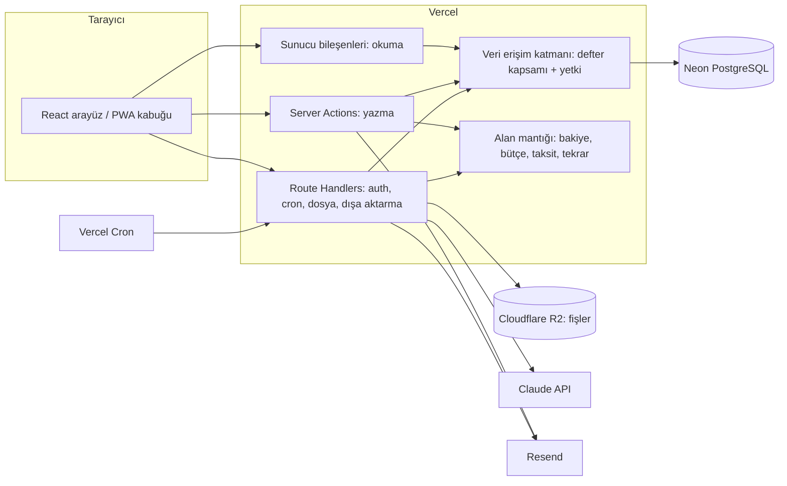

# Mimari

> **Durum:** v1.0 · **Son güncelleme:** 2026-10-15

## Genel bakış



## Katmanlar ve istek akışı

| Katman | Yer | Sorumluluk | Kural |
|---|---|---|---|
| Sayfa ve bileşen | `src/app/**`, `src/features/*/components` | Ekran; veriyi sunucu bileşeninde okur. | Veritabanına doğrudan erişmez; yalnızca `queries` çağırır. |
| Sorgu | `src/features/*/queries.ts` | Okuma. Her fonksiyon `ctx` (kullanıcı + defter + rol) alır. | `import "server-only"`. Defter kapsamı dışında satır döndüremez. |
| Eylem (action) | `src/features/*/actions.ts` | Yazma. Ortak sarmalayıcı sırasıyla oturumu, defter üyeliğini, rolü ve Zod girdisini denetler, işi yapar, `Result` döner. | Hata fırlatmaz. Önbelleği (`revalidateTag`) günceller. |
| Alan mantığı | `src/features/*/domain/*.ts`, `src/lib/money.ts` | Hesaplama ve kurallar: bakiye, kalan bütçe, taksit bölme, tekrar tarihleri, ekstre dönemi. | Saf fonksiyon; veri ve "bugün" parametre olarak verilir. Birim testlerinin asıl hedefi. |
| Route Handler | `src/app/api/**` | Better Auth, cron, dosya yükleme imzası, dışa aktarma indirmesi, sağlık kontrolü. | Yalnızca arayüz dışındaki çağıranlar için. |
| Veri erişimi | `src/server/db/**` | Drizzle şeması, bağlantı, veritabanı işlemi yardımcıları. | Kiracı tablolarına erişim yalnızca `scoped(ctx)` yardımcısından geçer (K-07). |

**Yazma akışı (örnek: işlem ekleme):**
1. Form (RHF + Zod) `createTransaction` eylemini çağırır.
2. Oturum doğrulanır; kullanıcının defterde `editor` veya üstü rolü olduğu doğrulanır.
3. Girdi sunucuda aynı Zod şemasıyla yeniden doğrulanır; iş kuralları (BR-TRX-…) uygulanır.
4. Tek veritabanı işlemi içinde işlem, kalemler, etiketler ve işlem geçmişi yazılır.
5. Bütçe eşik kontrolü yapılır (Faz 4'ten sonra bildirim üretir).
6. `revalidateTag` ile ilgili ekranların önbelleği yenilenir; `Result.ok` döner.

## Klasör yapısı

```
/
├─ docs/                        belgeler (§14)
├─ src/
│  ├─ app/
│  │  ├─ (public)/              giriş, kayıt, şifre sıfırlama, davet, yasal metinler, demo
│  │  ├─ (app)/                 oturum gerektiren ekranlar
│  │  │  ├─ dashboard/ transactions/ accounts/ categories/ budgets/
│  │  │  ├─ goals/ recurring/ reports/ import/ notifications/ trash/
│  │  │  └─ settings/           profil, güvenlik, bildirimler, görünüm, defterler, kurallar, veri
│  │  ├─ admin/                 yönetici paneli
│  │  └─ api/                   auth, cron, uploads, exports, health
│  ├─ features/                 accounts, transactions, categories, budgets, goals, recurring,
│  │                            installments, credit-cards, reports, imports, receipts,
│  │                            notifications, ledgers, audit, admin, onboarding
│  │    └─ {modül}/ actions.ts queries.ts schemas.ts domain/ components/ index.ts
│  ├─ server/                   db (schema, migrations, seed), auth, email, storage, ai, jobs
│  ├─ components/               ui/ (shadcn), ortak bileşenler, yerleşim
│  ├─ lib/                      money, dates, result, errors, format
│  └─ i18n/                     messages/tr.json, messages/en.json
├─ tests/                       e2e/, fixtures/
└─ .github/                     workflows, PR şablonu
```

Bir modül başka bir modülün yalnızca `index.ts`'inden içe aktarır (ESLint ile denetlenir).

## Önbellek modeli

Next.js Cache Components kapalıdır (ADR-0014). Oturuma bağlı tüm sayfalar istek anında işlenir; yazan sunucu eylemleri `revalidatePath("/", "layout")` ile ekranları yeniler. Okuma eylemleri (`readOnly`) yenileme yapmaz.

## Değişiklik kaydı

| Tarih | Versiyon | Değişiklik |
|---|---|---|
| 2026-10-15 | v1.0 | İlk sürüm; proje planından (plan.md v1.1) türetildi. |
