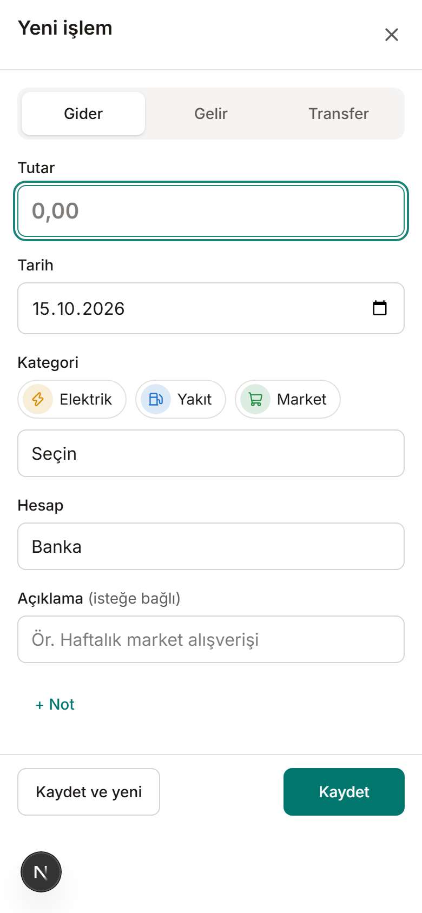
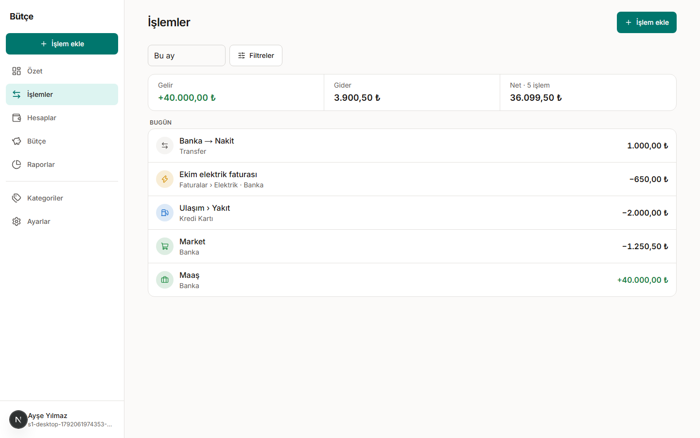
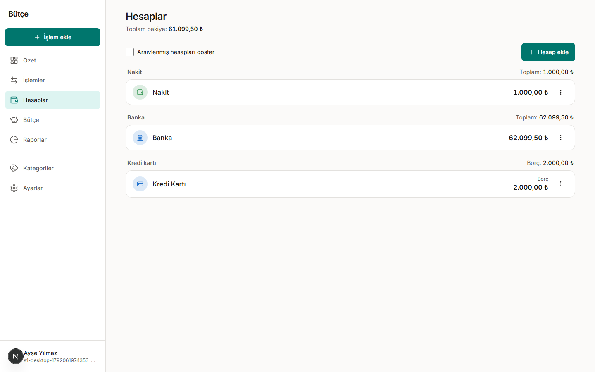
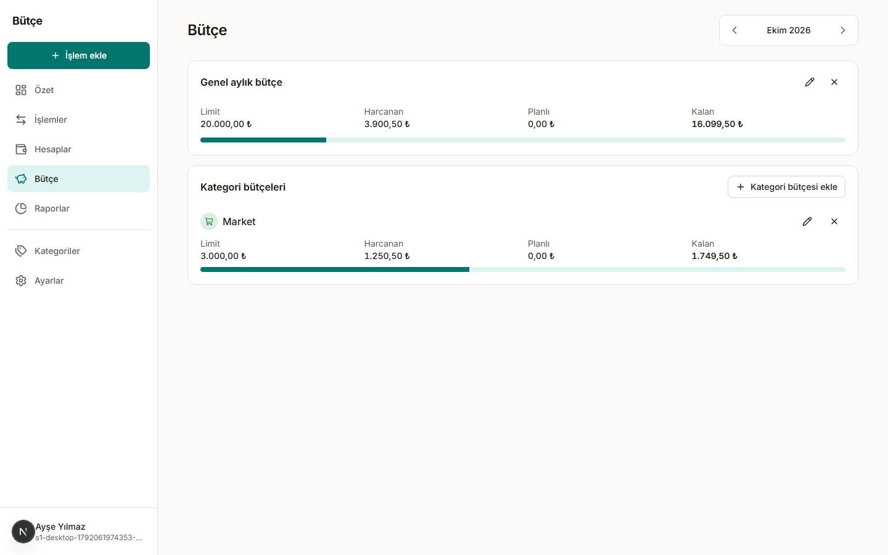
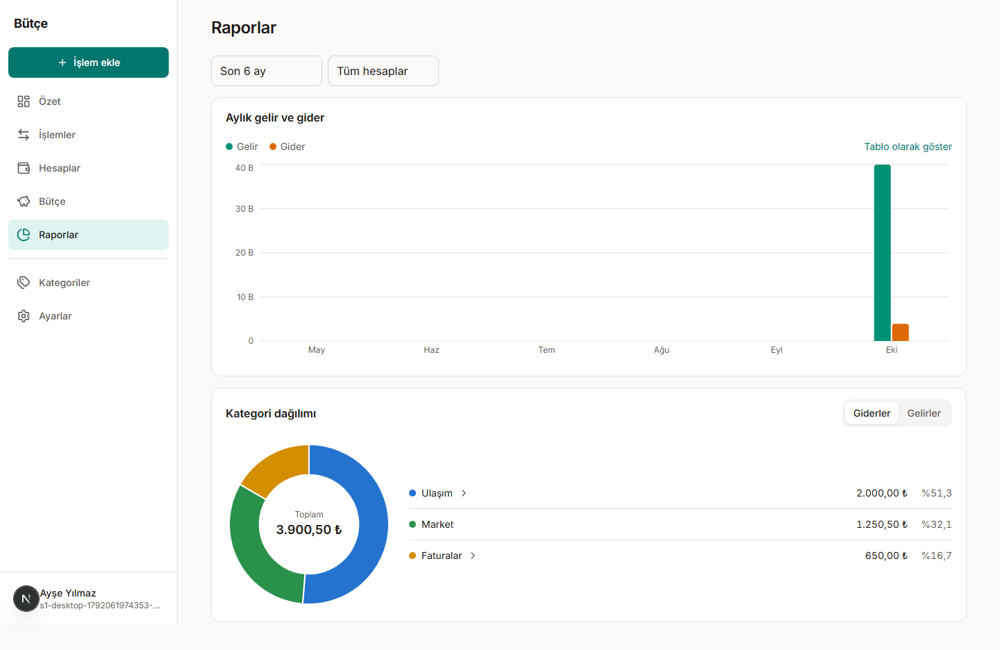
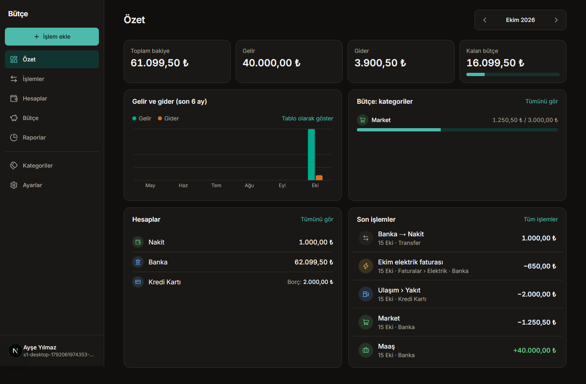

# Kullanım Kılavuzu

> **Sürüm:** Faz 1 (`v1.0.0`) · **Son güncelleme:** 2026-10-15

Bu kılavuz uygulamanın günlük kullanımını anlatır. Telefonda ve bilgisayarda aynı işlemler yapılabilir; telefonda menü alttadır.

## 1. Başlarken

### Hesap oluşturma

1. Giriş ekranında **Hesap oluştur**'a dokunun.
2. Adınızı, e-posta adresinizi ve en az 10 karakterlik bir şifre girin. Uzun bir cümle hem güçlü hem de hatırlaması kolay bir şifredir.
3. Aydınlatma metnini ve kullanım koşullarını onaylayın, **Hesap oluştur**'a basın.
4. E-posta adresinize gelen bağlantıya tıklayın. Hesabınız etkinleşir ve özet ekranı açılır.

E-posta gelmediyse istenmeyen e-posta klasörüne bakın ya da **Bağlantıyı yeniden gönder**'e basın.

Hesabınızla birlikte bir **Nakit** hesabı ve Türkçe varsayılan kategoriler (Market, Ulaşım, Faturalar…) hazır gelir.

### Şifremi unuttum

Giriş ekranında **Şifremi unuttum**'a basın, e-postanızı girin. Gelen bağlantı 1 saat geçerlidir. Şifre değişince diğer cihazlardaki oturumlarınız kapanır.

## 2. Özet ekranı

- **Toplam bakiye:** "toplama dahil" işaretli hesaplarınızın bakiyelerinin toplamı. Kredi kartı borcu bu toplamdan düşülür.
- **Gelir / Gider:** seçili ayın gelir ve giderleri. Hesaplar arası transferler bu toplamlara girmez.
- **Kalan bütçe:** aylık bütçe belirlediyseniz bütçeden kalan tutar. Bütçe yoksa kart "Gelir − gider"i gösterir.

Sağ üstteki oklarla geçmiş aylara bakabilirsiniz.

## 3. İşlem ekleme

1. Telefonda alttaki **+** düğmesine, bilgisayarda **İşlem ekle**'ye basın (bilgisayarda klavyede **N** tuşu da açar).
2. Türü seçin: **Gider**, **Gelir** ya da **Transfer**.
3. Tutarı yazın. `1.250,50`, `1250,50` ve `1250.50` aynı kabul edilir.
4. Kategoriyi seçin. Son kullandığınız kategoriler üstte tek dokunuşla seçilebilir.
5. Gerekirse tarihi, hesabı ve açıklamayı değiştirin, **Kaydet**'e basın.

Art arda birkaç işlem girecekseniz **Kaydet ve yeni**'yi kullanın: tarih, hesap ve tür korunur.

İleri tarihli bir işlem "planlı" sayılır: tarihi gelene kadar bakiyeyi değiştirmez, ama o ayın bütçesinde "planlı" olarak görünür.

### Transfer

Bir hesaptan diğerine para aktardığınızda (ör. bankadan nakit çekme) türü **Transfer** yapın. Kredi kartı borcunu ödemek de bir transferdir: banka hesabından kredi kartına.

## 4. İşlemleri görme, düzenleme ve silme

- **İşlemler** ekranı varsayılan olarak bu ayı gösterir. Üstte filtreye uyan tüm işlemlerin gelir, gider ve net toplamı vardır.
- Tarih aralığını üstteki seçimden değiştirin. **Filtreler** ile kategori, hesap, tür ve tutar aralığına göre daraltın. Bir üst kategori seçmek alt kategorilerini de kapsar.
- Filtreler adreste saklanır: sayfayı yenilediğinizde ya da bağlantıyı paylaştığınızda aynı sonuç gelir.
- Bir işleme dokunarak düzenleyin. Aynı pencerede **Kopyala** benzer bir işlemi hızla girmenizi, **Sil** silmeyi sağlar.
- Silinen işlem için ekranda 10 saniye boyunca **Geri al** görünür.

## 5. Hesaplar

- **Hesap ekle** ile nakit, banka, kredi kartı, birikim hesabı ekleyin ve bugünkü bakiyesini girin.
- Kredi kartı için karttaki güncel borcu girin; kart borç olarak gösterilir ve toplam bakiyeden düşülür.
- İşlemi olan bir hesap silinemez, **arşivlenir**: yeni işlem girilemez ama eski işlemler ve raporlar korunur.
- Bir hesaba dokunarak yalnızca o hesabın işlemlerini görebilirsiniz.

## 6. Kategoriler

- Gider ve gelir kategorileri ayrı sekmelerdedir. En fazla iki seviye vardır: **Ulaşım › Yakıt** gibi.
- Her kategoriye renk ve simge seçebilirsiniz.
- Kullanılmış bir kategori silinemez; **arşivleyebilir** ya da başka bir kategoriyle **birleştirebilirsiniz**. Birleştirmede tüm işlemler ve bütçe limitleri hedef kategoriye taşınır.

## 7. Bütçe

1. **Bütçe** ekranında **Genel bütçe belirle** ile aylık toplam bütçenizi girin.
2. **Kategori bütçesi ekle** ile harcamasını sınırlamak istediğiniz kategoriler için limit koyun.
3. Limit varsayılan olarak **bu aydan itibaren** geçerlidir ve sonraki aylara devam eder. Yalnızca bu ay için değiştirmek istiyorsanız **Yalnızca bu ay**'ı seçin.

Bütçenin %80'i geçilince çubuk sarıya, aşılınca kırmızıya döner ve durumu yazıyla belirtilir.

## 8. Raporlar

- **Aylık gelir ve gider:** son 6 ay, son 12 ay ya da bu yıl. **Tablo olarak göster** ile rakamları tablo halinde görebilirsiniz.
- **Kategori dağılımı:** harcamaların (ya da gelirlerin) kategorilere göre payı. Alt kategorisi olan bir kategoriye dokunarak alt kategorilere inin; diğerlerine dokunmak o kategorinin işlemlerini açar.
- İleri tarihli (planlı) işlemler raporlara girmez.

## 9. Ayarlar ve verileriniz

- **Profil:** adınızı ve e-posta adresinizi değiştirin. Yeni adres için önce mevcut adresinize onay bağlantısı gelir.
- **Güvenlik:** şifrenizi değiştirin; diğer cihazlardaki oturumlar kapanır.
- **Tercihler:** açık, koyu ya da sistem teması; saat dilimi; para birimi. Para birimi yalnızca hiç işlem girilmemişken değiştirilebilir.
- **Verilerimi indir:** şifrenizi girerek tüm hesap, kategori, işlem ve bütçelerinizi JSON dosyası olarak indirin.
- **Hesabımı sil:** hesabınız ve tüm verileriniz kalıcı olarak silinir. Bu işlem geri alınamaz; öncesinde verilerinizi indirmenizi öneririz.

## 10. Sık sorulan sorular

**Toplam bakiye neden gelir − gider ile aynı değil?**
Toplam bakiye hesaplarınızda duran paradır; açılış bakiyelerini ve kart borçlarını içerir. Gelir − gider yalnızca seçili ayın hareketidir.

**Kredi kartıyla harcama yaptım, bankadaki param neden azalmadı?**
Kart harcaması kart borcunu artırır. Borcu ödediğinizde (bankadan karta transfer) banka bakiyesi azalır. Toplam bakiye her iki durumda da doğrudur.

**Telefona uygulama gibi ekleyebilir miyim?**
Ana ekrana ekleme Faz 2 ile gelecek. Şimdilik tarayıcıdan yer imi olarak ekleyebilirsiniz.

**Koyu tema**

