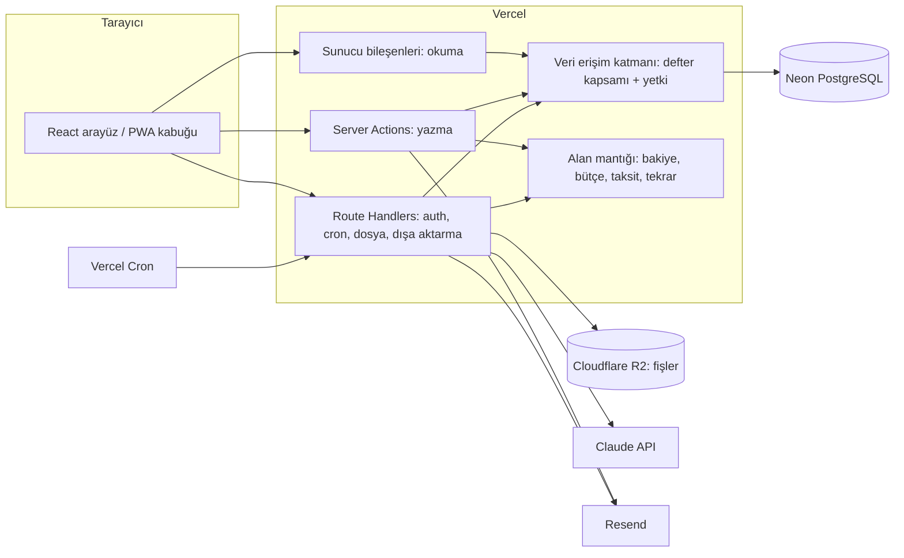
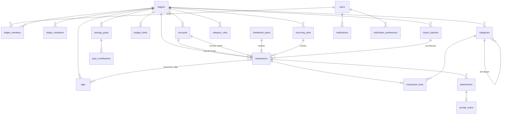
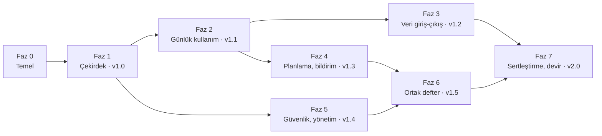

# Bütçe ve Harcama Takip Uygulaması — Proje Planı

> **Durum:** v1.2 · **Son güncelleme:** 2026-10-15
> **Not:** Faz 0'da bu plan [`docs/`](docs/README.md) altına bölündü. Kaynak artık oradaki belgelerdir; bu dosya kararların ve fazların özeti olarak kalır.
> **Kararlar:** [Bölüm 17](#17-kararlar) · **Açık konular:** [Bölüm 16](#16-riskler-ve-açık-konular)

## İçindekiler

1. [Bu belge ne işe yarar](#1-bu-belge-ne-işe-yarar)
2. [İlanın analizi](#2-ilanın-analizi)
3. [Kapsam](#3-kapsam)
4. [Sözlük](#4-sözlük)
5. [Kullanıcılar ve roller](#5-kullanıcılar-ve-roller)
6. [Teknoloji ve mimari](#6-teknoloji-ve-mimari)
7. [Veri modeli](#7-veri-modeli)
8. [İş kuralları](#8-iş-kuralları)
9. [Fonksiyonel gereksinimler](#9-fonksiyonel-gereksinimler)
10. [Fonksiyonel olmayan gereksinimler](#10-fonksiyonel-olmayan-gereksinimler)
11. [Kullanım senaryoları](#11-kullanım-senaryoları)
12. [Ekranlar ve gezinme](#12-ekranlar-ve-gezinme)
13. [Geliştirme fazları](#13-geliştirme-fazları)
14. [Belgeler ve standartlar](#14-belgeler-ve-standartlar)
15. [Teslimat paketi](#15-teslimat-paketi)
16. [Riskler ve açık konular](#16-riskler-ve-açık-konular)
17. [Kararlar](#17-kararlar)
18. [Değişiklik kaydı](#18-değişiklik-kaydı)

---

## 1. Bu belge ne işe yarar

Projenin tek kaynak planıdır:
- müşterinin ilanda istediklerini ve ilanda yazmasa da beklediklerini çıkarır,
- ilanın ötesinde, uygulamayı profesyonel bir ürüne dönüştürecek eklentileri tanımlar,
- teknoloji seçimlerini, veri modelini, iş kurallarını, gereksinimleri ve kullanım senaryolarını verir,
- geliştirmeyi bağımlılık sırasına göre fazlara böler,
- geliştirme sırasında `docs/` altında yazılacak belgelerin ve standartların içeriğini önceden belirler.

Takvim içermez; fazlar süreye göre değil, bağımlılığa ve teslim edilebilirliğe göre sıralanmıştır.

**Bu belgeden türeyecek belgeler.** Geliştirme başladığında (Faz 0) bu plan `docs/` altındaki ayrı belgelere bölünür ([§14](#14-belgeler-ve-standartlar)). Bölündükten sonra kaynak o belgelerdir; bu plan yalnızca kararların ve fazların özeti olarak kalır. Plan ile bir belge çelişirse belge geçerlidir, plan aynı değişiklikte düzeltilir.

**Numaralandırma.** Belgeler birbirine numarayla bağlanır:

| Önek | Ne | Örnek |
|---|---|---|
| `İ-` | İlandaki açık istek | İ-03 |
| `FR-` | Fonksiyonel gereksinim | FR-TRX-04 |
| `NFR-` | Fonksiyonel olmayan gereksinim | NFR-07 |
| `BR-` | İş kuralı (aynı zamanda hata kodu) | BR-TRX-003 |
| `UC-` | Kullanım senaryosu | UC-06 |
| `F{n}-` | Faz iş paketi | F1-05 |
| `K-` | Plan düzeyindeki karar | K-04 |
| `ADR-` | Mimari karar kaydı | ADR-0004 |

---

## 2. İlanın analizi

### 2.1 Müşterinin açıkça istedikleri

| No | İstek | İlandaki ifade | Karşılayan gereksinimler | Faz |
|---|---|---|---|---|
| İ-01 | Kullanıcı girişi | "E-posta ve şifre ile kayıt olma ve giriş yapma" | FR-AUTH-01…06 | 1 |
| İ-02 | Dashboard | "Toplam bakiye, aylık gelir, gider ve kalan bütçenin görüntülenmesi" | FR-DSH-01…05 | 1 |
| İ-03 | Gelir-gider yönetimi | "İşlem ekleme, düzenleme ve silme; işlem kategorisi, tutarı, tarihi ve açıklaması" | FR-TRX-01…06 | 1 |
| İ-04 | Kategori yönetimi | "Yemek, ulaşım, faturalar gibi kategorilere ayrılabilmesi" | FR-CAT-01…05 | 1 |
| İ-05 | Raporlama | "Aylık gelir-gider grafikleri ve kategori bazında harcama dağılımı" | FR-RPT-01…03 | 1 |
| İ-06 | Filtreleme | "Tarih aralığına ve kategoriye göre işlemlerin filtrelenebilmesi" | FR-TRX-07…09 | 1 |
| İ-07 | Güvenli veritabanı | "Kullanıcı verilerinin güvenli şekilde saklanması" | NFR-10…16, [security](#146-standartlar) | 0–1 |
| İ-08 | Responsive tasarım | "Bilgisayar ve telefon ekranlarında düzgün çalışması" | NFR-01…04 | 1 |
| İ-09 | Tasarım dili | "Modern, sade, kullanıcı dostu ve profesyonel… gereksiz animasyonlardan uzak, okunabilirliği yüksek" | NFR-05…07, [ui](#146-standartlar) | 0–1 |
| İ-10 | Teslimat | "Çalışan bir uygulama, kaynak kodları ve kurulum/kullanım talimatları" | [§15](#15-teslimat-paketi) | 1, 7 |
| İ-11 | Maliyet | "Ücretsiz veya düşük maliyetli bir hosting ve veritabanı çözümü" | [§6.5](#65-maliyet) | 0 |

**Teklifte istenenler:** kullanılacak teknolojiler, teslim süresi, bütçe kapsamında sunulacak özellikler, benzer projeler. Teknolojiler [§6](#6-teknoloji-ve-mimari)'da, özellik listesi [§3.2](#32-kapsam-haritası)'de hazırdır. Süre ve benzer projeler teklif aşamasında ayrıca yazılır.

### 2.2 Açıkça yazmasa da beklenenler

Müşteri bunları istemedi ama yokluklarını fark eder. Bu yüzden kapsamın çekirdeğine (Faz 1) alınırlar:

| Beklenti | Neden | Karşılayan |
|---|---|---|
| Şifremi unuttum | E-posta/şifre girişi olan her uygulamada beklenir; olmazsa ilk unutmada destek talebi gelir. | FR-AUTH-04 |
| E-posta doğrulama | Açık kayıtta yanlış yazılan e-posta, şifre sıfırlamayı imkansız kılar. | FR-AUTH-02 |
| Kullanıcı verilerinin kesin ayrımı | "Güvenli saklama"nın asıl anlamı: hiçbir kullanıcı başkasının verisini göremez. | BR-SYS-001, NFR-11 |
| Türkçe sayı ve tarih biçimi | 1.234,56 ₺ ve 15.10.2026; tutarın virgüllü girilebilmesi. | NFR-08, ui standardı |
| Hızlı işlem girişi | Uygulama ancak günlük kullanılırsa işe yarar; işlem girişi telefonda birkaç saniye sürmeli. | NFR-09 |
| Boş durumlar ve ilk kullanım | İlk girişte boş ekran yerine ne yapılacağını söyleyen ekran. | FR-ONB-01 |
| Verinin dışa alınabilmesi ve hesabın silinebilmesi | KVKK; kullanıcı güveni. | FR-PRV-01…02 |
| Yedekleme | Finansal veri kaybı kabul edilemez. | NFR-17 |
| Karanlık mod | Modern arayüz beklentisi; tasarım değişkenleriyle baştan kurulursa maliyeti düşük. | FR-SET-03 |

### 2.3 Belirsizlikler ve verilen kararlar

| İlandaki ifade | Olası yorumlar | Karar | Gerekçe |
|---|---|---|---|
| "Toplam bakiye" | (a) Gelir − gider toplamı; (b) hesapların bakiyeleri toplamı | **(b)** Tam hesap yönetimi: nakit, banka, kredi kartı, birikim hesapları; toplam bakiye = net varlık (K-03) | Gerçek hayatta para birden çok yerde durur. Kredi kartı harcaması o anda nakit eksiltmez; tek bakiye modeli bunu yanlış gösterir. |
| "Kalan bütçe" | (a) Bu ayın geliri − gideri; (b) belirlenen bütçe − harcanan | **(b)** Aylık bütçe limiti ve isteğe bağlı kategori limitleri. Bütçe tanımlanmamışsa (a) gösterilir (K-04). | "Bütçe" kelimesi bir plan ima eder. Fallback, bütçe tanımlamayan kullanıcıda da kartın anlamlı kalmasını sağlar. |
| Para birimi | Yazmıyor | Defter başına tek para birimi, varsayılan TRY, kullanıcı seçer (K-05) | Çoklu birim kur çevrimi ister; kişisel bütçede nadiren gerekir. |
| "Kayıt olma" | Yalnızca müşteri mi, herkes mi? | Açık kayıt, yönetici kapatabilir (K-11) | İlan kayıt istiyor; kapatma anahtarı müşteriye kontrol verir. |

### 2.4 Teklifte vurgulanacaklar

- İlanın istediği her şey ilk teslim noktasında (Faz 1 sonu) hazırdır; ekler bunun üzerine kurulur.
- Ücretsiz katmanlarda çalışan yığın: Vercel + Neon PostgreSQL. Tek ek maliyet bir alan adıdır (e-posta gönderimi için) ve isteğe bağlı fiş okuma kullanımıdır.
- Güvenlik: e-posta doğrulama, sızmış şifre kontrolü, iki adımlı doğrulama, oturum yönetimi, kullanıcılar arası kesin veri ayrımı ve bunun otomatik testleri, KVKK uyumlu veri indirme ve silme.
- Türkiye'ye özgü işlevler: taksitli alışveriş, kredi kartı hesap kesim ve son ödeme günü, banka ekstresinden CSV içe aktarma (Windows-1254 ve `1.234,56` biçimleri).
- Teslimde kaynak kod, kurulum ve kullanım kılavuzu ile tüm servis hesaplarının müşteriye devri.

---

## 3. Kapsam

### 3.1 Ürün tanımı

Kişisel ve aile finansını tek yerden yöneten, telefonda ve bilgisayarda aynı rahatlıkla kullanılan bir web uygulaması. Kullanıcı paranın nerede durduğunu (hesaplar), nereye gittiğini (kategoriler, raporlar) ve ay sonuna ne kalacağını (bütçe, yaklaşan ödemeler, taksitler) bir bakışta görür. İşlem girişi hızlıdır; tekrarlayan ödemeler, taksitler, CSV içe aktarma ve fiş okuma elle girişi azaltır.

### 3.2 Kapsam haritası

"Kaynak" sütunu: **İlan** = müşterinin istediği, **Örtük** = istemediği ama beklediği, **Ek** = birlikte karar verdiğimiz profesyonel eklenti.

| Alan | Özellik | Kaynak | Faz |
|---|---|---|---|
| Kimlik | E-posta/şifre ile kayıt ve giriş | İlan | 1 |
| Kimlik | E-posta doğrulama, şifre sıfırlama, sızmış şifre kontrolü | Örtük | 1 |
| Kimlik | İki adımlı doğrulama (TOTP + yedek kodlar) | Ek | 5 |
| Kimlik | Google ile giriş | Ek | 5 |
| Kimlik | Aktif oturumları görme ve kapatma | Ek | 5 |
| Kimlik | Yeni cihazdan giriş bildirimi | Ek | 5 |
| Dashboard | Toplam bakiye, aylık gelir/gider, kalan bütçe | İlan | 1 |
| Dashboard | Hesap bakiyeleri, kategori bütçe çubukları, son işlemler | Ek | 1 |
| Dashboard | Yaklaşan ödemeler (tekrarlayan, taksit, kart son ödeme) | Ek | 2 |
| İşlemler | Gelir/gider ekleme, düzenleme, silme | İlan | 1 |
| İşlemler | Hesaplar arası transfer | Ek | 1 |
| İşlemler | Bölünmüş işlem (bir işlem, birden çok kategori) | Ek | 2 |
| İşlemler | Etiketler ve açıklamada metin arama | Ek | 2 |
| İşlemler | Çöp kutusu (30 gün) ve geri alma | Ek | 2 |
| İşlemler | Tekrarlayan işlemler | Ek | 2 |
| Kategoriler | Kategori ekleme, düzenleme, arşivleme | İlan | 1 |
| Kategoriler | Alt kategoriler (iki seviye), birleştirme, simge ve renk | Ek | 1 |
| Kategoriler | Otomatik kategori kuralları | Ek | 3 |
| Hesaplar | Nakit, banka, kredi kartı, birikim hesapları; açılış bakiyesi | Ek | 1 |
| Kredi kartı | Hesap kesim ve son ödeme günü, dönem borcu, asgari ödeme, kullanılabilir limit | Ek | 2 |
| Kredi kartı | Taksitli alışveriş | Ek | 2 |
| Bütçe | Aylık toplam bütçe ve kategori limitleri | Örtük (ilanın "kalan bütçe"si) | 1 |
| Bütçe | %80 ve %100 uyarıları | Ek | 4 |
| Hedefler | Birikim hedefleri | Ek | 4 |
| Raporlar | Aylık gelir-gider grafiği, kategori dağılımı | İlan | 1 |
| Raporlar | Yıllık özet, 12 aylık trend, ay karşılaştırması, tasarruf oranı, hesap bazında rapor | Ek | 4 |
| Filtre | Tarih aralığı ve kategori | İlan | 1 |
| Filtre | Hesap, tür, tutar aralığı, etiket, metin | Ek | 1–2 |
| Veri | CSV / Excel dışa aktarma, aylık PDF rapor | Ek | 3 |
| Veri | CSV içe aktarma (banka ekstresi) | Ek | 3 |
| Veri | Fiş/fatura ekleme (görsel, PDF) | Ek | 3 |
| Veri | Fişten otomatik okuma (AI) | Ek | 3 |
| Bildirim | Uygulama içi bildirim merkezi ve tercihler | Ek | 4 |
| Bildirim | Bütçe uyarısı, aylık özet, ödeme hatırlatma e-postaları | Ek | 4 |
| Paylaşım | Ortak defter (aile/eş), davet, roller | Ek | 6 |
| Geçmiş | İşlem geçmişi (kim, ne zaman, ne değişti) | Ek | 2 |
| Deneyim | Responsive tasarım | İlan | 1 |
| Deneyim | Karanlık mod | Örtük | 1 |
| Deneyim | Hoş geldin akışı | Ek | 2 |
| Deneyim | PWA (ana ekrana ekleme) | Ek | 2 |
| Deneyim | Demo hesabı | Ek | 5 |
| Deneyim | Türkçe / İngilizce | Ek | 5 (altyapı Faz 0) |
| Yönetim | Yönetici paneli, kayıt modu, davet, askıya alma | Ek | 5 |
| Gizlilik | Verilerimi indir (JSON), hesabımı sil, KVKK metinleri | Örtük | 1 |

### 3.3 Kapsam dışı

Aşağıdakiler bilerek kapsam dışıdır. İstenirse ayrı bir faz olarak planlanır.

| Konu | Neden dışarıda |
|---|---|
| Çoklu para birimi ve kur çevrimi | K-05. Kur kaynağı, geçmiş kurlar ve karma toplamlar karmaşıklığı belirgin artırır. |
| Banka entegrasyonu (açık bankacılık) | Türkiye'de bireysel geliştiriciye açık, ücretsiz bir API yok; CSV içe aktarma ihtiyacın çoğunu karşılar. |
| Yerel (native) mobil uygulama | PWA telefonda uygulama gibi çalışır; mağaza süreci ve ayrı kod tabanı gerekmez. |
| Çevrimdışı işlem girme | Senkronizasyon ve çakışma çözümü gerektirir. PWA yalnızca kabuğu önbellekler. |
| Yatırım, hisse, döviz ve altın portföyü | Fiyat verisi ve değerleme ayrı bir ürün alanıdır. |
| Web push bildirimleri | iOS'ta yalnızca ana ekrana eklenmiş PWA'da çalışır; e-posta ve uygulama içi bildirim yeterli. İleride eklenebilir. |
| Kullanılmayan bütçenin sonraki aya devri | Zarf bütçeleme (YNAB tarzı) ayrı bir modeldir. |
| Ücretli abonelik / ödeme alma | Ürün müşterinin kişisel kullanımı içindir. |

### 3.4 Varsayımlar

- Kullanıcıların büyük çoğunluğu Türkiye'dedir. Varsayılan dil Türkçe, saat dilimi `Europe/Istanbul`, para birimi TRY.
- Bir kullanıcının yılda birkaç bin işlemi olur. Tasarım, kullanıcı başına 50.000 işleme kadar yavaşlamadan çalışır (NFR-20).
- Müşteri, teslimde servis hesaplarının (Vercel, Neon, Resend, Cloudflare, Anthropic, Sentry, alan adı) kendi adına açılmasını kabul eder ([§15](#15-teslimat-paketi)).
- E-posta gönderimi için bir alan adı vardır ya da alınır (açık konu A-01).

---

## 4. Sözlük

Koddaki, veritabanındaki ve arayüzdeki adlar bu tablodan türetilir. Yeni bir kavram koda girmeden önce buraya eklenir (Faz 0'dan sonra `docs/01-glossary.md`'ye).

| Türkçe | Kod adı | Tanım |
|---|---|---|
| Kullanıcı | `User` | Uygulamaya e-posta ile kayıtlı kişi. |
| Defter | `Ledger` | Verilerin sahibi olan birim. Hesaplar, kategoriler, işlemler, bütçeler ve hedefler bir deftere aittir. Her kullanıcının silinemeyen bir **kişisel defteri** vardır; **ortak defter** birden çok üyeye sahiptir. |
| Üye | `LedgerMember` | Bir defterde rolü olan kullanıcı. Roller: sahip (`owner`), düzenleyici (`editor`), görüntüleyici (`viewer`). |
| Davet | `LedgerInvitation` | Bir e-posta adresine gönderilen, defter üyeliği için tek kullanımlık bağlantı. |
| Hesap | `Account` | Paranın durduğu yer. Türler: nakit (`cash`), banka (`bank`), kredi kartı (`credit_card`), birikim (`savings`), diğer (`other`). |
| Açılış bakiyesi | `openingBalance` | Hesabın uygulamaya eklendiği tarihteki bakiyesi. |
| İşlem | `Transaction` | Paranın hareketi. Türler: gelir (`income`), gider (`expense`), transfer (`transfer`). |
| İşlem kalemi | `TransactionLine` | Gelir veya giderin bir kategoriye düşen parçası. Normal işlemde tek kalem, bölünmüş işlemde birden çok kalem vardır. |
| Transfer | `transfer` | İki hesap arasında para hareketi. Gelir ya da gider sayılmaz. Kart borcu ödemesi bir transferdir. |
| Planlı işlem | — | Tarihi bugünden ileride olan işlem. Bakiyeye henüz girmez. |
| Kategori | `Category` | Gelir veya giderin sınıfı. Türü (`income` / `expense`) vardır. En fazla iki seviye: üst kategori ve alt kategori. |
| Etiket | `Tag` | Kategoriden bağımsız, serbest işaret (#tatil). Bir işlemin birden çok etiketi olabilir. |
| Bütçe limiti | `BudgetLimit` | Bir ay için harcama sınırı. Kategorisiz ise genel bütçe, kategorili ise kategori bütçesidir. |
| Kalan bütçe | — | Genel bütçe limiti − bu ayki gider. Limit yoksa bu ayki gelir − gider. |
| Tekrarlayan işlem kuralı | `RecurringRule` | Belirli aralıklarla işlem üreten şablon (kira, maaş, abonelik). |
| Taksit planı | `InstallmentPlan` | Kredi kartıyla yapılan, aylara bölünmüş alışveriş. Her taksit ayrı bir gider işlemidir. |
| Hesap kesim günü | `statementDay` | Kredi kartı döneminin kapandığı ayın günü. |
| Son ödeme günü | `dueDay` | Dönem borcunun ödenmesi gereken ayın günü. |
| Dönem borcu | — | Son hesap kesim tarihindeki borç − kesimden sonra yapılan ödemeler. |
| Kullanılabilir limit | — | Kart limiti − güncel borç − henüz tarihi gelmemiş taksitler. |
| Birikim hedefi | `SavingsGoal` | Hedef tutarı ve isteğe bağlı hedef tarihi olan birikim amacı. |
| Hedef katkısı | `GoalContribution` | Bir hedefe ayrılan tutar kaydı. |
| Kategori kuralı | `CategoryRule` | Açıklamaya göre kategori öneren kural ("Migros içeriyorsa → Market"). |
| İçe aktarma | `ImportBatch` | Bir CSV dosyasından tek seferde alınan işlemler. Bütün olarak geri alınabilir. |
| Ek | `Attachment` | İşleme eklenmiş fiş, fatura görseli veya PDF. |
| Fiş okuma | `ReceiptScan` | Bir ekin AI ile okunması ve önerilen işlem bilgisi. |
| Bildirim | `Notification` | Kullanıcıya uygulama içinde ve/veya e-postayla iletilen ileti. |
| İşlem geçmişi | `AuditEvent` | Bir kaydın kim tarafından, ne zaman, nasıl değiştirildiğinin kaydı. |
| Çöp kutusu | — | Silinen işlemlerin 30 gün bekletildiği yer. |
| Yönetici | `admin` | Sistemi işleten kişi. Kullanıcıları yönetir, finansal verileri göremez. |

---

## 5. Kullanıcılar ve roller

### 5.1 Kişiler

| Kişi | Kim | Ne ister | Başlıca cihaz |
|---|---|---|---|
| **P-1 Bireysel kullanıcı** | Müşterinin kendisi ve kayıt olan herkes | Harcamalarını hızlıca girmek, ay sonunu görmek, paranın nereye gittiğini anlamak | Telefon (giriş), bilgisayar (rapor, içe aktarma) |
| **P-2 Ortak defter üyesi** | Eş, aile bireyi | Ortak giderleri birlikte girmek, ortak bütçeyi görmek | Telefon |
| **P-3 Yönetici** | Müşteri (işletmeci rolüyle) | Kaydı açıp kapatmak, davet göndermek, kötüye kullanımı engellemek, sistem sağlığını görmek | Bilgisayar |
| **P-4 Ziyaretçi** | Giriş yapmamış kişi | Uygulamayı tanımak, demo hesabıyla denemek | Her ikisi |

### 5.2 Roller ve yetkiler

İki ayrı eksen vardır: **sistem rolü** (kullanıcı / yönetici) ve **defter rolü** (sahip / düzenleyici / görüntüleyici). Yönetici olmak hiçbir deftere erişim vermez (BR-ADM-001).

| İşlem | Sahip | Düzenleyici | Görüntüleyici |
|---|:-:|:-:|:-:|
| Dashboard, işlemler, raporlar görme | ✔ | ✔ | ✔ |
| İşlem ekleme, düzenleme, silme | ✔ | ✔ | — |
| Hesap, kategori, etiket, bütçe, hedef, tekrarlayan kural yönetimi | ✔ | ✔ | — |
| İçe aktarma | ✔ | ✔ | — |
| Dışa aktarma | ✔ | ✔ | ✔ |
| İşlem geçmişini görme | ✔ | ✔ | ✔ |
| Üye davet etme, rol değiştirme, üye çıkarma | ✔ | — | — |
| Defter adını ve para birimini değiştirme, defteri silme | ✔ | — | — |

Kişisel defterde tek üye vardır ve o üye sahiptir. Rol arayüzü Faz 6'ya kadar görünmez, ama yetki denetimi Faz 1'den beri bu tabloya göre çalışır (K-06).

---

## 6. Teknoloji ve mimari

### 6.1 Seçimler

Sürümler Faz 0'da güncel kararlı sürümlere sabitlenir ve `docs/06-tech-stack.md`'ye yazılır.

| Katman | Seçim | Neden | Değerlendirilen alternatif |
|---|---|---|---|
| Dil | TypeScript (katı mod) | Ön yüz, sunucu ve doğrulama şemaları tek dilde; tipler uçtan uca taşınır. | — |
| Çatı | Next.js (App Router, React Server Components) | Tek kod tabanında hem arayüz hem sunucu. Vercel'de ek ayar gerektirmeden yayınlanır. Okuma işlemleri sunucu bileşenlerinde yapıldığı için ayrı API katmanı yazılmaz. | Vite SPA + ayrı API: iki dağıtım, iki hosting. |
| Sunucu işlemleri | Server Actions + tek tip sonuç (`Result`) | Formdan veritabanına tip güvenli yol; ayrı REST katmanı gerekmez. REST yalnızca dış tetikleyiciler için ([§6.3](#63-katmanlar-ve-istek-akışı)). | tRPC: ek bağımlılık, Server Actions ile aynı işi görür. |
| Veritabanı | PostgreSQL (Neon, ücretsiz katman, Frankfurt bölgesi) | Standart PostgreSQL olduğu için taşınabilir. Kullanılmadığında kendiliğinden küçülür ama proje askıya alınmaz. Her PR için ayrı veritabanı dalı açılabilir. | Supabase: 7 gün hareketsizlikte duraklar, platforma bağımlılık. |
| ORM ve migration | Drizzle ORM + drizzle-kit | SQL'e yakın ve tipli; sunucusuz ortamda hafif; migration'lar SQL dosyası olarak incelenebilir. | Prisma: daha ağır istemci, sunucusuzda soğuk başlangıç. |
| Kimlik doğrulama | Better Auth | E-posta/şifre, e-posta doğrulama, şifre sıfırlama, iki adımlı doğrulama, Google, oturum listesi, yönetici ve hız sınırı tek kütüphanede. Veri kendi veritabanımızda durur. | Auth.js: Better Auth ile birleşti. Clerk: ücretli kademeler, veri dışarıda. |
| Arayüz | React, Tailwind CSS, shadcn/ui (Radix), lucide simgeleri | Hazır bileşenler erişilebilir. Kodları projede durduğu için tamamen özelleştirilebilir. Karanlık mod tasarım değişkenleriyle kurulur. | MUI: ağır, "hazır şablon" görünümü. |
| Formlar ve doğrulama | React Hook Form + Zod | Aynı Zod şeması hem formda hem sunucuda çalışır. | — |
| Grafikler | Recharts (shadcn/ui chart bileşenleri) | Tasarım değişkenleriyle uyumlu, erişilebilir, yeterli grafik türü. | Chart.js: canvas tabanlı, tema entegrasyonu zayıf. |
| Tablolar | TanStack Table | Sıralama, sütun yönetimi, sanal kaydırma. | — |
| Adres durumu | nuqs | Filtreler adreste durur; geri tuşu ve paylaşılan bağlantı çalışır. | — |
| Tarih | date-fns (+ saat dilimi desteği) | Yalnızca kullanılan fonksiyonlar pakete girer; Türkçe yerel ayarı var. | — |
| Çok dillilik | next-intl (adres öneki olmadan) | Sunucu ve istemci bileşenlerinde aynı API; dil kullanıcı ayarından gelir (K-10). | — |
| E-posta | Resend + React Email | Ücretsiz katman yeterli; şablonlar önizlenebilen React bileşenleri. Alan adı doğrulaması gerekir (A-01). | Brevo: alan adı olmadan gönderebilir ama teslim oranı düşük. |
| Dosya depolama | Cloudflare R2 (özel kova, süreli imzalı adres) | Ücretsiz katmanı geniş, çıkış trafiği ücretsiz, S3 uyumlu. Fişler herkese açık olmamalı. | Vercel Blob: daha kolay kurulum; özel erişim ve ücretsiz kota daha sınırlı. |
| AI (fiş okuma) | Claude API, `@anthropic-ai/sdk`, varsayılan model `claude-opus-5-5` | Görsel ve PDF girdisi; Zod şemasıyla doğrulanan yapılandırılmış çıktı. Ayrıntı: [§6.6](#66-fiş-okuma-ai). | — |
| PDF rapor | @react-pdf/renderer | Sunucuda React bileşeninden PDF; Türkçe karakterli yazı tipi gömülebilir. | Tarayıcıda yazdırma: düzen tutarsız. |
| Excel | ExcelJS | Biçimli hücre, para biçimi, birden çok sayfa. | — |
| CSV | Papa Parse | Tarayıcıda akışlı ayrıştırma ve önizleme. | — |
| PWA | Next.js manifest + Serwist | Ana ekrana ekleme ve kabuk önbelleği; veri çevrimdışı tutulmaz. | — |
| Zamanlanmış işler | Vercel Cron (günde bir) + kaçırılanları yakalayan tasarım | Ücretsiz katmanda günlük iş yeterli; işler idempotent (K-09). | GitHub Actions zamanlayıcısı: yedek olarak. |
| Hata izleme | Sentry (ücretsiz katman) | İstemci ve sunucu hataları, kaynak eşlemeli yığın izi. | — |
| Test | Vitest, Testing Library, Testcontainers (PostgreSQL), Playwright, axe-core | Entegrasyon testleri gerçek PostgreSQL ile, uçtan uca testler gerçek tarayıcıda çalışır; erişilebilirlik taraması otomatik. | PGlite: hızlı ama birebir PostgreSQL değil. |
| Kod kalitesi | ESLint (typescript-eslint, katı), Prettier | — | Biome: Next.js ve React kurallarında eksik. |
| Paket yöneticisi | pnpm | Hızlı, katı bağımlılık çözümü. | — |
| CI/CD | GitHub Actions + Vercel Git entegrasyonu | Her PR'da önizleme ortamı; `main` birleşince yayın. | — |

### 6.2 Mimari genel bakış



### 6.3 Katmanlar ve istek akışı

| Katman | Yer | Sorumluluk | Kural |
|---|---|---|---|
| Sayfa ve bileşen | `src/app/**`, `src/features/*/components` | Ekran; veriyi sunucu bileşeninde okur. | Veritabanına doğrudan erişmez; yalnızca `queries` çağırır. |
| Sorgu | `src/features/*/queries.ts` | Okuma. Her fonksiyon `ctx` (kullanıcı + defter + rol) alır. | `import "server-only"`. Defter kapsamı dışında satır döndüremez. |
| Eylem (action) | `src/features/*/actions.ts` | Yazma. Ortak sarmalayıcı sırasıyla oturumu, defter üyeliğini, rolü ve Zod girdisini denetler, işi yapar, `Result` döner. | Hata fırlatmaz. Önbelleği (`revalidateTag`) günceller. |
| Alan mantığı | `src/features/*/domain/*.ts`, `src/lib/money.ts` | Hesaplama ve kurallar: bakiye, kalan bütçe, taksit bölme, tekrar tarihleri, ekstre dönemi. | Saf fonksiyon; veri ve "bugün" parametre olarak verilir. Birim testlerinin asıl hedefi. |
| Route Handler | `src/app/api/**` | Better Auth, cron, dosya yükleme imzası, dışa aktarma indirmesi, sağlık kontrolü. | Yalnızca arayüz dışındaki çağıranlar için. |
| Veri erişimi | `src/server/db/**` | Drizzle şeması, bağlantı, veritabanı işlemi yardımcıları. | Kiracı tablolarına erişim yalnızca `scoped(ctx)` yardımcısından geçer (K-07). |

**Yazma akışı (örnek: işlem ekleme):**
1. Form (RHF + Zod) `createTransaction` eylemini çağırır.
2. Oturum doğrulanır; kullanıcının defterde `editor` veya üstü rolü olduğu doğrulanır.
3. Girdi sunucuda aynı Zod şemasıyla yeniden doğrulanır; iş kuralları (BR-TRX-…) uygulanır.
4. Tek veritabanı işlemi içinde işlem, kalemler, etiketler ve işlem geçmişi yazılır.
5. Bütçe eşik kontrolü yapılır (Faz 4'ten sonra bildirim üretir).
6. `revalidateTag` ile ilgili ekranların önbelleği yenilenir; `Result.ok` döner.

### 6.4 Klasör yapısı

```
/
├─ docs/                        belgeler (§14)
├─ src/
│  ├─ app/
│  │  ├─ (public)/              giriş, kayıt, şifre sıfırlama, davet, yasal metinler, demo
│  │  ├─ (app)/                 oturum gerektiren ekranlar
│  │  │  ├─ dashboard/ transactions/ accounts/ categories/ budgets/
│  │  │  ├─ goals/ recurring/ reports/ import/ notifications/ trash/
│  │  │  └─ settings/           profil, güvenlik, bildirimler, görünüm, defterler, kurallar, veri
│  │  ├─ admin/                 yönetici paneli
│  │  └─ api/                   auth, cron, uploads, exports, health
│  ├─ features/                 accounts, transactions, categories, budgets, goals, recurring,
│  │                            installments, credit-cards, reports, imports, receipts,
│  │                            notifications, ledgers, audit, admin, onboarding
│  │    └─ {modül}/ actions.ts queries.ts schemas.ts domain/ components/ index.ts
│  ├─ server/                   db (schema, migrations, seed), auth, email, storage, ai, jobs
│  ├─ components/               ui/ (shadcn), ortak bileşenler, yerleşim
│  ├─ lib/                      money, dates, result, errors, format
│  └─ i18n/                     messages/tr.json, messages/en.json
├─ tests/                       e2e/, fixtures/
└─ .github/                     workflows, PR şablonu
```

Bir modül başka bir modülün yalnızca `index.ts`'inden içe aktarır (ESLint ile denetlenir).

### 6.5 Maliyet

Ücretsiz katman sınırlarını sağlayıcılar değiştirebilir. Faz 0'da güncel sınırlar doğrulanır ve tarihiyle `docs/08-environments-and-deployment.md`'ye yazılır.

| Servis | Kullanım | Beklenen maliyet |
|---|---|---|
| Vercel (Hobby) | Uygulama, önizleme ortamları, günlük cron | Ücretsiz. Hobby planı kişisel ve ticari olmayan kullanım içindir; uygulama ticarileşirse Pro plana geçilir (R-02). |
| Neon (Free) | PostgreSQL, PR başına veritabanı dalı | Ücretsiz |
| Resend (Free) | Doğrulama, sıfırlama ve bildirim e-postaları | Ücretsiz; alan adı gerekir |
| Cloudflare R2 | Fiş ve fatura dosyaları | Ücretsiz katman içinde |
| Sentry (Developer) | Hata izleme | Ücretsiz |
| Anthropic API | Fiş okuma | Kullanım başına; kullanıcı başına aylık kota ile sınırlı (BR-RCP-004) |
| Alan adı | E-posta gönderimi ve uygulama adresi | Yıllık düşük bir ücret |
| Uptime izleme (UptimeRobot veya Better Stack) | Sağlık kontrolü | Ücretsiz |

### 6.6 Fiş okuma (AI)

| Konu | Karar |
|---|---|
| SDK | `@anthropic-ai/sdk` (resmi TypeScript SDK). Ham HTTP çağrısı yazılmaz. |
| Model | `claude-opus-5-5`. Daha ucuz bir model (ör. `claude-haiku-5-5`) ancak örnek fişlerden oluşan bir değerlendirme setinde doğruluğu ölçüldükten sonra seçilir (açık konu A-04). |
| Girdi | Görsel (`image` bloğu: JPEG, PNG, WebP; HEIC sunucuda JPEG'e çevrilir) veya PDF (`document` bloğu). Görsel gönderilmeden önce küçültülür ve EXIF bilgisi silinir. |
| Çıktı | Yapılandırılmış çıktı (`output_config.format`), Zod şemasıyla doğrulanır (`client.messages.parse` + `zodOutputFormat`). Alanlar: işyeri, tarih, toplam tutar, para birimi, kalemler (isteğe bağlı), defterin kategori listesinden önerilen kategori, güven düzeyi. |
| Düşünme ve çaba | Bu modelde düşünme kapatılamaz; derinlik `output_config.effort` ile ayarlanır. Başlangıç `medium`; değerlendirme setinde `low` yeterli çıkarsa ona inilir. |
| Ret | `stop_reason === "refusal"` kontrol edilir; kullanıcıya "Fiş okunamadı, bilgileri elle girin" gösterilir. Sunucu taraflı yedek model (`fallbacks: "default"`, beta `server-side-fallback-2026-07-01`) açılır. |
| Hata | Kısa zaman aşımı; hız sınırı ve 5xx hatalarında SDK'nın kendi yeniden denemesi. Başarısızlıkta işlem elle girilir, fiş ek olarak kalır. |
| Gizlilik | Fiş yalnızca okuma için gönderilir. Bu bilgi ilk kullanımda ve aydınlatma metninde yazılır. Kullanıcı özelliği ayarlardan kapatabilir. |
| Maliyet kaydı | Her okumanın girdi ve çıktı token sayısı `receipt_scans` tablosunda tutulur; yönetici panelinde aylık toplam görünür. |

---

## 7. Veri modeli

Kavramsal modeldir. Kolon tipleri, indeksler ve kısıtlar Faz 0'da `docs/04-data-model.md`'de ve [database standardında](#146-standartlar) kesinleşir.

### 7.1 Temel kararlar

| Konu | Karar | Gerekçe |
|---|---|---|
| Kiracı anahtarı | Tüm finansal tablolarda `ledger_id` bulunur; kullanıcıya değil deftere bağlanır (K-06). | Ortak defter Faz 6'da geldiğinde veri taşımak gerekmez. Bütün yetki denetimi tek bir soruya iner: "bu kullanıcı bu defterin üyesi mi, rolü ne?" |
| Kimlik | UUID v7, uygulamada üretilir. | Sıralanabilir, indeks dostu; istemci ürettiği için çift gönderimde aynı kayıt tekrar oluşmaz (BR-SYS-004). |
| Tutar | `bigint`, para biriminin en küçük biriminde (kuruş): `amount_minor`. Her zaman pozitif; yönü işlem türü belirler. | Kayan nokta hatası olmaz. JavaScript `number` kuruş cinsinden 90 trilyon TL'ye kadar kesindir. PostgreSQL `numeric` sürücüden metin olarak gelir, her yerde dönüştürmek gerekir. |
| Para birimi | Defterin özelliği (`ledgers.currency_code`, ISO 4217). İşlemde tekrar saklanmaz. | Bir defterde tek birim (K-05). |
| İşlem tarihi | `occurred_on date` (takvim günü, kullanıcının saat diliminde). | "15 Ekim'deki market alışverişi" bir andır değil bir gündür; UTC dönüşümünde ay sınırında kayma olmaz. |
| Zaman damgaları | `created_at`, `updated_at` `timestamptz` (UTC). | — |
| Eşzamanlı düzenleme | Düzenlenebilen tablolarda `version integer`; güncelleme `WHERE version = :v` ile yapılır. | Ortak defterde iki kişinin aynı işlemi düzenlemesinde sessiz ezilme olmaz (BR-SYS-005). |
| Silme | İşlemler `deleted_at` ile yumuşak silinir (çöp kutusu, 30 gün). Diğer kayıtlar arşivlenir (`archived_at`) veya kısıtla korunur. | Geri alma; işlem geçmişinin bütünlüğü. |
| İşlem geçmişi | `audit_events` tablosu: varlık, kimlik, eylem, değişen alanların önceki ve sonraki değerleri (`jsonb`), kim, ne zaman. | — |
| Kategoriler | Her işlem en az bir **kalemle** (`transaction_lines`) kategoriye bağlanır; bölünmüş işlemde birden çok kalem. | Raporlar her zaman kalemler üzerinden toplanır; bölünmüş işlem özel durum olmaz. |

### 7.2 Varlık ilişkileri



### 7.3 Tablolar

**Kimlik (Better Auth'un yönettiği):** `user`, `session`, `account` (OAuth bağlantıları; adı Better Auth'tan gelir, finansal "hesap" ile karışmasın diye kodda `authAccount` diye anılır), `verification`, `two_factor`. Ek alanlar: `user.role` (`user` / `admin`), `user.banned`, `user.locale`, `user.time_zone`, `user.theme`.

| Tablo | Önemli kolonlar | Not |
|---|---|---|
| `ledgers` | `name`, `currency_code`, `kind` (`personal` / `shared`), `created_by` | Kişisel defter kayıtta otomatik açılır. |
| `ledger_members` | `ledger_id`, `user_id`, `role`, `joined_at` | `(ledger_id, user_id)` benzersiz. |
| `ledger_invitations` | `ledger_id`, `email`, `role`, `token_hash`, `expires_at`, `accepted_at`, `invited_by` | Token yalnızca özeti olarak saklanır. |
| `accounts` | `ledger_id`, `name`, `type`, `opening_balance_minor`, `opening_on`, `include_in_total`, `color`, `icon`, `sort_order`, `archived_at`, `version` | Kredi kartı alanları: `credit_limit_minor`, `statement_day`, `due_day`, `min_payment_percent`. |
| `categories` | `ledger_id`, `parent_id`, `kind`, `name`, `icon`, `color`, `sort_order`, `archived_at`, `version` | Alt kategorinin `kind`'i üstününkiyle aynıdır (BR-CAT-002). |
| `transactions` | `ledger_id`, `type`, `account_id`, `to_account_id` (yalnız transfer), `amount_minor`, `occurred_on`, `description`, `note`, `installment_plan_id`, `installment_no`, `recurring_rule_id`, `recurring_on`, `import_batch_id`, `import_hash`, `created_by`, `updated_by`, `deleted_at`, `version` | `CHECK (amount_minor > 0)`; transferde `to_account_id` dolu ve `account_id`'den farklı. |
| `transaction_lines` | `transaction_id`, `category_id`, `amount_minor`, `note` | Kalemlerin toplamı işlem tutarına eşit (BR-TRX-004). Transferde kalem yok. |
| `tags`, `transaction_tags` | `ledger_id`, `name` / `transaction_id`, `tag_id` | — |
| `budget_limits` | `ledger_id`, `category_id` (boş = genel), `amount_minor`, `effective_from` (ayın ilk günü) | Bir limit yeni bir kayıt gelene kadar sonraki aylarda geçerlidir (BR-BUD-003). |
| `recurring_rules` | `ledger_id`, işlem şablonu (tür, hesap, kalemler, açıklama), `frequency`, `interval`, `day_of_month`, `weekday`, `starts_on`, `ends_on`, `max_occurrences`, `mode` (`auto` / `confirm`), `next_run_on`, `paused_at` | — |
| `installment_plans` | `ledger_id`, `account_id`, `category_id`, `total_minor`, `count`, `purchased_on`, `description`, `cancelled_at` | Taksitler `transactions` içinde `installment_plan_id` ile. |
| `savings_goals` | `ledger_id`, `name`, `target_minor`, `target_on`, `linked_account_id`, `achieved_at`, `archived_at` | Bağlı hesap varsa ilerleme hesap bakiyesinden hesaplanır (BR-GOAL-001). |
| `goal_contributions` | `goal_id`, `amount_minor` (eksi olabilir: geri çekme), `contributed_on`, `note` | — |
| `category_rules` | `ledger_id`, `match_type` (`contains` / `starts_with` / `equals`), `pattern`, `category_id`, `priority`, `enabled` | — |
| `import_batches` | `ledger_id`, `account_id`, `file_name`, `column_mapping` (`jsonb`), `row_count`, `imported_count`, `skipped_count`, `undone_at`, `created_by` | — |
| `attachments` | `ledger_id`, `transaction_id`, `storage_key`, `mime_type`, `size_bytes`, `uploaded_by` | Dosya R2'de, kayıt veritabanında. |
| `receipt_scans` | `attachment_id`, `status`, `result` (`jsonb`), `model`, `input_tokens`, `output_tokens`, `error_code` | — |
| `notifications` | `user_id`, `ledger_id`, `type`, `params` (`jsonb`), `dedupe_key`, `read_at`, `emailed_at` | `(user_id, dedupe_key)` benzersiz (BR-NTF-002). |
| `notification_preferences` | `user_id`, `type`, `in_app`, `email`, `remind_days_before` | — |
| `audit_events` | `ledger_id`, `entity_type`, `entity_id`, `action`, `changes` (`jsonb`), `actor_id`, `occurred_at` | Yalnızca ekleme yapılır; güncelleme ve silme yok. |
| `app_settings` | `registration_mode` (`open` / `invite` / `closed`), `ai_monthly_quota`, `demo_enabled` | Tek satır. |
| `admin_invitations` | `email`, `token_hash`, `expires_at`, `accepted_at` | Davetli kayıt modunda kullanılır. |
| `job_runs` | `job`, `started_at`, `finished_at`, `status`, `processed_count`, `error` | Zamanlanmış işlerin kaydı. |
| `ai_usage` | `user_id`, `month`, `scan_count` | Kota sayacı. |

### 7.4 Hesaplanan değerler

Bakiye, kalan bütçe ve ekstre gibi değerler **saklanmaz, sorguyla hesaplanır**. Kullanıcı başına işlem sayısı küçük olduğu için `(ledger_id, occurred_on)` ve `(account_id, occurred_on)` indeksleriyle yeterince hızlıdır. Saklanan bir toplam, her düzenlemede tutarsızlık riski taşır. Performans testi (NFR-20) bunu yetersiz gösterirse ay bazında özet tablo eklenir; bu karar bir ADR ile alınır.

---

## 8. İş kuralları

Her kuralın numarası aynı zamanda **hata kodudur**. Sunucu ihlalde bu kodu döner, arayüz Türkçe metni çeviri dosyasından `errors.BR-TRX-004` anahtarıyla bulur. Testler kural numarasıyla adlandırılır ([testing](#146-standartlar)). Faz 0'dan sonra bu bölüm `docs/03-business-rules.md`'ye taşınır.

**Tür sütunu:** *Kısıt* ihlal edilirse işlem reddedilir · *Hesaplama* bir değerin nasıl bulunduğunu tanımlar · *Tetikleyici* bir olayın sonucunu tanımlar · *Yetki* kimin yapabileceğini tanımlar · *Varsayılan* kullanıcı değiştirmezse geçerli olan değerdir.

**Genel ilke:** Uygulama gerçekte olmuş bir şeyin kaydedilmesini engellemez, uyarır. Hesap bakiyesi eksiye düşebilir, kart limiti aşılabilir, bütçe aşılabilir. Bunlar reddedilmez, görünür biçimde işaretlenir.

### 8.1 Sistem (BR-SYS)

| No | Kural | Tür |
|---|---|---|
| BR-SYS-001 | Kullanıcı yalnızca üyesi olduğu defterlerin verisini görür ve değiştirir. Başka bir defterin kaydına yapılan istek `404` gibi yanıtlanır; kaydın var olduğu bile belli edilmez. | Yetki |
| BR-SYS-002 | Her yetki ve kural denetimi sunucuda yapılır. Arayüzde düğmeyi gizlemek yalnızca kolaylıktır. | Yetki |
| BR-SYS-003 | Defter rolleri [§5.2](#52-roller-ve-yetkiler)'deki tabloya göre yetkilendirilir. | Yetki |
| BR-SYS-004 | Yeni kaydın kimliği istemcide üretilir. Aynı kimlikle ikinci kez gelen ekleme isteği yeni kayıt oluşturmaz, ilk sonucu döner (çift tıklama, zayıf bağlantıda yeniden gönderim). | Kısıt |
| BR-SYS-005 | Düzenleme, istemcinin gördüğü `version` ile yapılır. Kayıt bu arada değiştiyse kayıt reddedilir ve kullanıcıya güncel hali gösterilir. | Kısıt |
| BR-SYS-006 | "Bugün", "bu ay" ve tüm tarih hesapları kullanıcının saat dilimine göre yapılır (varsayılan `Europe/Istanbul`). | Hesaplama |
| BR-SYS-007 | Tek bir tutar en az 0,01, en fazla 1.000.000.000,00 birimdir. | Kısıt |

### 8.2 Kimlik ve oturum (BR-AUTH)

| No | Kural | Tür |
|---|---|---|
| BR-AUTH-001 | Şifre en az 10, en fazla 128 karakterdir. Büyük harf, rakam gibi bileşim kuralı yoktur. Bilinen sızıntı listelerindeki şifreler reddedilir (Have I Been Pwned, k-anonimlik yöntemiyle; şifrenin kendisi gönderilmez). Bu yaklaşım NIST SP 800-63B'nin önerisidir. | Kısıt |
| BR-AUTH-002 | E-posta doğrulanmadan giriş yapılamaz. Doğrulama bağlantısı 24 saat geçerlidir; yeniden gönderme dakikada bir kez yapılabilir. | Kısıt |
| BR-AUTH-003 | Kayıt ve şifre sıfırlama ekranları e-postanın kayıtlı olup olmadığını belli etmez; her durumda aynı mesaj gösterilir. | Kısıt |
| BR-AUTH-004 | Şifre sıfırlama bağlantısı 1 saat geçerli ve tek kullanımlıktır. Sıfırlamadan sonra kullanıcının tüm oturumları kapanır. | Kısıt |
| BR-AUTH-005 | Giriş denemeleri IP başına dakikada 10 ile sınırlıdır. Aynı e-posta için 15 dakika içinde 5 başarısız denemeden sonra o e-postayla giriş 15 dakika bekletilir. Kullanıcıya hesabın var olup olmadığını belli etmeyen genel bir mesaj gösterilir. | Kısıt |
| BR-AUTH-006 | Oturum 30 gün geçerlidir ve kullanıldıkça uzar. Şifre veya e-posta değiştirme, iki adımlı doğrulamayı kapatma, veri indirme ve hesap silme işlemleri mevcut şifrenin yeniden girilmesini ister. | Kısıt |
| BR-AUTH-007 | Şifre değiştirildiğinde mevcut oturum dışındaki tüm oturumlar kapanır. | Tetikleyici |
| BR-AUTH-008 | İki adımlı doğrulama TOTP'dir (6 hane, 30 saniye). Açılırken 10 tek kullanımlık yedek kod verilir. Kullanıcı "Bu cihazda 30 gün sorma" seçeneğini işaretleyebilir. | Kısıt |
| BR-AUTH-009 | Google ile girişte, aynı e-postayla doğrulanmış bir hesap varsa Google hesabı ona bağlanır. Google ile açılan hesap sonradan şifre belirleyebilir. | Tetikleyici |
| BR-AUTH-010 | Daha önce görülmemiş bir cihaz veya tarayıcıdan giriş yapıldığında e-posta gönderilir. E-postadaki "Bu ben değilim" bağlantısı tüm oturumları kapatır ve şifre sıfırlamaya yönlendirir. | Tetikleyici |
| BR-AUTH-011 | Askıya alınmış kullanıcı giriş yapamaz; açık oturumları hemen kapanır. | Kısıt |
| BR-AUTH-012 | Hesap silme kalıcıdır: kişisel defter, sahip olunan ortak defterler, ekler ve bildirimler silinir. Kullanıcı başka üyeleri olan bir ortak defterin tek sahibiyse önce sahipliği devretmelidir. | Kısıt |

### 8.3 Defter ve paylaşım (BR-LDG)

| No | Kural | Tür |
|---|---|---|
| BR-LDG-001 | Her kullanıcının tam olarak bir kişisel defteri vardır. Kişisel defter silinemez ve paylaşılamaz; paylaşım için ayrı bir ortak defter açılır. | Kısıt |
| BR-LDG-002 | Ortak defterin en fazla 10 üyesi olabilir. | Kısıt |
| BR-LDG-003 | Davet 7 gün geçerli ve tek kullanımlıktır. Yalnızca davet edilen e-postayla oturum açmış kullanıcı kabul edebilir; kayıtlı değilse önce kayıt olur. Davetle gelen kullanıcı, kayıt modu kapalı olsa bile kayıt olabilir. | Kısıt |
| BR-LDG-004 | Defterin en az bir sahibi olur. Son sahip defterden ayrılamaz ve kendi rolünü düşüremez. | Kısıt |
| BR-LDG-005 | Defterin para birimi yalnızca defterde hiç işlem yokken değiştirilebilir. | Kısıt |
| BR-LDG-006 | Üye çıkarıldığında girdiği işlemler defterde kalır; işlem geçmişinde adı görünmeye devam eder. | Tetikleyici |
| BR-LDG-007 | Kullanıcı bir anda tek bir defterde çalışır; defter üst çubuktan değiştirilir ve son seçilen defter hatırlanır. | Varsayılan |

### 8.4 Hesaplar ve dashboard (BR-ACC, BR-DSH)

| No | Kural | Tür |
|---|---|---|
| BR-ACC-001 | Hesap bakiyesi = açılış bakiyesi + gelirler − giderler + gelen transferler − giden transferler. Yalnızca tarihi bugün veya öncesi olan ve silinmemiş işlemler sayılır. | Hesaplama |
| BR-ACC-002 | Kredi kartının bakiyesi borçtur ve eksi olarak tutulur: harcama borcu artırır, karta yapılan ödeme (transfer) azaltır. Arayüzde "Borç: 4.250,00 ₺" olarak gösterilir. Açılış bakiyesi karttaki mevcut borçtur. | Hesaplama |
| BR-ACC-003 | Toplam bakiye (net varlık) = arşivlenmemiş ve "toplama dahil" işaretli hesapların bakiyeleri toplamıdır. Kart borçları eksi olarak girer. | Hesaplama |
| BR-ACC-004 | İşlemi olan hesap silinemez, arşivlenir. Arşivlenmiş hesaba yeni işlem girilemez. Bakiyesi sıfır olmayan hesap arşivlenirken uyarı gösterilir. | Kısıt |
| BR-ACC-005 | Hesap adı defter içinde benzersizdir; karşılaştırma büyük/küçük harf duyarsızdır ve Türkçe kurallarına göre yapılır (İ/i, I/ı). | Kısıt |
| BR-DSH-001 | Dashboard dört ana değeri gösterir: toplam bakiye (BR-ACC-003), seçili ayın geliri, gideri ve kalan bütçe (BR-BUD-002). Geçmiş bir ay seçildiğinde toplam bakiye o ayın son günündeki değerdir. | Hesaplama |
| BR-DSH-002 | Aylık gelir ve gider transferleri içermez. Taksitli alışverişlerde yalnızca o aya düşen taksit sayılır. | Hesaplama |

### 8.5 İşlemler (BR-TRX)

| No | Kural | Tür |
|---|---|---|
| BR-TRX-001 | İşlem türü gelir, gider veya transferdir. Tutar her zaman pozitiftir; yönü tür belirler (BR-SYS-007). | Kısıt |
| BR-TRX-002 | İşlem tarihi 2000-01-01'den önce, bugünden 5 yıldan daha ileri olamaz. İleri tarihli işlem planlıdır: bakiyeye tarihi gelince girer. | Kısıt |
| BR-TRX-003 | Gelir işleminin kalemleri yalnızca gelir kategorilerine, gider işleminin kalemleri yalnızca gider kategorilerine bağlanır. | Kısıt |
| BR-TRX-004 | Gelir ve gider işleminde en az 1, en fazla 20 kalem vardır; kalemlerin toplamı işlem tutarına eşittir. | Kısıt |
| BR-TRX-005 | Transferde kaynak ve hedef hesap farklıdır; kategori ve kalem yoktur. Transfer, gelir-gider raporlarına ve bütçeye girmez. | Kısıt |
| BR-TRX-006 | Arşivlenmiş hesap veya kategoriyle yeni işlem girilemez. Var olan işlemler korunur; düzenlenirken mevcut arşivli değer kalabilir. | Kısıt |
| BR-TRX-007 | Açıklama en fazla 200, not en fazla 2.000 karakterdir. | Kısıt |
| BR-TRX-008 | Silinen işlem çöp kutusuna gider ve 30 gün içinde geri yüklenebilir; sonra ekleriyle birlikte kalıcı silinir. Silmeden hemen sonra 10 saniye boyunca "Geri al" sunulur. | Tetikleyici |
| BR-TRX-009 | Taksit işleminin tutarı, hesabı ve tarihi yalnızca taksit planı üzerinden değişir. Açıklama, kategori, etiket ve not tek tek düzenlenebilir. | Kısıt |
| BR-TRX-010 | Tekrarlayan kuraldan üretilen işlem, üretildikten sonra bağımsızdır; düzenlenmesi kuralı değiştirmez. | Kısıt |
| BR-TRX-011 | Etiket adı defter içinde benzersizdir ve en fazla 30 karakterdir. Bir işlemin en fazla 10 etiketi olur. | Kısıt |
| BR-TRX-012 | İşlem listesi varsayılan olarak tarihe göre yeniden eskiye, aynı gün içinde ekleme sırasına göre sıralanır. | Varsayılan |

### 8.6 Kategoriler ve kategori kuralları (BR-CAT, BR-RULE)

| No | Kural | Tür |
|---|---|---|
| BR-CAT-001 | Kategoriler en fazla iki seviyedir; alt kategorinin alt kategorisi olmaz. | Kısıt |
| BR-CAT-002 | Alt kategorinin türü (gelir/gider) üst kategorisininkiyle aynıdır. | Kısıt |
| BR-CAT-003 | Kategori adı aynı üst kategori ve tür içinde benzersizdir (BR-ACC-005'teki karşılaştırma). | Kısıt |
| BR-CAT-004 | Kullanılmış kategori silinemez. Ya arşivlenir ya da başka bir kategoriyle birleştirilir: kalemleri, bütçe limitleri ve kuralları hedef kategoriye taşınır, kaynak silinir. Birleştirme işlem geçmişine yazılır. | Kısıt |
| BR-CAT-005 | Alt kategorisi olan bir üst kategoriye doğrudan kalem bağlanabilir; raporlarda "{Üst kategori} (diğer)" olarak görünür. | Hesaplama |
| BR-CAT-006 | Kayıtta kullanıcının dilinde varsayılan kategoriler oluşturulur. **Gider:** Market; Yemek ve Kafe; Ulaşım (Yakıt, Toplu taşıma, Taksi); Faturalar (Elektrik, Su, Doğalgaz, İnternet, Telefon); Kira; Ev; Sağlık; Eğitim; Giyim; Eğlence; Abonelikler; Kişisel bakım; Hediye; Diğer. **Gelir:** Maaş; Ek gelir; Faiz ve getiri; Hediye; Diğer. | Varsayılan |
| BR-CAT-007 | Raporlarda üst kategori, alt kategorilerinin toplamını gösterir; kullanıcı alt kategoriye inebilir. | Hesaplama |
| BR-RULE-001 | Kategori kuralı açıklama alanında "içerir", "ile başlar" veya "eşittir" ile eşleşir. Eşleşme büyük/küçük harf ve Türkçe karakter duyarsızdır. | Hesaplama |
| BR-RULE-002 | Birden çok kural eşleşirse önceliği yüksek olan, öncelikler eşitse deseni en uzun olan uygulanır. | Hesaplama |
| BR-RULE-003 | Kural bir öneridir. Elle girişte, kullanıcı kategoriyi kendisi seçmediyse kategori alanını doldurur; içe aktarmada önizlemeye yansır. Var olan işlemlere kendiliğinden uygulanmaz; "Mevcut işlemlere uygula" önizlemeli ayrı bir eylemdir. | Tetikleyici |
| BR-RULE-004 | İçe aktarma önizlemesinde kullanıcı bir satırın kategorisini değiştirince "Bunu kural yap" önerilir. | Tetikleyici |

### 8.7 Bütçe (BR-BUD)

| No | Kural | Tür |
|---|---|---|
| BR-BUD-001 | Genel aylık bütçe ve kategori bütçeleri birbirinden bağımsız ve isteğe bağlıdır. | Kısıt |
| BR-BUD-002 | Kalan bütçe = genel limit − ayın harcanan gideri − ayın planlı gideri. Harcanan ve planlı ayrı gösterilir. Genel limit yoksa kart "Gelir − gider" başlığıyla ayın geliri − gideri gösterir. | Hesaplama |
| BR-BUD-003 | Bir limit belirlendiği aydan itibaren yeni bir limit girilene kadar geçerlidir. Değiştirirken kullanıcı "Yalnızca bu ay" veya "Bu aydan itibaren" seçer. Geçmiş ayların limitleri sonraki değişikliklerden etkilenmez. | Hesaplama |
| BR-BUD-004 | Üst kategori bütçesi alt kategorilerinin harcamasını kapsar. Alt kategori limitlerinin toplamı üst limiti aşarsa uyarı gösterilir, kayıt engellenmez. | Hesaplama |
| BR-BUD-005 | Bütçe yalnızca giderleri kapsar; gelir ve transfer girmez. Taksitli alışverişte yalnızca o aya düşen taksit sayılır. | Hesaplama |
| BR-BUD-006 | Eşikler %80 (yaklaşıyor) ve %100 (aşıldı). Durum renk, simge ve metinle birlikte gösterilir; yalnızca renge dayanmaz. | Hesaplama |

### 8.8 Tekrarlayan işlemler (BR-REC)

| No | Kural | Tür |
|---|---|---|
| BR-REC-001 | Sıklık günlük, haftalık (haftanın günü), aylık (ayın günü) veya yıllıktır; aralık verilebilir ("her 2 ayda bir"). | Kısıt |
| BR-REC-002 | **Ay sonu kuralı:** Ayın 29, 30 veya 31'i seçildiyse bu gün olmayan aylarda ayın son günü kullanılır. Taksit ve ekstre tarihleri de bu kurala uyar. | Hesaplama |
| BR-REC-003 | Mod "otomatik" ise işlem tarihi gelince oluşur. Mod "onaylı" ise işlem onay bekler; kullanıcı onaylarken tutarı değiştirebilir (ör. değişken fatura) veya o tekrarı atlayabilir. | Tetikleyici |
| BR-REC-004 | Günlük iş bir gün çalışmazsa sonraki çalışmada kaçırılan tüm tarihler işlenir. Aynı kural ve tarih için ikinci işlem oluşmaz (`(recurring_rule_id, recurring_on)` benzersiz). | Kısıt |
| BR-REC-005 | Kullanıcı uygulamayı açtığında da kendi defterinin zamanı gelmiş kuralları işlenir; günlük işi beklemez. | Tetikleyici |
| BR-REC-006 | Kuralı düzenlemek, duraklatmak veya silmek daha önce üretilmiş işlemleri değiştirmez. | Kısıt |
| BR-REC-007 | Kural bir bitiş tarihinde veya belirli bir tekrar sayısından sonra biter ve "tamamlandı" olarak işaretlenir. | Tetikleyici |

### 8.9 Kredi kartı ve taksit (BR-CC, BR-INS)

| No | Kural | Tür |
|---|---|---|
| BR-CC-001 | Kredi kartında limit, hesap kesim günü, son ödeme günü ve asgari ödeme oranı tanımlanır. Günler 1–31 arasıdır ve ay sonu kuralına uyar (BR-REC-002). | Kısıt |
| BR-CC-002 | Ekstre dönemi, önceki hesap kesim tarihinin ertesi gününden bu hesap kesim tarihine kadardır. | Hesaplama |
| BR-CC-003 | Dönem borcu = hesap kesim tarihindeki kart borcu − kesimden sonra karta yapılan ödemeler. Sıfırın altına inmez. | Hesaplama |
| BR-CC-004 | Asgari ödeme = dönem borcu × asgari ödeme oranı. Oran, yasal düzenlemeye ve karta göre değiştiği için kullanıcı tarafından girilir. Varsayılan değer Faz 2'de güncel düzenlemeye bakılarak belirlenir. | Hesaplama |
| BR-CC-005 | Kart borcu ödemesi, bir banka veya nakit hesabından karta yapılan transferdir. "Borcu öde" kısayolu dönem borcunu veya asgari ödemeyi önerir. | Tetikleyici |
| BR-CC-006 | Kullanılabilir limit = kart limiti − güncel borç − tarihi gelmemiş taksitlerin toplamı. Limit aşılsa da işlem kaydedilir, uyarı gösterilir. | Hesaplama |
| BR-INS-001 | Taksitli alışveriş yalnızca kredi kartı hesabında ve gider türünde yapılır; taksit sayısı 2–36 arasıdır. | Kısıt |
| BR-INS-002 | Taksit tutarı = toplam ÷ taksit sayısı, kuruşa aşağı yuvarlanır. Artan kuruşlar ilk taksite eklenir: 1.000,00 ₺ / 3 → 333,34 + 333,33 + 333,33. | Hesaplama |
| BR-INS-003 | Plan oluşturulurken tüm taksitler ayrı gider işlemleri olarak yazılır. İlk taksit alışveriş tarihindedir, sonrakiler izleyen aylarda aynı gündedir (BR-REC-002). | Tetikleyici |
| BR-INS-004 | Kart borcu yalnızca tarihi gelmiş taksitleri içerir (BR-ACC-001). Bütçe ve raporlarda her taksit kendi ayında sayılır. | Hesaplama |
| BR-INS-005 | Planın toplamı, taksit sayısı ve ilk tarihi yalnızca hiçbir taksitin tarihi gelmemişken değiştirilebilir. | Kısıt |
| BR-INS-006 | Plan iptal edildiğinde (iade, erken kapama) tarihi gelmemiş taksitler silinir, gelmiş olanlar kalır. Erken kapamada kalan tutar isteğe bağlı olarak bugün tarihli tek bir işlem olarak yazılır. | Tetikleyici |

### 8.10 Birikim hedefleri (BR-GOAL)

| No | Kural | Tür |
|---|---|---|
| BR-GOAL-001 | Hedef bir hesaba bağlıysa ilerleme o hesabın bakiyesidir. Bağlı değilse ilerleme katkıların toplamıdır. | Hesaplama |
| BR-GOAL-002 | Aylık gereken tutar = (hedef − ilerleme) ÷ hedef tarihine kalan ay sayısı (en az 1). Hedef tarihi yoksa gösterilmez. | Hesaplama |
| BR-GOAL-003 | Katkı bir ayırma kaydıdır, hesap bakiyesini değiştirmez. Geri çekme eksi katkıdır; katkıların toplamı sıfırın altına inemez. | Kısıt |
| BR-GOAL-004 | İlerleme hedefe ulaşınca hedef "ulaşıldı" olarak işaretlenir ve bildirim gönderilir. | Tetikleyici |

### 8.11 İçe aktarma, ekler ve fiş okuma (BR-IMP, BR-ATT, BR-RCP)

| No | Kural | Tür |
|---|---|---|
| BR-IMP-001 | Dosya CSV'dir; en fazla 5 MB ve 5.000 satır. Kodlama UTF-8 veya Windows-1254'tür (otomatik tespit, elle değiştirilebilir). Ayırıcı virgül, noktalı virgül veya sekmedir. | Kısıt |
| BR-IMP-002 | Sütun eşlemede tarih, tutar ve açıklama zorunludur. Tutar tek bir işaretli sütundan ya da ayrı borç/alacak sütunlarından gelir. Tarih biçimi ve ondalık ayırıcı seçilir (`1.234,56` veya `1,234.56`). Eşleme hesap başına hatırlanır. | Kısıt |
| BR-IMP-003 | İçe aktarmadan önce her satırın sonucu gösterilir: eklenecek, mükerrer veya hatalı (nedeniyle birlikte). | Tetikleyici |
| BR-IMP-004 | Aynı hesapta tarihi, tutarı ve sadeleştirilmiş açıklaması aynı olan bir işlem varsa satır mükerrer sayılır ve varsayılan olarak atlanır. | Hesaplama |
| BR-IMP-005 | Kategori kuralları uygulanır; eşleşmeyen satırlar ilgili türün "Diğer" kategorisine düşer ve önizlemede değiştirilebilir. | Varsayılan |
| BR-IMP-006 | İçe aktarma tek veritabanı işlemiyle yapılır: satırların ya hepsi eklenir ya hiçbiri. | Kısıt |
| BR-IMP-007 | Bir içe aktarma 30 gün içinde bütün olarak geri alınabilir; o partiden gelen işlemler çöp kutusuna taşınır. | Tetikleyici |
| BR-ATT-001 | Ek türleri JPEG, PNG, WebP, HEIC ve PDF'tir; dosya başına en fazla 10 MB, işlem başına en fazla 5 ek. Tür, dosya adına göre değil içeriğine göre denetlenir. | Kısıt |
| BR-ATT-002 | Görsellerin EXIF bilgisi (konum dahil) silinir; görseller en uzun kenarı 2.000 piksel olacak şekilde küçültülür. | Tetikleyici |
| BR-ATT-003 | Dosyalar herkese kapalı bir kovada durur. Erişim, yalnızca defter üyelerine verilen ve 5 dakika geçerli imzalı adresle olur. | Yetki |
| BR-ATT-004 | İşlem kalıcı silinince ekleri de depodan silinir. | Tetikleyici |
| BR-RCP-001 | Fiş okumanın sonucu bir öneridir. İşlem formu önerilen değerlerle dolar, güveni düşük alanlar işaretlenir; kullanıcı kaydetmeden işlem oluşmaz. | Kısıt |
| BR-RCP-002 | Okunan para birimi defterinkinden farklıysa uyarı gösterilir; kur çevrimi yapılmaz. | Kısıt |
| BR-RCP-003 | Kullanıcı özelliği ilk kullanımda bir bilgilendirmeyi onaylayarak açar ve ayarlardan kapatabilir. Yönetici özelliği tüm sistemde kapatabilir. | Yetki |
| BR-RCP-004 | Kullanıcı başına aylık okuma kotası vardır (varsayılan 50, yönetici değiştirir). Kota dolunca fiş eklenebilir ama okunamaz. | Kısıt |

### 8.12 Bildirimler (BR-NTF)

| No | Kural | Tür |
|---|---|---|
| BR-NTF-001 | Bildirim türleri: bütçe %80, bütçe aşıldı, onay bekleyen tekrarlayan işlem, yaklaşan tekrarlayan ödeme, kart son ödeme günü, hedefe ulaşıldı, aylık özet, yeni cihazdan giriş, defter daveti, üyelik değişikliği. | — |
| BR-NTF-002 | Aynı olay için tek bildirim gönderilir. Her bildirimin tekil bir anahtarı vardır (ör. `budget-80:{defter}:{kategori}:2026-10`); bütçe eşiği ayda kategori başına bir kez bildirilir. | Kısıt |
| BR-NTF-003 | Uygulama içi ve e-posta kanalları her tür için ayrı açılıp kapanır. Güvenlik bildirimleri (yeni cihaz, şifre değişikliği) kapatılamaz. | Yetki |
| BR-NTF-004 | Hatırlatmalar varsayılan olarak 3 gün önce gönderilir; kullanıcı 1–7 gün arasında değiştirebilir. | Varsayılan |
| BR-NTF-005 | Aylık özet her ayın 1'inde, kullanıcının saat diliminde sabah gönderilir. Önceki ayda işlemi olmayan kullanıcıya gönderilmez. E-posta tutar içerdiği için aylık özet varsayılan olarak kapalıdır ve hoş geldin akışında sorulur. | Varsayılan |
| BR-NTF-006 | Ortak defterde bütçe ve hatırlatma bildirimleri her üyeye, kendi tercihine göre gönderilir. | Tetikleyici |
| BR-NTF-007 | Okunmuş bildirimler 90 gün sonra silinir. | Tetikleyici |

### 8.13 Raporlar (BR-RPT)

| No | Kural | Tür |
|---|---|---|
| BR-RPT-001 | Raporlar yalnızca gelir ve gider kalemlerini kullanır; transferler girmez. | Hesaplama |
| BR-RPT-002 | Raporlar varsayılan olarak bugüne kadar olan işlemleri gösterir. "Planlıları dahil et" seçilirse ileri tarihli işlemler ayrı bir seri olarak eklenir. | Varsayılan |
| BR-RPT-003 | Tasarruf oranı = (gelir − gider) ÷ gelir. Gelir sıfırsa gösterilmez. | Hesaplama |
| BR-RPT-004 | Kategori dağılımı grafiğinde payı %3'ün altındaki kategoriler "Diğer" altında birleşir; yanındaki tabloda hepsi ayrı görünür. | Hesaplama |
| BR-RPT-005 | "Geçen aya göre" karşılaştırması, bu ayın bugüne kadarki kısmını geçen ayın aynı gününe kadarki kısmıyla karşılaştırır. | Hesaplama |
| BR-RPT-006 | Tüm raporlar hesap ve tarih aralığına göre filtrelenebilir. | — |

### 8.14 İşlem geçmişi, yönetim, demo ve gizlilik (BR-AUD, BR-ADM, BR-DEMO, BR-PRV)

| No | Kural | Tür |
|---|---|---|
| BR-AUD-001 | İşlem, hesap, kategori, bütçe, kural, hedef ve üyelik değişiklikleri kaydedilir: eylem (oluşturma, değişiklik, silme, geri yükleme, birleştirme), değişen alanların önceki ve sonraki değerleri, kim, ne zaman. | Tetikleyici |
| BR-AUD-002 | Geçmiş kayıtları değiştirilemez ve tek tek silinemez; defter silinince birlikte silinir. | Kısıt |
| BR-AUD-003 | Şifre, token, iki adımlı doğrulama sırrı gibi gizli bilgiler geçmişe yazılmaz. | Kısıt |
| BR-ADM-001 | Yönetici yalnızca hesap bilgilerini görür: e-posta, ad, kayıt tarihi, son giriş, doğrulama ve iki adımlı doğrulama durumu, defter ve işlem sayısı. Finansal içeriği göremez; yöneticiye hiçbir defterde rol verilmez. | Yetki |
| BR-ADM-002 | Kayıt modu açık, davetli veya kapalıdır. Davetli modda yalnızca yönetici davet bağlantısıyla, kapalı modda yalnızca defter davetiyle kayıt olunur (BR-LDG-003). | Kısıt |
| BR-ADM-003 | Askıya alınan kullanıcının oturumları kapanır ve giriş yapamaz (BR-AUTH-011); verileri silinmez. Askı kaldırılabilir. | Tetikleyici |
| BR-ADM-004 | Yönetici kendini askıya alamaz ve yöneticilikten çıkaramaz; sistemde en az bir yönetici kalır. | Kısıt |
| BR-ADM-005 | İlk yönetici kurulum betiğiyle atanır; sonrakileri bir yönetici atar. Yönetici eylemleri ayrı bir günlüğe yazılır. | Yetki |
| BR-DEMO-001 | "Demo'yu dene" her ziyaretçi için ayrı, geçici bir demo kullanıcısı ve örnek verili bir defter oluşturur. Ziyaretçiler birbirinin değişikliklerini görmez. | Tetikleyici |
| BR-DEMO-002 | Örnek veri: son 6 ayın gerçekçi işlemleri, 3 hesap (banka, nakit, kredi kartı), genel ve kategori bütçeleri, 1 taksit planı, 2 tekrarlayan kural, 1 birikim hedefi. | Varsayılan |
| BR-DEMO-003 | Demo kullanıcısına e-posta gönderilmez. Fiş okuma, dosya yükleme, davet ve hesap güvenliği ayarları kapalıdır. Her ekranda "Demo modundasınız" şeridi görünür. | Kısıt |
| BR-DEMO-004 | Demo kullanıcıları 24 saat sonra tüm verileriyle silinir ve yönetici istatistiklerine girmez. | Tetikleyici |
| BR-PRV-001 | Kayıtta aydınlatma metninin okunduğu ve kullanım koşullarının kabul edildiği iki ayrı onay kutusuyla alınır. Onaylanan metin sürümü ve zamanı saklanır. Metin değişirse sonraki girişte yeniden onay istenir. | Kısıt |
| BR-PRV-002 | "Verilerimi indir" kullanıcının profilini, kişisel defterini ve sahibi olduğu ortak defterleri JSON olarak, ekleriyle birlikte bir ZIP dosyasında verir. | — |
| BR-PRV-003 | Loglara ve hata izleme sistemine e-posta, tutar, açıklama, not ve dosya içeriği yazılmaz; kullanıcı yalnızca kimliğiyle anılır. | Kısıt |

---

## 9. Fonksiyonel gereksinimler

Sistemin **ne yapabildiğini** listeler. Nasıl hesaplandığı ve hangi koşulda reddedildiği [§8](#8-iş-kuralları)'dedir, kullanıcının adım adım nasıl yaptığı [§11](#11-kullanım-senaryoları)'dedir. Kaynak: **İ** ilan, **Ö** örtük, **E** ek.

### 9.1 Kimlik ve hesap güvenliği (FR-AUTH)

| No | Gereksinim | Kaynak | Faz | Bağlantı |
|---|---|---|---|---|
| FR-AUTH-01 | Ad, e-posta ve şifreyle kayıt; aydınlatma metni ve kullanım koşulları onayı | İ | 1 | UC-01, BR-AUTH-001, BR-PRV-001 |
| FR-AUTH-02 | E-posta doğrulama ve doğrulama e-postasını yeniden gönderme | Ö | 1 | UC-01, BR-AUTH-002 |
| FR-AUTH-03 | Giriş ve çıkış | İ | 1 | UC-02 |
| FR-AUTH-04 | Şifremi unuttum ve şifre sıfırlama | Ö | 1 | UC-03, BR-AUTH-004 |
| FR-AUTH-05 | Profil: ad değiştirme; e-posta değiştirme (yeni adres doğrulanır); şifre değiştirme | Ö | 1 | BR-AUTH-006, 007 |
| FR-AUTH-06 | Giriş hız sınırı ve sızmış şifre kontrolü | Ö | 1 | BR-AUTH-001, 005 |
| FR-AUTH-07 | İki adımlı doğrulama (TOTP), yedek kodlar, güvenilen cihaz | E | 5 | UC-30, BR-AUTH-008 |
| FR-AUTH-08 | Google ile giriş ve hesap bağlama | E | 5 | BR-AUTH-009 |
| FR-AUTH-09 | Aktif oturumları listeleme (cihaz, tarayıcı, yaklaşık konum, son etkinlik) ve kapatma | E | 5 | UC-31 |
| FR-AUTH-10 | Yeni cihazdan giriş e-postası ve "Bu ben değilim" akışı | E | 5 | BR-AUTH-010 |

### 9.2 Defter ve paylaşım (FR-LDG)

| No | Gereksinim | Kaynak | Faz | Bağlantı |
|---|---|---|---|---|
| FR-LDG-01 | Kayıtta kişisel defterin, varsayılan kategorilerin ve bir "Nakit" hesabının otomatik oluşturulması | E | 1 | BR-LDG-001, BR-CAT-006 |
| FR-LDG-02 | Ortak defter oluşturma (ad, para birimi) | E | 6 | UC-32 |
| FR-LDG-03 | E-postayla üye davet etme; daveti geri alma ve yeniden gönderme | E | 6 | UC-32, BR-LDG-003 |
| FR-LDG-04 | Daveti kabul etme veya reddetme | E | 6 | UC-33 |
| FR-LDG-05 | Rol değiştirme, üye çıkarma, defterden ayrılma, sahiplik devri | E | 6 | BR-LDG-004, 006 |
| FR-LDG-06 | Üst çubukta defter değiştirici | E | 6 | BR-LDG-007 |

### 9.3 Hesaplar ve kredi kartı (FR-ACC, FR-CC)

| No | Gereksinim | Kaynak | Faz | Bağlantı |
|---|---|---|---|---|
| FR-ACC-01 | Hesap ekleme: tür, ad, açılış bakiyesi ve tarihi, renk, simge, "toplama dahil" | E | 1 | UC-11 |
| FR-ACC-02 | Hesap düzenleme, sıralama, arşivleme ve arşivden çıkarma | E | 1 | BR-ACC-004 |
| FR-ACC-03 | Hesap detayı: bakiye, o hesabın işlemleri | E | 1 | BR-ACC-001 |
| FR-CC-01 | Kredi kartı ayarları: limit, hesap kesim günü, son ödeme günü, asgari ödeme oranı | E | 2 | BR-CC-001 |
| FR-CC-02 | Ekstre görünümü: dönem, dönem borcu, asgari ödeme, son ödeme tarihi, kullanılabilir limit, dönem işlemleri; geçmiş ekstreler | E | 2 | UC-21, BR-CC-002…006 |
| FR-CC-03 | "Borcu öde" kısayolu | E | 2 | BR-CC-005 |

### 9.4 İşlemler (FR-TRX)

| No | Gereksinim | Kaynak | Faz | Bağlantı |
|---|---|---|---|---|
| FR-TRX-01 | Gelir ve gider ekleme: tutar, tarih, hesap, kategori, açıklama, not | İ | 1 | UC-06 |
| FR-TRX-02 | İşlem düzenleme | İ | 1 | UC-07, BR-SYS-005 |
| FR-TRX-03 | İşlem silme ve 10 saniyelik geri alma | İ | 1 | UC-08, BR-TRX-008 |
| FR-TRX-04 | Hesaplar arası transfer | E | 1 | UC-12, BR-TRX-005 |
| FR-TRX-05 | Hızlı ekleme: telefonda sabit "+" düğmesi, masaüstünde `N` kısayolu; son kullanılan hesap ve bugünün tarihi varsayılan | Ö | 1 | NFR-09 |
| FR-TRX-06 | İşlemi kopyalama (aynı bilgilerle yeni işlem) | E | 1 | — |
| FR-TRX-07 | Tarih aralığına göre filtre: bu ay, geçen ay, son 3 ay, bu yıl, özel aralık | İ | 1 | UC-09 |
| FR-TRX-08 | Kategoriye göre filtre: çoklu seçim; üst kategori seçilince alt kategoriler de dahil | İ | 1 | UC-09 |
| FR-TRX-09 | Hesap, tür ve tutar aralığına göre filtre | E | 1 | UC-09 |
| FR-TRX-10 | Filtre sonucunun toplamları (gelir, gider, net) listenin üstünde | E | 1 | UC-09 |
| FR-TRX-11 | Filtrelerin adreste saklanması: yenileme, geri tuşu ve paylaşılan bağlantı aynı sonucu verir | E | 1 | — |
| FR-TRX-12 | Bölünmüş işlem | E | 2 | UC-22, BR-TRX-004 |
| FR-TRX-13 | Etiketler; etikete ve açıklamaya göre arama | E | 2 | UC-23, BR-TRX-011 |
| FR-TRX-14 | Çöp kutusu ekranı: geri yükleme, kalıcı silme | E | 2 | BR-TRX-008 |
| FR-TRX-15 | İşlem detayında geçmiş sekmesi | E | 2 | UC-34, BR-AUD-001 |
| FR-TRX-16 | Toplu işlem: çoklu seçimle kategori değiştirme, etiket ekleme, silme | E | 2 | — |

### 9.5 Kategoriler ve kurallar (FR-CAT)

| No | Gereksinim | Kaynak | Faz | Bağlantı |
|---|---|---|---|---|
| FR-CAT-01 | Gelir ve gider sekmeli, ağaç görünümlü kategori listesi | İ | 1 | UC-10 |
| FR-CAT-02 | Kategori ekleme ve düzenleme: ad, simge, renk, üst kategori | İ | 1 | BR-CAT-001…003 |
| FR-CAT-03 | Kategori arşivleme ve kullanılmamış kategoriyi silme | İ | 1 | BR-CAT-004 |
| FR-CAT-04 | Kategori birleştirme | E | 1 | BR-CAT-004 |
| FR-CAT-05 | Kategori sıralama | E | 1 | — |
| FR-CAT-06 | Kategori kuralları: ekleme, düzenleme, öncelik, mevcut işlemlere önizlemeli uygulama | E | 3 | UC-25, BR-RULE-001…004 |

### 9.6 Bütçe, hedefler ve tekrarlayan işlemler (FR-BUD, FR-GOAL, FR-REC, FR-INS)

| No | Gereksinim | Kaynak | Faz | Bağlantı |
|---|---|---|---|---|
| FR-BUD-01 | Genel aylık bütçe belirleme | Ö | 1 | UC-13 |
| FR-BUD-02 | Kategori bütçeleri | Ö | 1 | UC-13, BR-BUD-004 |
| FR-BUD-03 | Bütçe ekranı: kategori başına harcanan, planlı, limit ve kalan çubukları | Ö | 1 | BR-BUD-002, 006 |
| FR-BUD-04 | Bütçe eşiği bildirimleri | E | 4 | UC-14, BR-NTF-002 |
| FR-GOAL-01 | Birikim hedefi oluşturma: ad, tutar, tarih, isteğe bağlı bağlı hesap | E | 4 | UC-28 |
| FR-GOAL-02 | Katkı ekleme ve geri çekme | E | 4 | BR-GOAL-003 |
| FR-GOAL-03 | Hedef ilerleme kartları (hedefler ekranı ve dashboard) | E | 4 | BR-GOAL-001, 002 |
| FR-REC-01 | Tekrarlayan kural oluşturma; var olan bir işlemden "Tekrarla" ile başlatma | E | 2 | UC-18 |
| FR-REC-02 | Kural listesi: düzenleme, duraklatma, silme, sonraki tarih | E | 2 | BR-REC-006 |
| FR-REC-03 | Onay bekleyen tekrarları onaylama, tutarını değiştirme veya atlama | E | 2 | UC-19, BR-REC-003 |
| FR-INS-01 | Taksitli alışveriş girme | E | 2 | UC-20 |
| FR-INS-02 | Taksit planı detayı: ödenen ve kalan taksitler | E | 2 | BR-INS-004 |
| FR-INS-03 | Taksit planını iptal etme ve erken kapama | E | 2 | BR-INS-006 |

### 9.7 Dashboard ve raporlar (FR-DSH, FR-RPT)

| No | Gereksinim | Kaynak | Faz | Bağlantı |
|---|---|---|---|---|
| FR-DSH-01 | Toplam bakiye kartı | İ | 1 | UC-05, BR-ACC-003 |
| FR-DSH-02 | Aylık gelir ve gider kartları | İ | 1 | BR-DSH-002 |
| FR-DSH-03 | Kalan bütçe kartı | İ | 1 | BR-BUD-002 |
| FR-DSH-04 | Ay seçici | İ | 1 | BR-DSH-001 |
| FR-DSH-05 | Hesap bakiyeleri, kategori bütçe özeti, son işlemler, gelir-gider mini grafiği | E | 1 | — |
| FR-DSH-06 | Yaklaşan ödemeler ve onay bekleyen tekrarlar | E | 2 | BR-REC-003, BR-CC-003 |
| FR-DSH-07 | Gelir ve giderde geçen aya göre değişim; hedef ilerlemesi | E | 4 | BR-RPT-005 |
| FR-RPT-01 | Aylık gelir-gider sütun grafiği (son 6 veya 12 ay) | İ | 1 | UC-15 |
| FR-RPT-02 | Kategori bazında harcama dağılımı: halka grafik ve tablo; alt kategoriye inme | İ | 1 | UC-15, BR-RPT-004, BR-CAT-007 |
| FR-RPT-03 | Rapor filtreleri: tarih aralığı, hesap | İ | 1 | BR-RPT-006 |
| FR-RPT-04 | Her grafiğin erişilebilir tablo karşılığı | Ö | 1 | NFR-07 |
| FR-RPT-05 | Yıllık özet: ay ay gelir, gider, net, tasarruf oranı | E | 4 | UC-16, BR-RPT-003 |
| FR-RPT-06 | Trend: seçilen kategorilerin 12 aylık çizgisi | E | 4 | UC-16 |
| FR-RPT-07 | Karşılaştırma: bu ay ve geçen ay, kategori bazında fark | E | 4 | BR-RPT-005 |
| FR-RPT-08 | En çok harcanan kategoriler, en büyük harcamalar | E | 4 | — |
| FR-RPT-09 | Hesap bazında rapor ve net varlık geçmişi | E | 4 | — |

### 9.8 Veri giriş ve çıkışı (FR-IMP, FR-EXP, FR-ATT, FR-RCP)

| No | Gereksinim | Kaynak | Faz | Bağlantı |
|---|---|---|---|---|
| FR-IMP-01 | CSV yükleme, kodlama ve ayırıcı tespiti | E | 3 | UC-24, BR-IMP-001 |
| FR-IMP-02 | Sütun eşleme ve hesap başına eşlemeyi hatırlama | E | 3 | BR-IMP-002 |
| FR-IMP-03 | Önizleme: eklenecek, mükerrer ve hatalı satırlar; satır bazında kategori değiştirme | E | 3 | BR-IMP-003…005 |
| FR-IMP-04 | İçe aktarma geçmişi ve geri alma | E | 3 | BR-IMP-007 |
| FR-EXP-01 | Filtrelenmiş işlem listesini CSV ve Excel olarak indirme | E | 3 | UC-17 |
| FR-EXP-02 | Aylık raporu PDF olarak indirme | E | 3 | UC-17 |
| FR-ATT-01 | İşleme fiş veya fatura ekleme (dosya seçme veya telefonda kamera) | E | 3 | UC-26, BR-ATT-001…003 |
| FR-ATT-02 | Ekleri görüntüleme ve silme | E | 3 | BR-ATT-003 |
| FR-RCP-01 | Fişten işlem oluşturma (AI okuma, önizleme, onay) | E | 3 | UC-27, BR-RCP-001…004 |
| FR-RCP-02 | Kalan aylık okuma hakkının gösterilmesi | E | 3 | BR-RCP-004 |

### 9.9 Bildirimler, deneyim ve ayarlar (FR-NTF, FR-ONB, FR-SET, FR-PWA)

| No | Gereksinim | Kaynak | Faz | Bağlantı |
|---|---|---|---|---|
| FR-NTF-01 | Bildirim merkezi: zil simgesi, okunmamış sayısı, liste, tümünü okundu işaretleme | E | 4 | UC-29 |
| FR-NTF-02 | Tür ve kanal bazında bildirim tercihleri, hatırlatma günü | E | 4 | BR-NTF-003, 004 |
| FR-NTF-03 | Bütçe uyarısı, ödeme hatırlatma ve aylık özet e-postaları | E | 4 | BR-NTF-001…006 |
| FR-ONB-01 | Her ekran için ne yapılacağını söyleyen boş durum | Ö | 1 | — |
| FR-ONB-02 | Hoş geldin akışı: para birimi, hesaplar ve açılış bakiyeleri, isteğe bağlı aylık bütçe, bildirim tercihleri | E | 2 | UC-04 |
| FR-SET-01 | Saat dilimi ayarı | Ö | 1 | BR-SYS-006 |
| FR-SET-02 | Defterin para birimi ayarı | Ö | 1 | BR-LDG-005 |
| FR-SET-03 | Tema: açık, koyu, sistem | Ö | 1 | UC-37 |
| FR-SET-04 | Dil: Türkçe, İngilizce | E | 5 | UC-37 |
| FR-PWA-01 | Uygulama manifesti, simgeler, ana ekrana ekleme yönergesi | E | 2 | UC-38 |

### 9.10 Yönetim, demo ve gizlilik (FR-ADM, FR-DEMO, FR-PRV)

| No | Gereksinim | Kaynak | Faz | Bağlantı |
|---|---|---|---|---|
| FR-ADM-01 | Kullanıcı listesi: arama, filtre (doğrulanmış, askıda, 2FA) | E | 5 | UC-40, BR-ADM-001 |
| FR-ADM-02 | Kullanıcıyı askıya alma ve askıyı kaldırma | E | 5 | BR-ADM-003 |
| FR-ADM-03 | Kayıt modu ayarı ve yönetici daveti | E | 5 | UC-41, BR-ADM-002 |
| FR-ADM-04 | Sistem durumu: kullanıcı sayıları, son zamanlanmış iş çalışmaları, AI kullanımı ve kotası | E | 5 | — |
| FR-DEMO-01 | Demo hesabı | E | 5 | UC-39, BR-DEMO-001…004 |
| FR-PRV-01 | Verilerimi indir: Faz 1'de JSON, Faz 3'ten itibaren ekleriyle ZIP | Ö | 1, 3 | UC-35, BR-PRV-002 |
| FR-PRV-02 | Hesabımı sil | Ö | 1 | UC-36, BR-AUTH-012 |
| FR-PRV-03 | Aydınlatma metni, kullanım koşulları ve çerez bilgilendirmesi sayfaları | Ö | 1 | BR-PRV-001 |

---

## 10. Fonksiyonel olmayan gereksinimler

| No | Alan | Gereksinim | Nasıl doğrulanır |
|---|---|---|---|
| NFR-01 | Responsive | 360 px'ten 2560 px'e kadar her genişlikte yatay kaydırma olmadan çalışır. Kırılımlar: telefon (< 640 px), tablet (640–1023 px), masaüstü (≥ 1024 px). | Playwright'ta üç görünüm boyutunda uçtan uca testler |
| NFR-02 | Responsive | Dokunma hedefleri en az 44 × 44 px. | Bileşen kuralı, tasarım incelemesi |
| NFR-03 | Responsive | Telefonda alt gezinme çubuğu ve "+" düğmesi tek elle erişilebilir. | Tasarım incelemesi |
| NFR-04 | Uyumluluk | Chrome, Edge, Firefox ve Safari'nin son iki sürümü; iOS Safari 16.4 ve üstü; Android Chrome. | Gece uçtan uca testleri (Chromium, Firefox, WebKit) |
| NFR-05 | Tasarım | Hareket yalnızca bir durum değişimini anlatır ve 150 ms'yi geçmez. `prefers-reduced-motion` açıkken hiç hareket olmaz. Sayfa geçiş animasyonu, sayıların sayarak artması ve dekoratif hareket yoktur. | ui standardı, tasarım incelemesi |
| NFR-06 | Okunabilirlik | Gövde metni en az 16 px; tutarlar eşit genişlikli (tabular) rakamlarla; metin kontrastı WCAG AA. | axe taraması, tasarım değişkenleri |
| NFR-07 | Erişilebilirlik | WCAG 2.2 AA. Tüm işlemler klavyeyle yapılabilir; odak her zaman görünür; grafiklerin tablo karşılığı vardır. | `@axe-core/playwright` (ciddi ve kritik ihlal sıfır), elle klavye testi |
| NFR-08 | Yerelleştirme | Tutar ve tarihler `Intl` ile kullanıcının diline göre biçimlenir (`1.234,56 ₺`, `15 Eki 2026`). Tutar girişi `1.234,56`, `1234,56` ve `1234.56` biçimlerini kabul eder. | `lib/money` birim testleri |
| NFR-09 | Kullanılabilirlik | Telefonda bir gider, tutar yazmak dışında en fazla 3 dokunuşla kaydedilir; hedef süre 10 saniyenin altıdır. | Uçtan uca testte adım sayısı; elle ölçüm |
| NFR-10 | Güvenlik | OWASP ASVS 5.0 Seviye 1'in tamamı; Seviye 2'nin kimlik doğrulama, oturum yönetimi ve erişim denetimi bölümleri. | Faz 7 güvenlik denetimi, kontrol listesi |
| NFR-11 | Güvenlik | Kiracı yalıtımı: her eylem ve sorgu için başka bir defterin verisine erişimin reddedildiğini gösteren otomatik test vardır. | Entegrasyon testleri; yeni eylem testsiz birleşemez |
| NFR-12 | Güvenlik | Tüm trafik HTTPS (HSTS). Güvenlik başlıkları: nonce tabanlı CSP, `X-Content-Type-Options`, `Referrer-Policy`, `Permissions-Policy`, `frame-ancestors 'none'`. | Başlık testi; securityheaders.com taraması |
| NFR-13 | Güvenlik | Şifreler güçlü ve yavaş bir özet algoritmasıyla saklanır (Better Auth varsayılanı scrypt). Oturum çerezi `HttpOnly`, `Secure`, `SameSite=Lax`. | Yapılandırma incelemesi |
| NFR-14 | Güvenlik | Veriler depolamada şifreli (Neon ve R2 varsayılanı); iki adımlı doğrulama sırları uygulama düzeyinde de şifreli. | Yapılandırma incelemesi |
| NFR-15 | Güvenlik | Gizli bilgiler yalnızca ortam değişkenlerinde; depoda gizli bilgi taraması her PR'da. | gitleaks (commit öncesi ve CI) |
| NFR-16 | Güvenlik | Bilinen yüksek veya kritik açığı olan bağımlılıkla yayın yapılmaz. | `pnpm audit`, Dependabot |
| NFR-17 | Güvenilirlik | Yedekleme: Neon'un zamana geri dönme özelliği ve ayrıca haftalık şifreli mantıksal yedek (`pg_dump` → R2, 8 hafta saklama). Üç ayda bir geri yükleme tatbikatı. | GitHub Actions iş akışı; tatbikat kaydı |
| NFR-18 | Güvenilirlik | Zamanlanmış işler idempotenttir; kaçırılan gün sonraki çalışmada telafi edilir. | Entegrasyon testi: işi iki kez çalıştırmak tek sonuç üretir |
| NFR-19 | Güvenilirlik | Beklenmeyen sunucu hatalarının tamamı Sentry'ye düşer; oran isteklerin %0,5'inin altındadır. | Sentry panosu |
| NFR-20 | Performans | 50.000 işlemli bir defterde dashboard ve işlem listesi sunucu yanıtı p95 < 500 ms (veritabanı uyanıkken). | Tohumlanmış veriyle performans testi |
| NFR-21 | Performans | Orta seviye telefon ve 4G'de LCP < 2,5 s, INP < 200 ms, CLS < 0,1. | Lighthouse CI, Vercel Speed Insights |
| NFR-22 | Performans | Sayfa başına ilk yüklenen istemci JavaScript'i sıkıştırılmış halde 200 KB'ın altındadır; grafik kütüphanesi yalnızca grafik içeren sayfalarda yüklenir. | Derleme çıktısı denetimi (CI) |
| NFR-23 | Performans | Listeler imleç tabanlı sayfalama (50 kayıt) veya sanal kaydırma kullanır; hiçbir ekran tüm işlemleri tek seferde yüklemez. | Kod incelemesi |
| NFR-24 | Bakım | Alan mantığı (`domain/`, `lib/money`, `lib/dates`) satır kapsamı en az %90; her iş kuralının en az bir testi vardır. | Vitest kapsam raporu; kural izlenebilirlik betiği |
| NFR-25 | Bakım | Arayüzde sabit metin yoktur; tüm metinler çeviri dosyasındadır. Bir dilde eksik anahtar CI'da hata verir. | ESLint kuralı, çeviri anahtarı denetim betiği |
| NFR-26 | Gizlilik | Veriler AB bölgesinde (Frankfurt) tutulur. Aydınlatma metni yayındadır. Veri indirme ve hesap silme kullanıcının kendisi tarafından yapılabilir. | Yapılandırma, uçtan uca test |
| NFR-27 | İşletim | Yapılandırılmış loglar, sağlık kontrolü uç noktası, dış uptime izleme ve zamanlanmış iş kaydı vardır. | observability standardı |

---

## 11. Kullanım senaryoları

Her senaryo bir kullanıcının bir amaca nasıl ulaştığını adım adım anlatır. Kabul kriterleri, senaryonun bittiğini gösteren gözlemlenebilir sonuçlardır; uçtan uca ve bileşen testleri bunlardan yazılır. Faz 0'dan sonra her senaryo `docs/02-use-cases/UC-xx.md` olarak ayrı dosyaya taşınır.

### 11.1 Senaryo listesi

| No | Senaryo | Aktör | Faz |
|---|---|---|---|
| UC-01 | Kayıt olma ve e-postayı doğrulama | P-4 | 1 |
| UC-02 | Giriş yapma | P-1 | 1 (2FA: 5) |
| UC-03 | Şifreyi sıfırlama | P-1 | 1 |
| UC-04 | Hoş geldin akışını tamamlama | P-1 | 2 |
| UC-05 | Dashboard'u görüntüleme | P-1, P-2 | 1 |
| UC-06 | Gelir veya gider ekleme | P-1, P-2 | 1 |
| UC-07 | İşlemi düzenleme | P-1, P-2 | 1 |
| UC-08 | İşlemi silme ve geri alma | P-1, P-2 | 1 (çöp kutusu: 2) |
| UC-09 | İşlemleri filtreleme ve arama | P-1, P-2 | 1 (etiket, metin: 2) |
| UC-10 | Kategorileri yönetme | P-1 | 1 |
| UC-11 | Hesap ekleme ve yönetme | P-1 | 1 |
| UC-12 | Hesaplar arası transfer | P-1, P-2 | 1 |
| UC-13 | Aylık bütçe belirleme | P-1 | 1 |
| UC-14 | Bütçe uyarısı alma | P-1, P-2 | 4 |
| UC-15 | Aylık raporları görüntüleme | P-1, P-2 | 1 |
| UC-16 | Gelişmiş raporları inceleme | P-1, P-2 | 4 |
| UC-17 | İşlemleri ve raporu dışa aktarma | P-1, P-2 | 3 |
| UC-18 | Tekrarlayan işlem tanımlama | P-1 | 2 |
| UC-19 | Onay bekleyen tekrarı onaylama | P-1 | 2 |
| UC-20 | Taksitli alışveriş girme | P-1 | 2 |
| UC-21 | Kart ekstresini görme ve borcu ödeme | P-1 | 2 |
| UC-22 | Bölünmüş işlem girme | P-1 | 2 |
| UC-23 | Etiket kullanma | P-1 | 2 |
| UC-24 | Banka ekstresini CSV ile içe aktarma | P-1 | 3 |
| UC-25 | Otomatik kategori kuralı tanımlama | P-1 | 3 |
| UC-26 | İşleme fiş ekleme | P-1 | 3 |
| UC-27 | Fişten işlem oluşturma (AI) | P-1 | 3 |
| UC-28 | Birikim hedefi oluşturma ve katkı yapma | P-1 | 4 |
| UC-29 | Bildirimleri yönetme | P-1 | 4 |
| UC-30 | İki adımlı doğrulamayı açma | P-1 | 5 |
| UC-31 | Aktif oturumları yönetme | P-1 | 5 |
| UC-32 | Ortak defter oluşturma ve üye davet etme | P-1 | 6 |
| UC-33 | Defter davetine katılma | P-2 | 6 |
| UC-34 | İşlem geçmişini görüntüleme | P-1, P-2 | 2 |
| UC-35 | Verilerimi indirme | P-1 | 1 |
| UC-36 | Hesabımı silme | P-1 | 1 |
| UC-37 | Dil ve tema değiştirme | P-1 | 1 (dil: 5) |
| UC-38 | Uygulamayı telefona yükleme | P-1 | 2 |
| UC-39 | Demo hesabıyla deneme | P-4 | 5 |
| UC-40 | Kullanıcıyı askıya alma | P-3 | 5 |
| UC-41 | Kayıt modunu değiştirme ve davet gönderme | P-3 | 5 |

### 11.2 Çekirdek senaryolar (ilanın kapsamı)

#### UC-01 Kayıt olma ve e-postayı doğrulama
**Aktör:** P-4 · **Kurallar:** BR-AUTH-001…003, BR-PRV-001, BR-ADM-002, BR-LDG-001, BR-CAT-006

**Ana akış**
1. Ziyaretçi giriş ekranında "Hesap oluştur"a dokunur.
2. Ad, e-posta ve şifreyi girer; aydınlatma metni ve kullanım koşulları onay kutularını işaretler.
3. Şifre alanının altında şifre kuralı canlı olarak gösterilir.
4. "Hesap oluştur"a basar. Sistem "Doğrulama bağlantısını e-posta adresine gönderdik" ekranını gösterir.
5. Kullanıcı e-postadaki bağlantıya tıklar; sistem e-postayı doğrular, oturumu açar, kişisel defteri, varsayılan kategorileri ve "Nakit" hesabını oluşturur.
6. Kullanıcı dashboard'a (Faz 2'den sonra hoş geldin akışına) yönlenir.

**Alternatif akışlar**
- 2a. Şifre sızıntı listesindeyse: "Bu şifre daha önce bir veri sızıntısında görülmüş. Başka bir şifre seçin."
- 4a. E-posta zaten kayıtlıysa: aynı ekran gösterilir; o adrese "Zaten bir hesabınız var, giriş yapın veya şifrenizi sıfırlayın" e-postası gider (BR-AUTH-003).
- 4b. Kayıt modu kapalıysa kayıt formu yerine "Kayıtlar şu an kapalı" mesajı gösterilir.
- 5a. Bağlantının süresi geçmişse "Bağlantının süresi doldu" ekranında "Yeniden gönder" düğmesi vardır.

**Kabul kriterleri**
- [ ] Doğrulanmamış hesapla giriş denendiğinde doğrulama ekranı ve "Yeniden gönder" gösterilir.
- [ ] Kayıtlı ve kayıtsız e-postayla yapılan kayıt denemeleri arayüzde ayırt edilemez.
- [ ] Doğrulamadan sonra kullanıcının tam olarak bir kişisel defteri, kullanıcının dilinde varsayılan kategorileri ve bir "Nakit" hesabı vardır.
- [ ] Onaylanan aydınlatma metni sürümü ve zamanı kayıtlıdır.

#### UC-02 Giriş yapma
**Aktör:** P-1 · **Kurallar:** BR-AUTH-005, 008, 010, 011

**Ana akış**
1. Kullanıcı e-posta ve şifresini girer, "Giriş yap"a basar.
2. Sistem oturumu açar ve kullanıcıyı son çalıştığı defterin dashboard'una yönlendirir. Oturum gerektiren bir adresten geldiyse o adrese döner.

**Alternatif akışlar**
- 1a. Bilgiler hatalıysa: "E-posta veya şifre hatalı." Hangisinin hatalı olduğu söylenmez.
- 1b. Deneme sınırı aşıldıysa: "Çok fazla deneme yapıldı. Birkaç dakika sonra tekrar deneyin."
- 2a. *(Faz 5)* İki adımlı doğrulama açıksa 6 haneli kod veya yedek kod istenir.
- 2b. *(Faz 5)* Cihaz yeniyse kullanıcıya giriş bildirimi e-postası gider.
- 2c. Hesap askıdaysa: "Hesabınız askıya alındı."

**Kabul kriterleri**
- [ ] Giriş formu klavyeyle doldurulup Enter ile gönderilebilir; tarayıcının şifre yöneticisi alanları tanır (`autocomplete` öznitelikleri).
- [ ] 15 dakikada 5 başarısız denemeden sonra aynı e-postayla giriş bekletilir.

#### UC-03 Şifreyi sıfırlama
**Aktör:** P-1 · **Kurallar:** BR-AUTH-001, 003, 004

**Ana akış**
1. Kullanıcı giriş ekranında "Şifremi unuttum"a dokunur, e-postasını girer.
2. Sistem "Bu adres kayıtlıysa sıfırlama bağlantısı gönderdik" mesajını gösterir.
3. Kullanıcı e-postadaki bağlantıyla yeni şifresini iki kez girer.
4. Sistem şifreyi değiştirir, tüm oturumları kapatır ve kullanıcıyı giriş ekranına "Şifreniz değişti" mesajıyla yönlendirir.

**Kabul kriterleri**
- [ ] Bağlantı bir kez kullanıldıktan veya 1 saat geçtikten sonra çalışmaz.
- [ ] Sıfırlamadan sonra diğer cihazlardaki oturumlar kapanmıştır.

#### UC-05 Dashboard'u görüntüleme
**Aktör:** P-1, P-2 · **Kurallar:** BR-DSH-001, 002, BR-ACC-003, BR-BUD-002, 006

**Ana akış**
1. Kullanıcı uygulamayı açar; dashboard içinde bulunulan ayla açılır.
2. Üstte dört kart görünür: **Toplam bakiye**, **Bu ayın geliri**, **Bu ayın gideri**, **Kalan bütçe** (harcanan ve planlı ayrımıyla, ilerleme çubuğuyla).
3. Altında: hesap bakiyeleri listesi, kategori bütçe özeti (en çok harcanan 5 kategori, limit çubuklarıyla), son 5 işlem ve son 6 ayın gelir-gider mini grafiği.
4. *(Faz 2+)* Yaklaşan ödemeler ve onay bekleyen tekrarlar; *(Faz 4+)* geçen aya göre değişim ve hedef ilerlemesi.
5. Kullanıcı ay seçiciyle geçmiş bir aya geçer; kartlar o ayın değerlerini gösterir.

**Alternatif akışlar**
- 1a. Hiç işlem yoksa kartların yerinde "İlk işleminizi ekleyin" boş durumu ve "+ İşlem ekle" düğmesi görünür.
- 2a. Genel bütçe yoksa dördüncü kartın başlığı "Gelir − gider" olur ve altında "Bütçe belirle" bağlantısı bulunur.

**Kabul kriterleri**
- [ ] Toplam bakiye, hesap detaylarındaki bakiyelerin "toplama dahil" olanlarının toplamına eşittir; kart borcu eksi olarak girer.
- [ ] Transferler gelir ve gider kartlarını değiştirmez.
- [ ] Bütçe %80'i geçince kalan bütçe kartı uyarı tonuna, %100'ü geçince tehlike tonuna geçer; durum metinle de yazılır ("Bütçe aşıldı: 450,00 ₺").
- [ ] 360 px genişlikte kartlar 2 × 2, masaüstünde 4 × 1 dizilir; yatay kaydırma olmaz.

#### UC-06 Gelir veya gider ekleme
**Aktör:** P-1, P-2 (düzenleyici veya sahip) · **Kurallar:** BR-TRX-001…007, 011, BR-SYS-004, BR-RULE-003

**Ana akış**
1. Kullanıcı telefonda alt çubuktaki "+" düğmesine dokunur (masaüstünde `N` tuşu veya "İşlem ekle" düğmesi).
2. Form açılır. Tür "Gider", tarih bugün, hesap son kullanılan hesaptır; tutar alanı odaktadır ve sayısal klavye açılır.
3. Kullanıcı tutarı yazar, kategoriyi seçer (son kullanılan 6 kategori hızlı seçim olarak üstte, arama kutulu liste altta).
4. İsterse açıklama, not ve *(Faz 2)* etiket ekler.
5. "Kaydet"e basar. Form kapanır, "Gider eklendi" kısa bildirimi görünür, liste ve dashboard güncellenir.

**Alternatif akışlar**
- 2a. Kullanıcı türü "Gelir" yapar; kategori listesi gelir kategorilerine döner.
- 3a. *(Faz 3)* Açıklama bir kategori kuralıyla eşleşirse ve kullanıcı kategoriyi henüz seçmediyse kategori önerilen değerle dolar.
- 5a. "Kaydet ve yeni" ile form temizlenir ama hesap, tarih ve tür korunur (art arda giriş).
- 5b. Doğrulama hatası ilgili alanın altında gösterilir; odak ilk hatalı alana gider.
- 5c. Bağlantı koparsa form açık kalır, girilenler kaybolmaz; "Kaydedilemedi, tekrar deneyin" mesajı gösterilir. Tekrar deneme aynı kimlikle gider, çift kayıt oluşmaz.

**Kabul kriterleri**
- [ ] Tutar alanı `1.234,56`, `1234,56` ve `1234.56` girdilerini aynı değer olarak kabul eder.
- [ ] Telefonda tutar yazmak dışında en fazla 3 dokunuşla gider kaydedilir (NFR-09).
- [ ] Görüntüleyici rolündeki kullanıcı "+" düğmesini görmez; eyleme doğrudan istek gönderirse reddedilir.
- [ ] Çift tıklama tek kayıt oluşturur.

#### UC-07 İşlemi düzenleme
**Aktör:** P-1, P-2 · **Kurallar:** BR-SYS-005, BR-TRX-006, 009, BR-AUD-001

**Ana akış**
1. Kullanıcı listeden bir işleme dokunur; detay paneli (telefonda tam ekran) açılır.
2. "Düzenle"ye basar, alanları değiştirir, "Kaydet"e basar.
3. Sistem değişikliği kaydeder, işlem geçmişine yazar ve listeyi günceller.

**Alternatif akışlar**
- 2a. Kayıt bu arada başka bir üye tarafından değiştirildiyse: "Bu işlem siz düzenlerken değişti." mesajıyla güncel değerler gösterilir; kullanıcı kendi değişikliğini yeniden uygulayabilir.
- 2b. Kaydedilmemiş değişiklik varken form kapatılmak istenirse onay sorulur.
- 2c. Taksit işleminde tutar, hesap ve tarih alanları kilitlidir; "Planı düzenle" bağlantısı gösterilir.

**Kabul kriterleri**
- [ ] İki sekmede aynı işlem düzenlendiğinde ikinci kaydetme sessizce ilkini ezmez.
- [ ] Değişiklik, değişen alanların önceki ve sonraki değerleriyle geçmişte görünür (Faz 2'den sonra arayüzde).

#### UC-08 İşlemi silme ve geri alma
**Aktör:** P-1, P-2 · **Kurallar:** BR-TRX-008, BR-AUD-001

**Ana akış**
1. Kullanıcı işlem detayında "Sil"e basar (telefonda listede sola kaydırma da silme seçeneği gösterir).
2. İşlem hemen listeden kalkar; "İşlem silindi · Geri al" bildirimi 10 saniye görünür.
3. Kullanıcı "Geri al"a basarsa işlem eski yerine döner.

**Alternatif akışlar**
- 1a. Taksit işlemi siliniyorsa: "Yalnızca bu taksiti mi, planın tamamını mı silmek istiyorsunuz?" sorulur.
- 3a. *(Faz 2)* 10 saniye geçtiyse kullanıcı işlemi 30 gün boyunca "Çöp kutusu"ndan geri yükleyebilir.

**Kabul kriterleri**
- [ ] Tek işlem silmek onay diyaloğu istemez (geri alınabildiği için); toplu silme ve kalıcı silme onay ister.
- [ ] Silinen işlem bakiyeyi, raporları ve bütçeyi hemen etkiler; geri alınınca eski değerler döner.

#### UC-09 İşlemleri filtreleme ve arama
**Aktör:** P-1, P-2 · **Kurallar:** BR-TRX-012, BR-CAT-007

**Ana akış**
1. Kullanıcı "İşlemler" ekranını açar; bu ayın işlemleri tarihe göre gruplu olarak listelenir.
2. "Filtre"ye basar (masaüstünde filtre çubuğu her zaman görünür).
3. Tarih aralığını seçer: hazır aralıklar (bu ay, geçen ay, son 3 ay, bu yıl) veya takvimden özel aralık.
4. Bir veya birden çok kategori seçer; üst kategori seçilince alt kategoriler de dahil olur.
5. İsterse hesap, tür ve tutar aralığı; *(Faz 2)* etiket ve açıklamada metin araması ekler.
6. Liste ve üstteki toplamlar (gelir, gider, net, işlem sayısı) güncellenir. Etkin filtreler kaldırılabilir çipler olarak görünür.

**Alternatif akışlar**
- 6a. Sonuç yoksa: "Bu filtrelere uyan işlem yok." ve "Filtreleri temizle" düğmesi.

**Kabul kriterleri**
- [ ] Filtreler adreste durur; sayfa yenilendiğinde, geri tuşunda ve bağlantı paylaşıldığında aynı sonuç gelir.
- [ ] Liste 50'şer kayıt yüklenir; kaydırdıkça devam eder.
- [ ] Toplamlar yalnızca o anki sayfayı değil, filtreye uyan tüm işlemleri kapsar.
- [ ] Dashboard'daki kategori satırına veya rapordaki bir dilime dokunmak, işlem listesini o kategori ve dönemle filtreli açar.

#### UC-10 Kategorileri yönetme
**Aktör:** P-1 · **Kurallar:** BR-CAT-001…007

**Ana akış**
1. Kullanıcı "Kategoriler" ekranını açar; gider ve gelir sekmelerinde ağaç görünümü vardır.
2. "Kategori ekle"ye basar; ad, simge, renk ve isteğe bağlı üst kategori seçer, kaydeder.
3. Bir kategoriyi düzenler veya sürükleyerek (telefonda yukarı/aşağı düğmeleriyle) sıralar.
4. Kullanılmayan bir kategoriyi siler; kullanılmış bir kategoriyi arşivler veya başka bir kategoriyle birleştirir.

**Alternatif akışlar**
- 4a. Birleştirmede hedef kategori seçilir; "42 işlem, 1 bütçe limiti ve 2 kural 'Market' kategorisine taşınacak." özeti gösterilir ve onay istenir.

**Kabul kriterleri**
- [ ] Alt kategorinin altına kategori eklenemez; gelir kategorisi gider kategorisinin altına taşınamaz.
- [ ] Arşivlenen kategori yeni işlem formunda görünmez, eski işlemlerde ve raporlarda görünmeye devam eder.

#### UC-11 Hesap ekleme ve yönetme
**Aktör:** P-1 · **Kurallar:** BR-ACC-001…005, BR-CC-001

**Ana akış**
1. Kullanıcı "Hesaplar" ekranında "Hesap ekle"ye basar.
2. Türü seçer (nakit, banka, kredi kartı, birikim, diğer); ad, açılış bakiyesi ve tarihini girer.
3. Kredi kartında ayrıca limit, hesap kesim günü, son ödeme günü ve asgari ödeme oranı istenir *(Faz 2)*.
4. Kaydeder; hesap listede bakiyesiyle görünür. Hesaplar türe göre gruplu, grup toplamlarıyla listelenir.

**Alternatif akışlar**
- 4a. Kullanıcı hesabı arşivler; bakiye sıfır değilse "Bu hesabın bakiyesi 1.250,00 ₺. Arşivlerseniz toplam bakiyeye dahil edilmez." uyarısı gösterilir.

**Kabul kriterleri**
- [ ] Hesap bakiyesi, açılış bakiyesi ve o hesabın işlemlerinden hesaplanan değere eşittir (BR-ACC-001).
- [ ] Kredi kartı borç olarak gösterilir ve toplam bakiyeden düşülür.

#### UC-12 Hesaplar arası transfer
**Aktör:** P-1, P-2 · **Kurallar:** BR-TRX-005, BR-CC-005

**Ana akış**
1. Kullanıcı işlem formunda türü "Transfer" yapar.
2. Kaynak hesap, hedef hesap, tutar ve tarihi girer; kaydeder.
3. İki hesabın bakiyesi güncellenir; işlem listede iki hesap adıyla ("Banka → Nakit") görünür.

**Kabul kriterleri**
- [ ] Kaynak ve hedef aynı hesap seçilemez.
- [ ] Transfer gelir ve gider toplamlarını, bütçeyi ve kategori raporlarını değiştirmez; toplam bakiye değişmez.

#### UC-13 Aylık bütçe belirleme
**Aktör:** P-1 · **Kurallar:** BR-BUD-001…006

**Ana akış**
1. Kullanıcı "Bütçe" ekranını açar; seçili ayın genel bütçesi ve kategori bütçeleri görünür.
2. "Genel bütçe"ye tutar girer.
3. "Kategori bütçesi ekle" ile bir kategori seçip limit girer.
4. Bir limiti değiştirirken "Yalnızca bu ay" veya "Bu aydan itibaren" seçer.
5. Ekranda her kategori için harcanan, planlı, limit ve kalan, ilerleme çubuğuyla gösterilir.

**Alternatif akışlar**
- 3a. Alt kategori limitlerinin toplamı üst kategori limitini aşarsa: "Alt kategori bütçelerinin toplamı (3.500,00 ₺) Ulaşım bütçesini (3.000,00 ₺) aşıyor." uyarısı gösterilir.
- 1a. Önceki ayda bütçe varsa bu ay da otomatik geçerlidir; ekranda "Geçen aydan devam ediyor" yazar.

**Kabul kriterleri**
- [ ] Geçmiş bir ayın bütçesi, sonraki bir ayda yapılan değişiklikten etkilenmez.
- [ ] Taksitli bir alışverişin yalnızca o aya düşen taksiti bütçeye yansır.

#### UC-15 Aylık raporları görüntüleme
**Aktör:** P-1, P-2 · **Kurallar:** BR-RPT-001…004, 006, BR-CAT-005, 007

**Ana akış**
1. Kullanıcı "Raporlar" ekranını açar; varsayılan dönem son 6 aydır.
2. **Gelir-gider grafiği:** her ay için yan yana gelir ve gider sütunları; üzerine gelince veya dokununca tam tutarlar.
3. **Kategori dağılımı:** seçilen dönemde giderlerin kategori payları halka grafikte, yanında tutar ve yüzdeli tablo. Gelir sekmesinde aynısı gelirler için.
4. Kullanıcı bir üst kategoriye dokunur; dağılım alt kategorilere iner. "Geri" ile üst seviyeye döner.
5. Dönemi ve hesap filtresini değiştirir; grafikler güncellenir.

**Kabul kriterleri**
- [ ] Grafikteki toplamlar aynı dönem ve filtreyle işlem listesindeki toplamlara eşittir.
- [ ] Her grafiğin altında "Tablo olarak göster" seçeneği vardır; ekran okuyucu tabloyu okur.
- [ ] Kategori renkleri her grafikte ve listede aynıdır.
- [ ] Telefonda grafikler tam genişliktedir, yatay kaydırma olmaz.

#### UC-35 Verilerimi indirme
**Aktör:** P-1 · **Kurallar:** BR-PRV-002, BR-AUTH-006

**Ana akış**
1. Kullanıcı "Ayarlar → Verilerim"de "Verilerimi indir"e basar ve şifresini girer.
2. Sistem dosyayı hazırlar ve indirmeyi başlatır (büyük veride "Hazırlanıyor" gösterilir ve hazır olunca bildirim gelir).

**Kabul kriterleri**
- [ ] Dosya profil, kişisel defter ve sahibi olunan defterlerin tüm hesaplarını, kategorilerini, işlemlerini, bütçelerini, kurallarını ve hedeflerini içerir; Faz 3'ten sonra ekleri de içerir.
- [ ] Başka bir kullanıcının kişisel verisi dosyada yer almaz.

#### UC-36 Hesabımı silme
**Aktör:** P-1 · **Kurallar:** BR-AUTH-012

**Ana akış**
1. Kullanıcı "Ayarlar → Verilerim"de "Hesabımı sil"e basar.
2. Sistem neyin silineceğini listeler ve önce verileri indirmeyi önerir.
3. Kullanıcı şifresini girer ve onay kutusunu işaretler; "Hesabımı kalıcı olarak sil"e basar.
4. Sistem tüm verileri ve ekleri siler, oturumu kapatır, "Hesabınız silindi" sayfasını gösterir ve onay e-postası gönderir.

**Alternatif akışlar**
- 2a. Kullanıcı başka üyeleri olan bir ortak defterin tek sahibiyse silme engellenir ve sahiplik devri ekranına bağlantı verilir.

**Kabul kriterleri**
- [ ] Silmeden sonra aynı e-postayla giriş yapılamaz; veritabanında kullanıcıya ait satır ve R2'de ek kalmaz.

#### UC-37 Dil ve tema değiştirme
**Aktör:** P-1 · **Kurallar:** —

**Ana akış**
1. Kullanıcı "Ayarlar → Görünüm"de tema olarak açık, koyu veya sistem seçer; değişiklik hemen uygulanır.
2. *(Faz 5)* Dil olarak Türkçe veya İngilizce seçer; arayüz ve sayı/tarih biçimleri değişir. E-postalar da bu dilde gönderilir.

**Kabul kriterleri**
- [ ] Tema ve dil tercihi hesaba kaydedilir; başka cihazda giriş yapıldığında da geçerlidir.
- [ ] Sayfa ilk yüklenirken yanlış temanın bir an görünüp değişmesi (parlama) olmaz.

### 11.3 Ek senaryolar

#### UC-04 Hoş geldin akışını tamamlama · Faz 2
**Aktör:** P-1 · **Kurallar:** BR-LDG-005, BR-NTF-005

**Ana akış**
1. E-postasını doğrulayan kullanıcı ilk girişte 4 adımlı akışı görür; üstte adım göstergesi ve her adımda "Atla" vardır.
2. **Para birimi:** TRY seçili gelir; kullanıcı değiştirebilir.
3. **Hesaplar:** "Nakit" hazırdır; kullanıcı banka hesabı ve kredi kartı ekleyip güncel bakiyelerini girer.
4. **Bütçe:** isteğe bağlı aylık genel bütçe.
5. **Bildirimler:** aylık özet e-postası ve hatırlatmalar için tercih.
6. "Başla" ile dashboard açılır; boş durumda "İlk işleminizi ekleyin" öne çıkar.

**Kabul kriterleri**
- [ ] Akış yarıda bırakılırsa bir sonraki girişte kaldığı adımdan devam eder; "Atla" ile tamamen geçilebilir.
- [ ] Akış tamamlandıktan sonra tekrar gösterilmez.

#### UC-14 Bütçe uyarısı alma · Faz 4
**Aktör:** P-1, P-2 · **Kurallar:** BR-BUD-006, BR-NTF-002, 003, 006

**Ana akış**
1. Kullanıcı bir gider ekler; "Market" kategorisinde ayın harcaması limitin %80'ini geçer.
2. Sistem uygulama içi bildirim oluşturur ve tercih açıksa e-posta gönderir: "Market bütçenizin %82'sini kullandınız. Kalan: 360,00 ₺".
3. Aynı ay aynı kategoride %80 bildirimi tekrar gönderilmez; %100 aşılınca ayrı bir "aşıldı" bildirimi gider.

**Kabul kriterleri**
- [ ] Gider silinip yeniden eklense de aynı eşik için ikinci bildirim oluşmaz.
- [ ] Ortak defterde her üye kendi tercihine göre bildirim alır.

#### UC-16 Gelişmiş raporları inceleme · Faz 4
**Aktör:** P-1, P-2 · **Kurallar:** BR-RPT-002, 003, 005

**Ana akış**
1. Kullanıcı "Raporlar"da sekmeler arasında geçer: **Özet** (UC-15), **Yıllık**, **Trend**, **Karşılaştırma**, **Hesaplar**.
2. **Yıllık:** seçilen yılın ay ay gelir, gider, net ve tasarruf oranı tablosu ve grafiği.
3. **Trend:** seçilen 1–5 kategorinin son 12 aylık harcama çizgisi.
4. **Karşılaştırma:** bu ayın bugüne kadarki kısmı ile geçen ayın aynı gününe kadarki kısmı; kategori bazında fark ve yüzde.
5. **Hesaplar:** hesap başına giriş-çıkış özeti ve net varlığın aylık geçmişi.

**Kabul kriterleri**
- [ ] Karşılaştırmada ayın 10'unda bakılınca geçen ayın da 1–10 arası alınır.
- [ ] "Planlıları dahil et" açıkken ileri tarihli işlemler ayrı renkte/desende gösterilir.

#### UC-17 İşlemleri ve raporu dışa aktarma · Faz 3
**Aktör:** P-1, P-2 · **Kurallar:** BR-SYS-001

**Ana akış**
1. Kullanıcı işlem listesinde filtreleri ayarlar, "Dışa aktar"a basar, CSV veya Excel seçer.
2. Dosya, filtreye uyan tüm işlemlerle iner: tarih, tür, hesap, kategori (üst / alt), tutar, açıklama, not, etiketler.
3. Raporlar ekranında "Aylık rapor (PDF)"ye basar ve ayı seçer; özet kartları, gelir-gider grafiği, kategori dağılımı tablosu ve bütçe durumu içeren PDF iner.

**Kabul kriterleri**
- [ ] CSV UTF-8 BOM'lu ve noktalı virgül ayırıcılıdır, böylece Türkçe Excel'de doğru açılır. Excel dosyasında tutarlar sayı olarak, para biçimiyle yer alır.
- [ ] PDF'te Türkçe karakterler doğru görünür.

#### UC-18 Tekrarlayan işlem tanımlama · Faz 2
**Aktör:** P-1 · **Kurallar:** BR-REC-001…007

**Ana akış**
1. Kullanıcı "Tekrarlayanlar" ekranında "Ekle"ye basar veya var olan bir işlemde "Tekrarla"yı seçer.
2. İşlem bilgilerini (tür, tutar, hesap, kategori, açıklama), sıklığı ("Her ay, ayın 1'i"), başlangıç ve isteğe bağlı bitişi girer.
3. Modu seçer: **Otomatik ekle** veya **Onayımı bekle**.
4. Kaydeder; listede sonraki tarihle görünür.

**Kabul kriterleri**
- [ ] "Ayın 31'i" seçilen kural Şubat'ta ayın son gününde işlem oluşturur.
- [ ] Günlük iş iki kez çalıştırıldığında aynı tarih için tek işlem vardır.
- [ ] Kural silindiğinde daha önce oluşturulmuş işlemler kalır.

#### UC-19 Onay bekleyen tekrarı onaylama · Faz 2
**Aktör:** P-1 · **Kurallar:** BR-REC-003

**Ana akış**
1. Dashboard'daki "Onay bekleyenler" kartında "Elektrik faturası · 15 Eki · ~650,00 ₺" görünür.
2. Kullanıcı tutarı gerçek fatura tutarıyla (712,40 ₺) değiştirir ve "Onayla"ya basar; işlem oluşur.

**Alternatif akışlar**
- 2a. "Bu ay atla" ile o tekrar işlem oluşturmadan geçilir.

**Kabul kriterleri**
- [ ] Onaylanmayan tekrarlar birikir ve her biri ayrı ayrı onaylanabilir veya atlanabilir.

#### UC-20 Taksitli alışveriş girme · Faz 2
**Aktör:** P-1 · **Kurallar:** BR-INS-001…006, BR-CC-006

**Ana akış**
1. Kullanıcı gider formunda hesap olarak bir kredi kartı seçer; "Taksitli" anahtarı görünür.
2. Anahtarı açar; toplam tutarı (12.000,00 ₺) ve taksit sayısını (6) girer. Form "6 × 2.000,00 ₺ · Son taksit: Mart 2027" önizlemesini gösterir.
3. Kaydeder; 6 gider işlemi oluşur. Bu ayın taksiti listede "Taksit 1/6" etiketiyle görünür.
4. Kartın kullanılabilir limiti, kalan 5 taksit kadar ek olarak düşer.

**Alternatif akışlar**
- 4a. Kullanıcı ürünü iade eder: taksit planı detayında "Planı iptal et"e basar; gelecek taksitler silinir.

**Kabul kriterleri**
- [ ] 1.000,00 ₺ / 3 taksit: 333,34 + 333,33 + 333,33.
- [ ] Bu ayın bütçesine ve raporuna yalnızca 2.000,00 ₺ yansır.

#### UC-21 Kart ekstresini görme ve borcu ödeme · Faz 2
**Aktör:** P-1 · **Kurallar:** BR-CC-002…006

**Ana akış**
1. Kullanıcı kredi kartı hesabını açar; üstte **Dönem borcu**, **Asgari ödeme**, **Son ödeme tarihi** (kalan gün sayısıyla) ve **Kullanılabilir limit** görünür.
2. Altında içinde bulunulan dönemin işlemleri; "Geçmiş ekstreler" ile önceki dönemler.
3. "Borcu öde"ye basar; tutar olarak dönem borcu önerilir (asgari ödeme ve serbest tutar seçenekleriyle); kaynak hesabı seçip kaydeder.
4. Banka hesabından karta transfer oluşur; dönem borcu düşer.

**Kabul kriterleri**
- [ ] Hesap kesimden sonra yapılan harcama sonraki döneme düşer; dönem borcunu değiştirmez.
- [ ] Ödeme tutarı dönem borcundan fazlaysa kart bakiyesi artıya geçebilir (fazla ödeme) ve bu durum gösterilir.

#### UC-22 Bölünmüş işlem girme · Faz 2
**Aktör:** P-1 · **Kurallar:** BR-TRX-003, 004

**Ana akış**
1. Kullanıcı gider formunda toplam tutarı (1.000,00 ₺) girer ve "Böl"e basar.
2. İlk kalem seçili kategoriyle gelir; "Kalem ekle" ile ikinci kalemi (Temizlik, 200,00 ₺) ekler.
3. Form kalan dağıtılmamış tutarı canlı gösterir ("Dağıtılmamış: 0,00 ₺"); sıfır olunca "Kaydet" etkinleşir.

**Kabul kriterleri**
- [ ] Bölünmüş işlem listede tek satır ve "2 kategori" göstergesiyle görünür; kategori filtresi kalem bazında çalışır.
- [ ] Kategori raporunda her kalem kendi kategorisine yansır.

#### UC-23 Etiket kullanma · Faz 2
**Aktör:** P-1 · **Kurallar:** BR-TRX-011

**Ana akış**
1. Kullanıcı işlem formundaki etiket alanına "tatil" yazar; var olan etiket önerilir ya da Enter ile yeni etiket oluşur.
2. İşlem listesinde etiket filtresiyle "#tatil" işlemlerini ve toplamını görür.

**Kabul kriterleri**
- [ ] "Tatil" ve "tatil" aynı etiket sayılır.

#### UC-24 Banka ekstresini CSV ile içe aktarma · Faz 3
**Aktör:** P-1 · **Kurallar:** BR-IMP-001…007, BR-RULE-003, 004

**Ana akış**
1. Kullanıcı "İçe aktar" ekranında hesabı seçer ve bankasından indirdiği CSV dosyasını yükler.
2. Sistem kodlamayı ve ayırıcıyı tespit eder, ilk 10 satırı gösterir.
3. Kullanıcı sütunları eşler (tarih, tutar veya borç/alacak, açıklama), tarih biçimini ve ondalık ayırıcıyı onaylar.
4. Önizleme: her satır için tür, kategori (kurallardan), durum (eklenecek / mükerrer / hatalı). Kullanıcı kategorileri değiştirir, mükerrer satırları dahil etmeyi seçebilir.
5. "142 işlemi içe aktar"a basar; işlemler eklenir, sonuç özeti gösterilir.

**Alternatif akışlar**
- 4a. Kullanıcı bir satırın kategorisini değiştirir; "‘A101’ içeren açıklamalar için bunu kural yap?" önerisi çıkar.
- 5a. Kullanıcı "İçe aktarma geçmişi"nden bu partiyi 30 gün içinde geri alabilir.

**Kabul kriterleri**
- [ ] Windows-1254 kodlu bir dosyadaki "ŞĞİÜÖÇ" karakterleri doğru görünür.
- [ ] Aynı dosya ikinci kez yüklendiğinde tüm satırlar mükerrer olarak işaretlenir.
- [ ] Hatalı bir satır içe aktarmayı durdurmaz; hatalı satırlar atlanır ve nedenleri listelenir.
- [ ] Sütun eşlemesi bir sonraki içe aktarmada aynı hesap için hazır gelir.

#### UC-25 Otomatik kategori kuralı tanımlama · Faz 3
**Aktör:** P-1 · **Kurallar:** BR-RULE-001…004

**Ana akış**
1. Kullanıcı "Ayarlar → Kategori kuralları"nda "Kural ekle"ye basar.
2. "Açıklama **içerir** `migros` → **Market**" kuralını girer ve kaydeder.
3. İsterse "Mevcut işlemlere uygula"ya basar; sistem etkilenecek işlemleri listeler, kullanıcı onaylar.

**Kabul kriterleri**
- [ ] "MİGROS", "Migros" ve "migros" açıklamaları kurala uyar.
- [ ] Kural, kullanıcının elle seçtiği bir kategorinin üzerine yazmaz.

#### UC-26 İşleme fiş ekleme · Faz 3
**Aktör:** P-1 · **Kurallar:** BR-ATT-001…004

**Ana akış**
1. Kullanıcı işlem formunda veya detayında "Fiş ekle"ye basar; telefonda kamera veya galeri, masaüstünde dosya seçici açılır.
2. Dosya yüklenirken ilerleme gösterilir; bitince küçük resim olarak görünür.
3. Küçük resme dokununca fiş tam ekranda açılır.

**Kabul kriterleri**
- [ ] Fiş adresi başka bir kullanıcıyla paylaşıldığında 5 dakika sonra çalışmaz; başka defterin üyesi hiç erişemez.
- [ ] Yüklenen görselde konum bilgisi kalmaz.

#### UC-27 Fişten işlem oluşturma (AI) · Faz 3
**Aktör:** P-1 · **Kurallar:** BR-RCP-001…004

**Ana akış**
1. Kullanıcı "+" menüsünde "Fişten ekle"yi seçer ve fişin fotoğrafını çeker.
2. İlk kullanımda fişin okuma için bir AI hizmetine gönderileceği anlatılır ve onay alınır.
3. "Fiş okunuyor…" gösterilir. Sonuçta işlem formu işyeri (açıklama), tarih, toplam tutar ve önerilen kategoriyle dolu açılır; güveni düşük alanlar işaretlidir. Fiş ek olarak bağlıdır.
4. Kullanıcı kontrol eder, gerekirse düzeltir ve kaydeder.

**Alternatif akışlar**
- 3a. Okuma başarısızsa veya ret dönerse: "Fiş okunamadı. Bilgileri elle girebilirsiniz." Form boş açılır, fiş ekli kalır.
- 1a. Aylık kota dolduysa "Bu ayki fiş okuma hakkınız doldu" yazar; fiş yine eklenebilir.

**Kabul kriterleri**
- [ ] Kullanıcı kaydetmeden işlem oluşmaz.
- [ ] Ayarlar ekranında "Bu ay 12 / 50 fiş okundu" gösterilir.

#### UC-28 Birikim hedefi oluşturma ve katkı yapma · Faz 4
**Aktör:** P-1 · **Kurallar:** BR-GOAL-001…004

**Ana akış**
1. Kullanıcı "Hedefler"de "Hedef ekle"ye basar: "Tatil", 30.000,00 ₺, Haziran 2027; isteğe bağlı olarak bir birikim hesabına bağlar.
2. Hedef kartında ilerleme çubuğu, kalan tutar ve "Ayda 3.750,00 ₺ ayırmalısınız" görünür.
3. Hesaba bağlı değilse "Katkı ekle" ile tutar ayırır veya geri çeker.

**Kabul kriterleri**
- [ ] Hesaba bağlı hedefte ilerleme, o hesabın bakiyesiyle birlikte değişir.
- [ ] Hedefe ulaşınca kart "Ulaşıldı" durumuna geçer ve bildirim gelir.

#### UC-29 Bildirimleri yönetme · Faz 4
**Aktör:** P-1 · **Kurallar:** BR-NTF-001…007

**Ana akış**
1. Üst çubuktaki zilde okunmamış sayısı görünür; kullanıcı zile basar, son bildirimler listelenir.
2. Bir bildirime basınca ilgili ekrana gider (bütçe, işlem, kart) ve bildirim okundu olur.
3. "Ayarlar → Bildirimler"de her tür için uygulama içi ve e-posta anahtarlarını ve hatırlatma gününü ayarlar.

**Kabul kriterleri**
- [ ] Güvenlik bildirimlerinin anahtarları kapatılamaz ve bunun nedeni yazılıdır.
- [ ] Her e-postanın altında, o türün e-postalarını kapatan bir bağlantı vardır.

#### UC-30 İki adımlı doğrulamayı açma · Faz 5
**Aktör:** P-1 · **Kurallar:** BR-AUTH-006, 008

**Ana akış**
1. Kullanıcı "Ayarlar → Güvenlik"te "İki adımlı doğrulamayı aç"a basar ve şifresini girer.
2. QR kod (ve elle girilecek anahtar) gösterilir; kullanıcı kimlik doğrulama uygulamasıyla tarar.
3. Uygulamadaki 6 haneli kodu girer; sistem doğrular ve 10 yedek kodu gösterir (indir, kopyala, yazdır).
4. Kullanıcı "Kodları sakladım"ı işaretleyip bitirir.

**Kabul kriterleri**
- [ ] Bir sonraki girişte kod istenir; her yedek kod yalnızca bir kez çalışır.
- [ ] Kapatmak için şifre ve geçerli bir kod gerekir.

#### UC-31 Aktif oturumları yönetme · Faz 5
**Aktör:** P-1 · **Kurallar:** BR-AUTH-007

**Ana akış**
1. Kullanıcı "Ayarlar → Güvenlik → Oturumlar"da cihaz, tarayıcı, yaklaşık konum ve son etkinlikle oturumlarını görür; mevcut oturum işaretlidir.
2. Bir oturumu veya "Diğer tüm oturumları" kapatır.

**Kabul kriterleri**
- [ ] Kapatılan oturumdaki bir sonraki istek giriş ekranına yönlendirilir.

#### UC-32 Ortak defter oluşturma ve üye davet etme · Faz 6
**Aktör:** P-1 · **Kurallar:** BR-LDG-002…005, BR-SYS-003

**Ana akış**
1. Kullanıcı defter değiştiricide "Yeni ortak defter"e basar; ad ("Ev") ve para birimi girer.
2. "Üyeler"de e-posta ve rol (düzenleyici veya görüntüleyici) girip davet gönderir.
3. Bekleyen davetler listede görünür; geri alınabilir veya yeniden gönderilebilir.

**Kabul kriterleri**
- [ ] 11. üye davet edilemez.
- [ ] Davetin süresi 7 gün sonra dolar.

#### UC-33 Defter davetine katılma · Faz 6
**Aktör:** P-2 · **Kurallar:** BR-LDG-003

**Ana akış**
1. Davetli kişi e-postadaki bağlantıya tıklar.
2. Hesabı yoksa davet bilgisi korunarak kayıt ekranına, varsa giriş ekranına gider.
3. "Ayşe sizi 'Ev' defterine düzenleyici olarak davet etti." ekranında "Katıl"a basar; defter, defter değiştiricide görünür.

**Alternatif akışlar**
- 3a. Oturum başka bir e-postayla açıksa: "Bu davet ayse@ornek.com için. O hesapla giriş yapın."

**Kabul kriterleri**
- [ ] Kayıt modu kapalıyken de davetle kayıt yapılabilir.
- [ ] Davet bağlantısı ikinci kez kullanılamaz.

#### UC-34 İşlem geçmişini görüntüleme · Faz 2
**Aktör:** P-1, P-2 · **Kurallar:** BR-AUD-001…003

**Ana akış**
1. Kullanıcı işlem detayında "Geçmiş" sekmesini açar.
2. "Ayşe · 15 Eki 14:03 · Tutar: 450,00 ₺ → 540,00 ₺ · Kategori: Market → Yemek ve Kafe" biçiminde değişiklikler, yeniden eskiye listelenir.
3. *(Faz 6)* Ortak defterde "Etkinlik" ekranı tüm defterin değişikliklerini gösterir.

**Kabul kriterleri**
- [ ] Silinen ve geri yüklenen işlemin geçmişinde bu iki olay görünür.

#### UC-38 Uygulamayı telefona yükleme · Faz 2
**Aktör:** P-1 · **Kurallar:** —

**Ana akış**
1. Android Chrome'da kullanıcıya "Ana ekrana ekle" önerisi çıkar; iOS Safari'de "Ayarlar → Uygulamayı yükle"de Paylaş → Ana Ekrana Ekle yönergesi gösterilir.
2. Kullanıcı simgeden açtığında uygulama tarayıcı çubuğu olmadan, tam ekran açılır.

**Kabul kriterleri**
- [ ] Bağlantı yokken uygulama açılırsa "İnternet bağlantısı yok" ekranı gösterilir; boş beyaz sayfa görünmez.

#### UC-39 Demo hesabıyla deneme · Faz 5
**Aktör:** P-4 · **Kurallar:** BR-DEMO-001…004

**Ana akış**
1. Ziyaretçi giriş ekranında "Demo'yu dene"ye basar.
2. Sistem geçici bir demo kullanıcısı ve örnek verili defter oluşturur, oturumu açar.
3. Ziyaretçi uygulamayı serbestçe kullanır; üstte "Demo modundasınız · Hesap oluştur" şeridi vardır.

**Kabul kriterleri**
- [ ] İki ziyaretçi birbirinin demo verisini görmez.
- [ ] Demo kullanıcısı 24 saat sonra silinir; yönetici istatistiklerinde sayılmaz.

#### UC-40 Kullanıcıyı askıya alma · Faz 5
**Aktör:** P-3 · **Kurallar:** BR-ADM-001, 003, 004

**Ana akış**
1. Yönetici "Yönetim → Kullanıcılar"da kullanıcıyı arar.
2. "Askıya al"a basar, nedeni yazar, onaylar.
3. Kullanıcının oturumları kapanır; listede "Askıda" etiketi görünür. "Askıyı kaldır" ile geri alınır.

**Kabul kriterleri**
- [ ] Yönetici ekranlarının hiçbirinde işlem, tutar veya hesap adı görünmez.
- [ ] Yönetici kendini askıya alamaz.

#### UC-41 Kayıt modunu değiştirme ve davet gönderme · Faz 5
**Aktör:** P-3 · **Kurallar:** BR-ADM-002, 005

**Ana akış**
1. Yönetici "Yönetim → Ayarlar"da kayıt modunu "Davetli" yapar.
2. "Kullanıcı davet et" ile bir e-posta adresine kayıt daveti gönderir.
3. Davetli kişi bağlantıyla kayıt olur; davet kullanılmış olarak işaretlenir.

**Kabul kriterleri**
- [ ] Davetli modda kayıt formu davet bağlantısı olmadan açılmaz.
- [ ] Mod değişikliği yönetici günlüğüne yazılır.

---

## 12. Ekranlar ve gezinme

Ekran çizimleri ve şablonlar Faz 0'da `docs/05-screens.md`'de hazırlanır. Burada ekranların listesi ve gezinme yapısı vardır.

### 12.1 Gezinme

| Cihaz | Yapı |
|---|---|
| Masaüstü (≥ 1024 px) | **Sol kenar çubuğu:** Özet, İşlemler, Hesaplar, Bütçe, Raporlar, Hedefler, Tekrarlayanlar; ayraçtan sonra Kategoriler, İçe aktar, Çöp kutusu, Ayarlar. Daraltılabilir. **Üst çubuk:** defter değiştirici (Faz 6), "İşlem ekle" düğmesi, bildirim zili (Faz 4), kullanıcı menüsü. |
| Tablet (640–1023 px) | Kenar çubuğu yalnızca simgelerle; üzerine gelince veya dokununca etiket. |
| Telefon (< 640 px) | **Alt çubuk (5 öğe):** Özet, İşlemler, **+** (ortada, büyük), Raporlar, Menü. Diğer ekranlar "Menü"dedir. Üst çubukta ekran başlığı, defter değiştirici ve zil. Formlar tam ekran açılır, kaydet düğmesi altta sabittir. |

Masaüstünde klavye kısayolları: `N` yeni işlem, `/` arama, `G` sonra `D` / `T` / `R` ile Özet / İşlemler / Raporlar. `?` kısayol listesini gösterir.

### 12.2 Ekran listesi

| Ekran | Adres | Faz |
|---|---|---|
| Giriş, kayıt, e-posta doğrulama, şifremi unuttum, şifre sıfırlama | `/login`, `/register`, `/verify-email`, `/forgot-password`, `/reset-password` | 1 |
| Yasal metinler | `/legal/privacy`, `/legal/terms`, `/legal/cookies` | 1 |
| Davet kabul | `/invite/[token]` | 6 |
| Hoş geldin akışı | `/welcome` | 2 |
| Özet (dashboard) | `/dashboard` | 1 |
| İşlemler (liste + filtre) | `/transactions` | 1 |
| İşlem detayı ve düzenleme | `/transactions/[id]` (masaüstünde yan panel, telefonda tam ekran) | 1 |
| Hesaplar ve hesap detayı (kredi kartında ekstre) | `/accounts`, `/accounts/[id]` | 1 (ekstre: 2) |
| Kategoriler | `/categories` | 1 |
| Bütçe | `/budgets` | 1 |
| Raporlar | `/reports` (sekmeler: özet, yıllık, trend, karşılaştırma, hesaplar) | 1 (sekmeler: 4) |
| Tekrarlayanlar ve onay bekleyenler | `/recurring` | 2 |
| Taksit planı detayı | `/installments/[id]` | 2 |
| Çöp kutusu | `/trash` | 2 |
| İçe aktar ve içe aktarma geçmişi | `/import` | 3 |
| Hedefler | `/goals` | 4 |
| Bildirimler | `/notifications` (+ zil açılır menüsü) | 4 |
| Ayarlar: profil, güvenlik, oturumlar, bildirimler, görünüm, defterler ve üyeler, kategori kuralları, verilerim | `/settings/*` | 1–6 |
| Yönetim: kullanıcılar, ayarlar, sistem durumu | `/admin/*` | 5 |
| Demo girişi | `/demo` | 5 |

### 12.3 Özet ekranının yerleşimi

```
Telefon (390 px)                         Masaüstü (1440 px)
┌──────────────────────────┐             ┌────────┬──────────────────────────────────────────────┐
│ Özet        Ekim 2026 ▾ ◎│             │ Kenar  │ Özet                    ◂ Ekim 2026 ▸   + İşlem │
├────────────┬─────────────┤             │ çubuğu ├───────────┬───────────┬───────────┬──────────┤
│ Toplam     │ Kalan bütçe │             │        │ Toplam    │ Gelir     │ Gider     │ Kalan    │
│ bakiye     │ ▓▓▓▓▓░░ 62% │             │        │ bakiye    │           │           │ bütçe    │
├────────────┼─────────────┤             │        ├───────────┴───────────┼───────────┴──────────┤
│ Gelir      │ Gider       │             │        │ Gelir-gider (6 ay)    │ Bütçe: kategoriler   │
├────────────┴─────────────┤             │        │ ▇▅ ▇▆ ▇▇ ▇▅ ▇▆ ▇▃      │ Market    ▓▓▓▓▓░ 82% │
│ Yaklaşan ödemeler (F2)   │             │        │                       │ Ulaşım    ▓▓▓░░░ 54% │
├──────────────────────────┤             │        ├───────────────────────┼──────────────────────┤
│ Bütçe: kategoriler       │             │        │ Hesaplar              │ Son işlemler         │
├──────────────────────────┤             │        │ Yaklaşan ödemeler(F2) │                      │
│ Son işlemler             │             │        │ Hedefler (F4)         │                      │
├──────────────────────────┤             └────────┴───────────────────────┴──────────────────────┘
│ Özet İşlemler (+) Rapor ☰│
└──────────────────────────┘
```

---

## 13. Geliştirme fazları

### 13.1 İlkeler

1. **İlan önce.** Müşterinin istediği her şey Faz 1'de biter. Faz 1 sonu tek başına teslim edilebilir bir sürümdür (Teslim noktası 1, `v1.0.0`).
2. **Veri modeli baştan, arayüz sırayla.** Sonradan veri taşıması gerektirecek kararlar (defter kiracı modeli, işlem kalemleri, kuruş cinsinden tutar, işlem geçmişi kaydı) Faz 1'de uygulanır. Arayüzleri sonraki fazlarda gelir.
3. **Dikey dilim.** Her iş paketi veritabanı, eylem, ekran ve testleriyle birlikte biter. "Önce tüm sunucu, sonra tüm ekranlar" yapılmaz.
4. **Her faz bir sürümdür.** Faz sonunda bitti tanımının sürüm bölümü ([§14.6](#146-standartlar)) uygulanır ve sürüm etiketlenir.
5. **Fazlar sıralıdır ama katı değildir.** Bir fazın işi bağımlılığı bittiyse öne alınabilir; bu durum değişiklik kaydına yazılır.



### 13.2 Faz 0 — Temel

**Amaç:** Tüm sonraki işlerin üzerine kurulacağı iskelet, araçlar, ortamlar ve standartlar.

| No | İş paketi |
|---|---|
| F0-01 | Depo: pnpm, Next.js, TypeScript katı ayarları, ESLint, Prettier; commit öncesi kontroller (lefthook: biçim, lint, commit mesajı, gitleaks). |
| F0-02 | Belgeler: bu planın `docs/` altına bölünmesi; standartların v1.0'ı ([§14](#14-belgeler-ve-standartlar)); ilk ADR'ler (ADR-0001…0014). |
| F0-03 | CI: PR hattı (tip denetimi, lint, biçim, birim ve entegrasyon testleri, derleme, migration tutarlılığı, gitleaks, bağımlılık denetimi); Dependabot; PR şablonu. |
| F0-04 | Ortamlar: Vercel projesi, Neon (üretim + PR başına veritabanı dalı), Sentry, açılışta Zod ile doğrulanan ortam değişkenleri, `.env.example`. |
| F0-05 | Veritabanı temeli: Drizzle bağlantısı, migration akışı, ortak kolon yardımcıları, UUID v7, `scoped(ctx)` yardımcısı, Testcontainers ile test veritabanı. |
| F0-06 | Uygulama iskeleti: `Result` tipi, hata kodları, eylem sarmalayıcısı (`ledgerAction`), `lib/money`, `lib/dates`, next-intl ve `tr.json`, tema altyapısı. |
| F0-07 | Tasarım sistemi: açık ve koyu tasarım değişkenleri, yazı tipi, shadcn/ui bileşenlerinin uyarlanması, yerleşim kabuğu (kenar çubuğu, alt çubuk), boş / yükleniyor / hata bileşenleri, tutar ve tarih giriş bileşenleri; yalnızca geliştirmede açılan bileşen örnek sayfası. |
| F0-08 | Uçtan uca test altyapısı: Playwright (masaüstü ve telefon görünümleri), axe, test verisi tohumlama. |
| F0-09 | Sağlık kontrolü uç noktası, yapılandırılmış log, Sentry istemci ve sunucu entegrasyonu. |

**Çıkış kriterleri**
- [ ] Önizleme ve üretim ortamında oturumsuz bir iskelet sayfa yayında; sağlık kontrolü yeşil.
- [ ] Örnek bir eylem tüm katmanlardan (form → eylem → veritabanı → `Result` → ekran) geçiyor; birim, entegrasyon ve uçtan uca testi var.
- [ ] CI'daki tüm kontroller zorunlu ve yeşil; `main` dalı korumalı.
- [ ] Standartlar v1.0 ve ilk ADR'ler yazılı.

### 13.3 Faz 1 — Çekirdek (ilanın tamamı) · Teslim noktası 1 · `v1.0.0`

**Amaç:** İlandaki her isteği eksiksiz karşılayan, yayında çalışan ve kılavuzlu ilk sürüm.

| No | İş paketi | Gereksinimler |
|---|---|---|
| F1-01 | Kimlik: kayıt, e-posta doğrulama, giriş, çıkış, şifre sıfırlama, profil, hız sınırı, sızmış şifre kontrolü; Resend ve e-posta şablonları | FR-AUTH-01…06 |
| F1-02 | Kişisel defter, kayıt sonrası kurulum, rol tabanlı yetki, kiracı yalıtımı testleri | FR-LDG-01, NFR-11 |
| F1-03 | Hesaplar ve bakiye hesaplama | FR-ACC-01…03 |
| F1-04 | Kategoriler, alt kategoriler, birleştirme, varsayılan kategoriler | FR-CAT-01…05 |
| F1-05 | İşlemler: ekleme, düzenleme, silme ve geri alma, transfer, kopyalama, hızlı ekleme. Veri modeli kalemlidir (bölme arayüzü Faz 2'de). | FR-TRX-01…06 |
| F1-06 | İşlem listesi, filtreler, toplamlar, adreste filtre | FR-TRX-07…11 |
| F1-07 | Bütçe: genel ve kategori limitleri, bütçe ekranı | FR-BUD-01…03 |
| F1-08 | Dashboard | FR-DSH-01…05 |
| F1-09 | Raporlar: aylık gelir-gider grafiği, kategori dağılımı, tablo karşılıkları | FR-RPT-01…04 |
| F1-10 | Ayarlar: tema, saat dilimi, para birimi | FR-SET-01…03 |
| F1-11 | Gizlilik: yasal metinler, verilerimi indir (JSON), hesabımı sil | FR-PRV-01…03 |
| F1-12 | İşlem geçmişinin kaydı (arayüzü Faz 2'de; kayıt şimdiden başlar ki geçmiş eksik kalmasın) | BR-AUD-001…003 |
| F1-13 | Boş durumlar | FR-ONB-01 |
| F1-14 | Haftalık yedekleme iş akışı ve uptime izleme | NFR-17, NFR-27 |
| F1-15 | README (kurulum, yayın), kullanım kılavuzu (Türkçe, ekran görüntülü) | İ-10 |
| F1-16 | S1 demo senaryosunun uçtan uca testi (aşağıda) | — |

**S1 demo senaryosu.** Faz 1'in bitti kanıtıdır; temiz bir veritabanında, masaüstü (1440 × 900) ve telefon (390 × 844) görünümlerinde Playwright ile otomatik çalışır. Tüm işlemler içinde bulunulan ayın tarihlidir.

1. Yeni bir kullanıcı kayıt olur ve e-postasını doğrular.
2. "Banka" hesabını 25.000,00 ₺ açılış bakiyesiyle ve "Kredi Kartı" hesabını 0,00 ₺ borçla ekler ("Nakit" hazırdır).
3. Bankaya 40.000,00 ₺ "Maaş" geliri ekler.
4. Giderler ekler: Market 1.250,50 ₺ (Banka), Ulaşım › Yakıt 2.000,00 ₺ (Kredi Kartı), Faturalar › Elektrik 650,00 ₺ (Banka).
5. Market giderini siler ve "Geri al" ile geri getirir; Elektrik giderinin açıklamasını düzenler.
6. Bankadan Nakite 1.000,00 ₺ transfer yapar.
7. Aylık genel bütçeyi 20.000,00 ₺, Market bütçesini 3.000,00 ₺ yapar.
8. Dashboard'da görür: **Toplam bakiye 61.099,50 ₺** (Banka 62.099,50 + Nakit 1.000,00 − Kart 2.000,00) · **Gelir 40.000,00 ₺** · **Gider 3.900,50 ₺** · **Kalan bütçe 16.099,50 ₺**.
9. İşlemleri bu ay ve "Ulaşım" kategorisiyle filtreler; tek işlem ve 2.000,00 ₺ gider toplamı görür.
10. Raporlarda bu ayın sütunlarında 40.000,00 ₺ gelir ve 3.900,50 ₺ gider; kategori dağılımında Ulaşım %51,3, Market %32,1, Faturalar %16,7 görür.
11. Bütçe ekranında Market için "Kalan 1.749,50 ₺" görür.
12. İkinci bir kullanıcı, ilk kullanıcının işlem ve hesap kimlikleriyle yaptığı tüm okuma ve yazma isteklerinde "bulunamadı" yanıtı alır.

**Çıkış kriterleri**
- [ ] S1 iki görünümde de otomatik geçiyor.
- [ ] İlandaki İ-01…İ-11'in her biri en az bir test veya belgeyle kanıtlanmış ([§2.1](#21-müşterinin-açıkça-istedikleri)).
- [ ] Üretim ortamında çalışıyor; README'deki adımlarla temiz bir makinede yerel kurulum yapılabiliyor.
- [ ] Kullanım kılavuzu hazır.

### 13.4 Faz 2 — Günlük kullanım · `v1.1.0`

**Amaç:** Uygulamayı her gün kullanılan bir araca dönüştüren otomasyon ve kredi kartı gerçekliği.

| No | İş paketi | Gereksinimler |
|---|---|---|
| F2-01 | Tekrarlayan işlemler, onay bekleyenler, günlük zamanlanmış iş ve uygulama açılışında telafi | FR-REC-01…03, BR-REC-001…007 |
| F2-02 | Kredi kartı ayarları, ekstre görünümü, "Borcu öde" | FR-CC-01…03 |
| F2-03 | Taksitli alışveriş ve taksit planı | FR-INS-01…03 |
| F2-04 | Dashboard'da yaklaşan ödemeler ve onay bekleyenler | FR-DSH-06 |
| F2-05 | Bölünmüş işlem | FR-TRX-12 |
| F2-06 | Etiketler ve metin arama | FR-TRX-13 |
| F2-07 | Çöp kutusu, işlem geçmişi sekmesi, toplu işlem | FR-TRX-14…16 |
| F2-08 | Hoş geldin akışı | FR-ONB-02 |
| F2-09 | PWA: manifest, simgeler, çevrimdışı ekranı, yükleme yönergesi | FR-PWA-01 |

**Çıkış kriterleri:** UC-04, UC-08 (çöp kutusu), UC-18…UC-23, UC-34, UC-38'in kabul kriterleri testli. Tekrarlayan iş iki kez çalıştırıldığında tek sonuç üretiyor.

### 13.5 Faz 3 — Veri giriş ve çıkışı · `v1.2.0`

**Amaç:** Elle girişi azaltmak (içe aktarma, kurallar, fiş okuma) ve verinin dışarı alınabilmesi.

| No | İş paketi | Gereksinimler |
|---|---|---|
| F3-01 | CSV içe aktarma: yükleme, kodlama tespiti, eşleme, önizleme, mükerrer kontrolü, geri alma; Türk bankalarından örnek dosyalarla test | FR-IMP-01…04 |
| F3-02 | Kategori kuralları | FR-CAT-06 |
| F3-03 | Dışa aktarma: CSV, Excel, aylık PDF rapor | FR-EXP-01, 02 |
| F3-04 | Ekler: R2 kovası, imzalı yükleme ve indirme, EXIF silme, küçültme | FR-ATT-01, 02 |
| F3-05 | Fiş okuma: değerlendirme seti (en az 30 gerçek fiş), Claude API entegrasyonu, kota, maliyet kaydı | FR-RCP-01, 02, A-04 |
| F3-06 | Verilerimi indir: ekleriyle ZIP | FR-PRV-01 |

**Çıkış kriterleri:** UC-17, UC-24…UC-27 testli. Fiş okuma değerlendirme setinde toplam tutar ve tarih doğruluğu ölçülmüş ve [§16](#16-riskler-ve-açık-konular)'ya yazılmış.

### 13.6 Faz 4 — Planlama, içgörü ve bildirimler · `v1.3.0`

| No | İş paketi | Gereksinimler |
|---|---|---|
| F4-01 | Bildirim altyapısı: bildirim tablosu, tekilleştirme, tercihler, bildirim merkezi | FR-NTF-01, 02 |
| F4-02 | E-postalar: bütçe uyarısı, ödeme hatırlatma, aylık özet; abonelikten çıkma bağlantısı | FR-NTF-03, FR-BUD-04 |
| F4-03 | Birikim hedefleri | FR-GOAL-01…03 |
| F4-04 | Gelişmiş raporlar: yıllık, trend, karşılaştırma, en çoklar, hesaplar | FR-RPT-05…09 |
| F4-05 | Dashboard eklentileri: geçen aya göre değişim, hedef ilerlemesi | FR-DSH-07 |

**Çıkış kriterleri:** UC-14, UC-16, UC-28, UC-29 testli. E-posta şablonları açık ve koyu e-posta istemcilerinde ve telefonda kontrol edilmiş.

### 13.7 Faz 5 — Hesap güvenliği, yönetim ve erişim · `v1.4.0`

| No | İş paketi | Gereksinimler |
|---|---|---|
| F5-01 | İki adımlı doğrulama | FR-AUTH-07 |
| F5-02 | Google ile giriş | FR-AUTH-08 |
| F5-03 | Aktif oturumlar ve yeni cihaz bildirimi | FR-AUTH-09, 10 |
| F5-04 | Yönetici paneli, kayıt modu, yönetici daveti, sistem durumu, yönetici günlüğü | FR-ADM-01…04 |
| F5-05 | Demo hesabı ve örnek veri üreteci | FR-DEMO-01 |
| F5-06 | İngilizce çeviri, dil ayarı, İngilizce e-posta şablonları | FR-SET-04 |

**Çıkış kriterleri:** UC-30, UC-31, UC-39…UC-41 testli. İngilizce arayüzde eksik çeviri anahtarı yok.

### 13.8 Faz 6 — Ortak defter · `v1.5.0`

| No | İş paketi | Gereksinimler |
|---|---|---|
| F6-01 | Ortak defter oluşturma ve defter değiştirici | FR-LDG-02, 06 |
| F6-02 | Davetler ve davet kabulü | FR-LDG-03, 04 |
| F6-03 | Üye yönetimi: rol değiştirme, çıkarma, ayrılma, sahiplik devri | FR-LDG-05 |
| F6-04 | Role göre arayüz (görüntüleyicide düzenleme düğmeleri gizli); işlemlerde "Ekleyen: Ayşe" | BR-SYS-002, 003 |
| F6-05 | Eşzamanlı düzenleme çakışma ekranı, defter etkinlik akışı | BR-SYS-005, UC-34 |
| F6-06 | Rol matrisi testleri: her eylem × her rol | §5.2 |

**Çıkış kriterleri:** UC-32, UC-33 testli. Rol matrisi testi her eylem için izinli ve izinsiz rolleri doğruluyor.

### 13.9 Faz 7 — Sertleştirme ve devir · `v2.0.0`

| No | İş paketi |
|---|---|
| F7-01 | Güvenlik denetimi: OWASP ASVS kontrol listesi, bağımlılık ve başlık taraması, yetki testlerinin gözden geçirilmesi. |
| F7-02 | Performans: 50.000 işlemli defterle ölçüm (NFR-20), Core Web Vitals (NFR-21), paket boyutu (NFR-22). |
| F7-03 | Erişilebilirlik: axe taramasına ek olarak elle klavye ve ekran okuyucu (VoiceOver, TalkBack) testi. |
| F7-04 | Tarayıcı ve cihaz testi: gerçek iPhone ve Android cihazda tüm demo senaryoları. |
| F7-05 | Geri yükleme tatbikatı: yedekten ayrı bir veritabanına geri yükleme ve doğrulama. |
| F7-06 | Belgeler: kullanım kılavuzu, yönetici kılavuzu ve işletim el kitabı güncel. |
| F7-07 | Devir: servis hesaplarının müşteriye aktarılması ([§15](#15-teslimat-paketi)). |
| F7-08 | S2 demo senaryosu: S1'e tekrarlayan işlem, taksit, ekstre ödemesi, CSV içe aktarma, bütçe uyarısı ve ortak defter adımlarının eklendiği uçtan uca test. |

**Çıkış kriterleri:** Bitti tanımının sürüm bölümü eksiksiz; `critical` ve `high` açık hata yok; S1 ve S2 tüm tarayıcılarda geçiyor.

---

## 14. Belgeler ve standartlar

### 14.1 Belge yapısı

Faz 0'da (F0-02) bu plan aşağıdaki belgelere bölünür:

```
docs/
├─ README.md                      belge dizini ve durum tablosu
├─ 00-scope.md                    kapsam, varsayımlar, kapsam dışı, demo senaryoları (§2, §3, §13)
├─ 01-glossary.md                 sözlük (§4)
├─ 02-use-cases/                  her senaryo ayrı dosya: UC-01.md … (§11)
├─ 03-business-rules.md           iş kuralları ve değişiklik kaydı (§8)
├─ 04-data-model.md               tablolar, kolonlar, kısıtlar, indeksler, ER şeması (§7)
├─ 05-screens.md                  ekran listesi, şablonlar, çizimler, gezinme (§12)
├─ 06-tech-stack.md               araçlar, sürümler, seçim gerekçeleri (§6.1)
├─ 07-architecture.md             katmanlar, modüller, istek akışı, klasörler (§6.2–6.4)
├─ 08-environments-and-deployment.md  ortamlar, servis hesapları, yayın akışı, maliyet (§6.5)
├─ 09-operations.md               işletim el kitabı: yedek, geri yükleme, gizli bilgi döndürme, olay müdahalesi
├─ adr/                           mimari karar kayıtları: 0001-nextjs-full-stack.md …
├─ standards/                     kod yazılırken uyulan kurallar (§14.6)
└─ guides/
   ├─ user-guide.md               kullanım kılavuzu (Türkçe, ekran görüntülü)
   └─ admin-guide.md              yönetici kılavuzu
```

Kökte ayrıca `README.md` (kurulum ve geliştirme), `CHANGELOG.md` (release-please üretir) ve `.github/pull_request_template.md` bulunur.

### 14.2 Belge yazım kuralları

Tüm belgeler `standards_ornek/` içindeki örneklerin biçimini izler:

1. **Durum satırı.** Her belge başlığın altında `> **Durum:** v1.0 · **Son güncelleme:** YYYY-AA-GG` ve kararlar bölümüne bağlantıyla başlar.
2. **Sabit bölüm sırası.** *1. Bu belge ne işe yarar* → *2. Temel ilkeler* → konu bölümleri → *Nasıl denetlenir* → *Kararlar* (No · Konu · Karar · Gerekçe) → *Değişiklik kaydı* (Tarih · Versiyon · Değişiklik).
3. **Ne, neden, nasıl denetlenir.** Her kural ne olduğunu, neden seçildiğini ve hangi araç ya da testle denetlendiğini yazar. Denetlenemeyen kural "inceleme" ile denetlenir ve bu açıkça yazılır.
4. **Kaynak.** Bir tercihin dayanağı dış bir kaynaksa bağlantısı verilir.
5. **Önce belge.** Bir kural değişecekse önce belge, sonra araç yapılandırması aynı PR'da değişir. Belgeyle kod çelişirse hata koddadır, ta ki belge değişene kadar.
6. **Numaralar sabittir.** Silinen kural veya senaryonun numarası yeniden kullanılmaz; "kaldırıldı" olarak işaretlenir.
7. **Dil.** Belgeler Türkçe; kod, commit mesajları ve kod içi yorumlar İngilizce (K-12).
8. **Biçim.** Markdown; tablolar Prettier'ın dışındadır (tablo hizalaması her değişiklikte tüm satırları değiştirmesin diye).

### 14.3 ADR listesi

ADR biçimi: Bağlam · Karar · Sonuçlar · Değerlendirilen alternatifler. Faz 0'da yazılacak ilk kayıtlar:

| No | Konu | Karar |
|---|---|---|
| ADR-0001 | Uygulama yapısı | Next.js ile tek tam yığın uygulama; ayrı API sunucusu yok |
| ADR-0002 | Veritabanı ve ORM | Neon PostgreSQL + Drizzle ORM |
| ADR-0003 | Kimlik doğrulama | Better Auth; kimlik verisi kendi veritabanımızda |
| ADR-0004 | Kiracı modeli | Defter (ledger) tabanlı kiracılık; yalıtım uygulama katmanında `scoped(ctx)` ve zorunlu testlerle. PostgreSQL satır düzeyi güvenliği (RLS) değerlendirildi ve şimdilik ertelendi: sunucusuz bağlantı havuzunda her isteğe kullanıcı bağlamı taşımak karmaşıklık katıyor; yeniden değerlendirme koşulu yazılır. |
| ADR-0005 | Tutar tipi | Kuruş cinsinden `bigint`; yuvarlama tek yardımcıda |
| ADR-0006 | İşlem kalemleri | Her gelir/gider en az bir kalemle kategoriye bağlanır; bölünmüş işlem özel durum değildir |
| ADR-0007 | Sunucu işlemleri | Server Actions + `Result`; REST yalnızca dış tetikleyiciler için |
| ADR-0008 | Hesaplanan değerler | Bakiye, bütçe ve ekstre saklanmaz, sorguyla hesaplanır |
| ADR-0009 | Taksit modeli | Taksitler oluşturma anında ileri tarihli işlemler olarak yazılır |
| ADR-0010 | Zamanlanmış işler | Günlük Vercel Cron + kaçırılanları telafi + uygulama açılışında işleme; tüm işler idempotent |
| ADR-0011 | Dosya depolama | Cloudflare R2 özel kova, doğrudan imzalı yükleme |
| ADR-0012 | Fiş okuma | Claude API, yapılandırılmış çıktı, öneri olarak kullanım, kullanıcı başına kota |
| ADR-0013 | Çok dillilik | next-intl, adreste dil öneki yok; dil kullanıcı ayarından |
| ADR-0014 | Next.js önbellek modeli | Cache Components kapalı; oturuma bağlı sayfalar dinamik işlenir, yazmalardan sonra `revalidatePath` |

### 14.4 Kullanıcıya yönelik belgeler

| Belge | İçerik | Faz |
|---|---|---|
| `README.md` | Ne olduğu, ekran görüntüsü, gereksinimler, yerel kurulum (Docker ile PostgreSQL veya Neon dalı), ortam değişkenleri, komutlar, test çalıştırma, yayın adımları | 0, 1 |
| `docs/guides/user-guide.md` | Kayıt, ilk kurulum, işlem girme, kategoriler, bütçe, raporlar, sık sorulan sorular; her bölüm ekran görüntülü | 1, her faz güncellenir |
| `docs/guides/admin-guide.md` | Yönetici hesabını açma, kayıt modu, davet, askıya alma, sistem durumu, maliyet takibi | 5 |
| `docs/09-operations.md` | Yedekten geri yükleme, gizli bilgi döndürme, servis kesintisinde ne yapılır, ücretsiz katman sınırlarına yaklaşınca ne yapılır | 1, 7 |
| `CHANGELOG.md` | Sürüm notları (otomatik) | Her sürüm |

### 14.5 Standartların listesi

`docs/standards/` altında yazılacak belgeler. §14.6 her birinin kapsamını ve **başlangıç kararlarını** verir; belge yazılırken bu kararlar gerekçe, örnek ve denetim yöntemiyle genişletilir.

| Belge | Kapsam |
|---|---|
| `README.md` | Standartların dizini ve sürüm tablosu |
| `naming.md` | Kod, veritabanı, adres, çeviri anahtarı, ortam değişkeni ve test adları; sözlükten dönüşüm |
| `code-style.md` | TypeScript ayarları, biçim, lint kuralları, React ve Next.js kuralları, yasak kullanımlar |
| `database.md` | Kimlik, kolon tipleri, para, zaman, ortak kolonlar, kiracılık, kısıtlar, indeksler, eşzamanlılık, migration'lar |
| `api.md` | Eylem sözleşmesi, `Result` ve hata kodları, sarmalayıcılar, tekrar güvenliği, listeler, Route Handler'lar, hız sınırları |
| `security.md` | Yetki modeli, kimlik doğrulama ve oturum, şifre, gizli bilgiler, tarayıcı başlıkları, girdi doğrulama, dosya ve AI güvenliği, KVKK |
| `ui.md` | Tasarım değişkenleri, renk ve tonlar, yazı, yerleşim, bileşenler, formlar, listeler, geri bildirim, durumlar, grafikler, metinler ve Türkçe biçimler, erişilebilirlik, performans |
| `testing.md` | Test katmanları, değişiklik türüne göre gereken testler, kural izlenebilirliği, test verisi, zaman, dış servisler, kararsız testler |
| `git.md` | Dal düzeni, commit mesajları, PR, görev takibi, sürümler, commit öncesi kontroller, bağımlılıklar, repo ayarları |
| `ci.md` | İş akışları, PR hattı, yayın hattı, gece işleri, yedek işi, iş akışı güvenliği |
| `configuration.md` | Ortamlar, ortam değişkenleri ve doğrulaması, iş parametreleri, yönetici ayarları, dış servis çağrıları, bölge |
| `observability.md` | Loglar, hata izleme, ölçümler, sağlık kontrolü, zamanlanmış iş takibi, uyarılar |
| `definition-of-done.md` | PR, senaryo, hata düzeltmesi ve sürüm için bitti tanımı |

### 14.6 Standartlar

#### naming.md — İsimlendirme

**Başlangıç kararları**
- Kod adları İngilizcedir ve sözlükten türetilir. Sözlükte olmayan bir kavram koda girmeden önce sözlüğe eklenir.
- **Dönüşüm tablosu** (her kavram için tek satır): sözlük "İşlem kalemi" → tip `TransactionLine` → değişken `transactionLine` → tablo `transaction_lines` → yabancı anahtar `transaction_line_id` → çeviri anahtarı `transactions.line.*`.
- TypeScript: değişken ve fonksiyon `camelCase`; tip, arayüz ve React bileşeni `PascalCase`; modül düzeyindeki sabitler `SCREAMING_SNAKE_CASE`. Boolean adları `is`, `has`, `can`, `should` ile başlar. Olay işleyicisi `handleX`, bileşen özelliği `onX`.
- Eylemler fiil + nesne (`createTransaction`, `archiveAccount`); sorgular `getX` (tek) ve `listX` (çok). Zod şeması `createTransactionSchema`, tipi `CreateTransactionInput`.
- Dosya adları `kebab-case` (`transaction-form.tsx`); Next.js'in özel dosyaları (`page.tsx`, `layout.tsx`) kendi adlarıyla.
- Veritabanı: `snake_case`; tablolar çoğul; yabancı anahtar `{tekil}_id`. Sonekler: an `_at` (`timestamptz`), takvim günü `_on` (`date`), tutar `_minor` (`bigint`), yüzde `_percent`. Kısıt adları `pk_`, `fk_`, `ux_`, `ix_`, `ck_` önekli.
- Adresler İngilizce, `kebab-case`, kaynak adı çoğul (`/transactions`, `/settings/notifications`); dil öneki yoktur.
- Çeviri anahtarları `{modül}.{ekran veya bileşen}.{öğe}` (`budgets.card.remaining`); hata metinleri `errors.{kod}` (`errors.BR-TRX-004`).
- Ortam değişkenleri `SCREAMING_SNAKE_CASE`; tarayıcıya açılanlar `NEXT_PUBLIC_` önekli ve `env.ts`'te ayrı grupta.
- Test adları kural numarasıyla başlar: `BR-INS-002: distributes leftover cents to the first installment`.
- Kısaltma kullanılmaz (`txn`, `amt`, `cat` yok). İzinli kısaltmalar: `id`, `url`, `csv`, `pdf`, `ai`, `db`, `env`.

**Denetim:** ESLint `@typescript-eslint/naming-convention` ve yalnızca ASCII ad kuralı (`id-match`); veritabanı adları için şema testi; çeviri anahtarlarının biçimi için betik.

#### code-style.md — Kod stili ve statik analiz

**Başlangıç kararları**
- TypeScript `strict` açık; ek olarak `noUncheckedIndexedAccess`, `noImplicitOverride`, `noFallthroughCasesInSwitch`, `verbatimModuleSyntax`. `any` yasak; dış veri `unknown` olarak alınır ve Zod ile daraltılır. `enum` yerine `as const` nesneler ve birleşim tipleri.
- Prettier varsayılan ayarlarla, yalnızca `printWidth: 100`; Tailwind sınıf sıralama eklentisi. Markdown dosyaları Prettier dışında.
- ESLint: `typescript-eslint` (`strictTypeChecked`, `stylisticTypeChecked`), `@next/eslint-plugin-next`, `eslint-plugin-react-hooks`, `eslint-plugin-jsx-a11y`, `eslint-plugin-boundaries` (modüller yalnızca birbirinin `index.ts`'inden içe aktarır), `simple-import-sort`, kural kapatma yorumları için `eslint-comments`.
- **Projeye özgü yasaklar** (ESLint ile):
  - Tutarı `Number()`, `parseFloat()` ile ayrıştırmak; `lib/money`'deki `parseMoney` kullanılır.
  - Alan mantığında `new Date()` ve `Date.now()`; "bugün" parametre olarak gelir (test edilebilirlik).
  - `Date` nesnesiyle ay aritmetiği; `lib/dates` kullanılır (ay sonu kuralı tek yerde).
  - Argümansız `toLocaleLowerCase()`, `toLocaleUpperCase()`, `localeCompare()`; dil her zaman verilir (Türkçe İ/ı).
  - `console.log`; loglayıcı kullanılır.
  - `dangerouslySetInnerHTML`.
  - Sunucu modülü dışında veritabanı içe aktarımı; kiracı tablosuna `scoped(ctx)` dışından erişim.
- React ve Next.js: bileşenler varsayılan olarak sunucu bileşenidir; `"use client"` ağacın en küçük yaprağına konur. Sunucu modülleri `import "server-only"` içerir. Veri sunucuda okunur; istemcide `useEffect` ile veri çekilmez. Liste `key`'i olarak dizi indeksi kullanılmaz.
- Hata yönetimi: eylemler fırlatmaz, `Result` döner. Beklenmeyen hatalar yakalanır, Sentry'ye gönderilir, kullanıcıya genel mesaj ve hata kimliği gösterilir.
- Varsayılan dışa aktarım yalnızca Next.js'in istediği dosyalarda.
- Yorumlar "ne"yi değil "neden"i anlatır. `TODO` yalnızca issue numarasıyla yazılır.
- Kuraldan sapma tek satırla sınırlıdır (`eslint-disable-next-line kural -- gerekçe`); gerekçesiz kapatma lint hatasıdır.

**Denetim:** `pnpm typecheck`, `pnpm lint`, `pnpm format:check`; commit öncesinde değişen dosyalarda, CI'da tüm depoda.

#### database.md — Veritabanı

**Başlangıç kararları**
- PostgreSQL (Neon, Frankfurt). Uygulama havuzlu bağlantıyla, migration'lar doğrudan bağlantıyla çalışır.
- Kimlik: UUID v7, uygulamada üretilir.
- Ortak kolonlar: `id`, `created_at`, `updated_at`; kiracı tablolarında `ledger_id`; düzenlenebilen tablolarda `version`; gerekli yerlerde `created_by`, `updated_by`.
- Tutar: `bigint`, `_minor` sonekli, `CHECK (… > 0)`. Para birimi deftere aittir. Yuvarlama yalnızca `lib/money` ile yapılır; yöntem yarım değeri sıfırdan uzağa yuvarlamadır (PostgreSQL `round()` ile aynı sonuç). Taksit bölmede BR-INS-002 geçerlidir.
- Zaman: anlar `timestamptz` (UTC); takvim günü `date`; ay, ayın ilk günü olan bir `date` ve `CHECK (extract(day from …) = 1)`.
- Metin: `text` + uzunluk `CHECK`'i; uzunluklar iş kurallarından gelir.
- Sabit değer kümeleri PostgreSQL enum'u yerine `text` + `CHECK (… IN (…))` ile tutulur; değer eklemek tek satırlık migration'dır.
- Büyük/küçük harf duyarsız benzersizlik: uygulamada Türkçe kurallarla hesaplanan `name_key` kolonu ve üzerinde benzersiz indeks (PostgreSQL'in `lower()` fonksiyonu İ/ı dönüşümünü dile göre yapmaz).
- Tüm yabancı anahtarlar tanımlıdır ve `ON DELETE` davranışı tablo tablo yazılır: defter silinince alt kayıtlar `CASCADE`; kalemden kategoriye `RESTRICT`.
- İndeksler: kiracı tablolarındaki bileşik indeksler `ledger_id` ile başlar. İşlem listesi için `(ledger_id, occurred_on DESC, id DESC)`; bakiye için `(account_id, occurred_on)`; açıklama araması için `pg_trgm` GIN indeksi. Her yabancı anahtarın indeksi vardır.
- Yumuşak silme yalnızca `transactions`'ta vardır; sorgu yardımcıları `deleted_at IS NULL` koşulunu kendiliğinden ekler.
- Eşzamanlılık: `version` ile iyimser kilit. Birden çok tabloyu değiştiren yazmalar tek veritabanı işlemindedir. Zamanlanmış işlerin tekilliği benzersiz kısıtlarla sağlanır.
- Toplamalar SQL'de (`SUM`, `GROUP BY`) yapılır, uygulamada değil. N+1 sorgu yazılmaz. Listeler imleç tabanlıdır.
- Migration'lar `drizzle-kit generate` ile üretilir, SQL'i PR'da incelenir ve birleştikten sonra değiştirilmez. Geriye uyumsuz değişiklik genişlet / daralt yöntemiyle iki sürüme bölünür. Yayında önce migration, sonra kod.
- Başlangıç verisi: varsayılan kategoriler kodda tanımlıdır ve kayıtta oluşturulur; migration'a gömülmez. Demo verisi bir üretici fonksiyonla oluşturulur.

**Denetim (veritabanı testleri):** DT-01 tüm migration'lar boş veritabanına sırayla uygulanır; DT-02 Drizzle şeması ile migration'lar arasında fark yoktur; DT-03 `ledger_id`'si olmayan kiracı tablosu yoktur; DT-04 her yabancı anahtarın indeksi vardır; DT-05 kısıt ihlali doğru kural koduna eşlenir.

#### api.md — Sunucu işlemleri ve HTTP uç noktaları

**Başlangıç kararları**
- **Eylem sözleşmesi:** girdi, modülün `schemas.ts` dosyasındaki Zod şemasıdır ve istemciyle paylaşılır. Çıktı `Result<T>`: `{ ok: true, data }` veya `{ ok: false, error: { code, params?, fieldErrors? } }`.
- **Hata kodları:** iş kuralı ihlalinde kural numarası (`BR-TRX-004`); teknik hatalarda `validation`, `unauthenticated`, `forbidden`, `notFound`, `conflict`, `rateLimited`, `quotaExceeded`, `unexpected`. Sunucu kullanıcıya gösterilecek metin üretmez; metin çeviri dosyasındadır ve `params` ile doldurulur.
- **Sarmalayıcılar:** her eylem şunlardan biriyle tanımlanır: `publicAction`, `authAction`, `ledgerAction({ minRole })`, `adminAction`. Sarmalayıcısız eylem yazılmaz.
- Başka bir defterin kaydına yapılan istek `notFound` döner (BR-SYS-001).
- **Tekrar güvenliği:** oluşturma eylemleri istemcinin ürettiği `id`'yi alır; aynı `id` ikinci kez gelirse yeni kayıt oluşmaz, mevcut kayıt döner.
- **Eşzamanlılık:** güncelleme ve silme `version` alır; uyuşmazlıkta `conflict` ve kaydın güncel hali döner.
- **Önbellek:** okumalar `ledger:{id}:{kaynak}` biçiminde etiketlenir; eylemler değiştirdikleri kaynakların etiketlerini geçersiz kılar.
- **Listeler:** imleç tabanlı sayfalama (`occurred_on`, `id`), sayfa boyutu 50. Filtre ve sıralama adres parametrelerindedir ve Zod ile ayrıştırılır.
- **Route Handler'lar** yalnızca şunlar içindir: `/api/auth/*` (Better Auth), `/api/cron/*` (`Authorization: Bearer CRON_SECRET`), `/api/uploads/*` (imzalı adres), `/api/exports/*` (dosya indirme), `/api/health`. Hata gövdesi eylemlerle aynı `error` nesnesidir; HTTP durum kodları eşleme tablosuyla verilir.
- **Hız sınırları:** giriş, kayıt, şifre sıfırlama, doğrulama e-postası, fiş okuma, dışa aktarma ve içe aktarma için ayrı sınırlar; değerler tabloda.
- **Dosya yükleme:** tarayıcı dosyayı imzalı adresle doğrudan R2'ye yükler (Vercel'in istek gövdesi sınırına takılmaz); ardından `confirmUpload` eylemi dosyanın türünü ve boyutunu doğrular.
- **Yayın uyumluluğu:** yeni yayından sonra eski sekmede açık kalan form bulunamayan bir eylemi çağırırsa "Uygulama güncellendi, sayfayı yenileyin" gösterilir. Eylem girdilerine alan eklemek serbesttir; alan kaldırmak iki yayına bölünür.

**Denetim:** her eylem için zorunlu entegrasyon testi seti ([testing](#testingmd--test-stratejisi)); sarmalayıcısız eylem olmadığını denetleyen mimari test.

#### security.md — Güvenlik

**Başlangıç kararları**
- **İlkeler:** her denetim sunucudadır; en az yetki; katmanlı savunma; güvenli varsayılan (yeni eylem sarmalayıcısız yazılamaz); gizli bilgi depoda olmaz.
- **Yetki modeli:** sistem rolü (`user`, `admin`) ve defter rolü (`owner`, `editor`, `viewer`). [§5.2](#52-roller-ve-yetkiler)'deki tablo kodda tek dosyada (`permissions.ts`) tanımlıdır; hem sarmalayıcı hem arayüz bu dosyayı kullanır.
- **Kimlik doğrulama:** Better Auth. Şifre politikası BR-AUTH-001; özetleme algoritması kütüphanenin varsayılanı (scrypt). Oturum çerezi `HttpOnly`, `Secure`, `SameSite=Lax`, `__Secure-` önekli. Oturum süresi ve hassas işlemlerde şifrenin yeniden istenmesi BR-AUTH-006. Kullanıcı numaralandırma engeli BR-AUTH-003.
- **İki adımlı doğrulama** isteğe bağlıdır, ama yönetici hesaplarında zorunludur (Faz 5).
- **Gizli bilgiler:** yalnızca Vercel ortam değişkenlerinde ve yerelde git'e girmeyen `.env.local`'de. Depoda gitleaks taraması (commit öncesi ve CI) ve GitHub push koruması. Döndürme prosedürü işletim el kitabındadır (ör. `BETTER_AUTH_SECRET` değişirse tüm oturumlar kapanır).
- **Tarayıcı başlıkları:** nonce tabanlı CSP (`script-src 'nonce-…' 'strict-dynamic'`; `img-src`'de yalnızca R2 alan adı; `connect-src`'de Sentry), HSTS, `X-Content-Type-Options: nosniff`, `Referrer-Policy: strict-origin-when-cross-origin`, kısıtlı `Permissions-Policy` (kamera yalnızca kendi kaynağımız), `frame-ancestors 'none'`.
- **Girdi doğrulama katmanları:** istemcide Zod (kolaylık) → sunucuda aynı Zod şeması (zorunlu) → iş kuralları → veritabanı kısıtları.
- **Çıktı güvenliği:** React'in kaçışlamasına güvenilir; `dangerouslySetInnerHTML` yasak. CSV ve Excel dışa aktarmada `=`, `+`, `-`, `@`, sekme ve satır başı ile başlayan hücreler kaçışlanır (formül enjeksiyonu).
- **Dosyalar:** tür içerikten denetlenir; boyut sınırı; depolama anahtarı UUID'dir, kullanıcının dosya adı anahtara girmez; kova herkese kapalı; imzalı adres 5 dakika; EXIF silinir.
- **AI:** fiş içeriği güvenilmeyen girdidir. Modelin çıktısı yalnızca şemaya uyan veri olarak kullanılır, hiçbir zaman komut olarak yorumlanmaz; kullanıcı onayı olmadan hiçbir kayıt oluşmaz.
- **Kişisel veri ve KVKK:** hangi verinin neden, nerede (AB) ve ne kadar süre tutulduğu tablosu; alt işleyenler listesi (Vercel, Neon, Resend, Cloudflare, Anthropic, Sentry); aydınlatma metninin sürümlenmesi; veri indirme ve silme. Yalnızca zorunlu çerezler kullanılır; bu yüzden çerez onay penceresi değil, bilgilendirme sayfası vardır.
- **Bağımlılıklar:** kilit dosyası zorunlu; pnpm'in kurulum betiklerini varsayılan olarak çalıştırmama davranışı korunur, izin verilen paketler listede açıkça yazılır; Dependabot ve `pnpm audit`.

**Denetim:** kiracı yalıtımı testleri (her eylem ve sorgu), rol matrisi testleri, güvenlik başlığı testi, gizli bilgi taraması, Faz 7'de OWASP ASVS kontrol listesi.

#### ui.md — Arayüz

**Başlangıç kararları**
- **İlkeler:** önce sayılar okunur; sade ama sıkışık değil; her tıklama 100 ms içinde görünür tepki verir; hareket yalnızca bir durumu anlatmak içindir; hata önlenir, önlenemiyorsa ne yapılacağı söylenir.
- **Tasarım değişkenleri:** CSS değişkenleri ve Tailwind `@theme`. Renkler, aralıklar, köşeler ve yazı boyutları yalnızca değişkenlerden gelir; bileşende sabit renk kodu yazılmaz.
- **Renk:** nötr gri taban ve tek bir vurgu rengi. **Gelir yeşil ve "+" işaretiyle, gider normal metin renginde ve "−" işaretiyle gösterilir. Kırmızı yalnızca hata ve aşım içindir.** Böylece kırmızı, her harcamada değil, gerçekten dikkat gerektiğinde görünür.
- **Durum tonları:** başarı, uyarı, tehlike, bilgi; her biri açık ve koyu temada AA kontrastlı.
- **Kategori renkleri:** açık ve koyu tema için ayrı tonları olan 12 renkli sabit palet. Kullanıcı bu paletten seçer; serbest renk seçimi yoktur (kontrast garantisi).
- **Yazı:** tek yazı ailesi (Inter veya sistem yazı tipi; Faz 0'da Türkçe karakterlerle denenip seçilir). Tutarlarda `tabular-nums`. Gövde metni 16 px.
- **Aralık ve şekil:** 4 px ızgara; tek köşe yarıçapı ölçeği; gölge yalnızca açılır katmanlarda.
- **Hareket:** yalnızca opaklık ve renk geçişi, en fazla 150 ms; `prefers-reduced-motion` açıkken hiç hareket yok; iskelet yükleme ekranlarında parıltı efekti yok.
- **Temalar:** açık, koyu, sistem; sayfa yüklenirken yanlış tema görünmez.
- **Simgeler:** lucide, 16 / 20 / 24 px. Simge tek başına anlam taşımaz; yanında etiket ya da `aria-label` vardır.
- **Ortak bileşenler:** `MoneyInput`, `MoneyText` (işaret, renk, para birimi), `DateInput`, `DateRangePicker`, `CategoryPicker` (arama, son kullanılanlar, alt kategoriler), `AccountPicker`, `StatCard`, `BudgetBar`, `FilterBar`, `EmptyState`, `ErrorState`, `ConfirmDialog`, `ResponsiveDialog` (masaüstünde diyalog veya yan panel, telefonda alttan açılan tam ekran panel).
- **Formlar:** React Hook Form + Zod. Doğrulama ilk gönderimde başlar, sonra alan değiştikçe güncellenir. Sunucu hataları ilgili alanın altına yazılır. Gönderirken düğme yükleniyor durumuna geçer. Kaydedilmemiş değişiklik varken çıkışta onay sorulur. Tutar alanı `inputmode="decimal"`.
- **Listeler:** masaüstünde tablo, telefonda kart listesi; tarih başlıklarıyla gruplu; tutarlar sağa hizalı; 200 satırı aşan listelerde sanal kaydırma.
- **Geri bildirim:** başarı kısa bildirimle, hata satır içinde gösterilir. Geri alınabilen eylem onay sormaz, "Geri al" sunar. Geri alınamayan eylem onay diyaloğu ister ve düğmesi eylemi adlandırır ("Kalıcı olarak sil").
- **Durumlar:** yükleniyor (iskelet; 300 ms'den kısa yüklemede hiç gösterilmez), boş (ne olduğu, ne yapılabileceği, eylem düğmesi), hata (ne oldu, tekrar dene, hata kimliği).
- **Grafikler:** eksenler etiketli; sayılar Türkçe biçimde; bir kategorinin rengi her grafikte aynı; halka grafikte en fazla 7 dilim ve "Diğer"; her grafiğin tablo karşılığı; araç ipucu klavyeyle de açılır; 3B ve dekoratif gölge yok.
- **Metinler:** "siz" hitabı; yalnızca ilk harfi büyük başlıklar; fiille düğmeler ("Kaydet", "İşlem ekle"); hata mesajı ne olduğunu ve ne yapılacağını söyler; değişken değerlere ek getirilmez ("Market'te" yerine "Kategori: Market").
- **Türkçe biçimler:** tutar `1.234,56 ₺` (sayı `Intl` ile biçimlenir; sembol, Türkiye'deki banka ve fatura alışkanlığına uyarak sona yazılır; `Intl`'in Türkçe varsayılanı sembolü başa koyduğu için bu `formatToParts` ile yapılır). İngilizcede `Intl` varsayılanı kullanılır. Tarih: uzun `15 Ekim 2026`, kısa `15 Eki`, sayısal `15.10.2026`; listelerde "Bugün", "Dün".
- **Erişilebilirlik:** WCAG 2.2 AA; her zaman görünür odak halkası; en az 44 × 44 px dokunma hedefi; renk tek başına anlam taşımaz; tüm işlemler klavyeyle yapılır.
- **Performans:** NFR-21 ve NFR-22'deki bütçeler; grafik ve PDF kütüphaneleri yalnızca gereken sayfada yüklenir.

**Denetim:** axe taraması (uçtan uca testlerde), Lighthouse CI, PR'da masaüstü ve telefon ekran görüntüsü, faz sonlarında tasarım incelemesi.

#### testing.md — Test stratejisi

**Başlangıç kararları**

| Katman | Ne sınanır | Araç | Ne zaman |
|---|---|---|---|
| Statik | Tipler, lint, biçim | TypeScript, ESLint, Prettier | Editör, commit öncesi, CI |
| Birim | Alan mantığı: para, tarih, bakiye, bütçe, taksit, tekrar, ekstre, CSV ayrıştırma, kural eşleme | Vitest | Her kayıtta, saniyeler içinde |
| Entegrasyon | Eylem ve sorgular sarmalayıcılarıyla birlikte, gerçek PostgreSQL'de: yetki, kiracı yalıtımı, kurallar, eşzamanlılık, tekrar güvenliği, zamanlanmış işler | Vitest + Testcontainers | Her PR |
| Bileşen | Formlar ve ekran durumları kullanıcı gözünden | Vitest + Testing Library | Her PR |
| Uçtan uca | Demo senaryoları ve kritik akışlar, masaüstü ve telefon görünümünde | Playwright | PR'da Chromium; gece tüm tarayıcılar |
| Erişilebilirlik | Ana ekranlarda ciddi ve kritik ihlaller | `@axe-core/playwright` | Uçtan uca testlerle |
| Performans | NFR-20, NFR-21 | Tohumlanmış veriyle betik, Lighthouse CI | Haftalık ve faz sonu |

- Testlerin ağırlığı **entegrasyon** katmanındadır: hataların çoğu parçaların birleştiği yerde (eksik yetki, yanlış kapsam, işlem sınırı) çıkar. Hesaplama kuralları birim testleriyle, tablo biçiminde ve sınır değerleriyle sınanır.
- **Her yeni eylem için zorunlu testler:** başarılı yol; doğrulama hatası; başka defterin kaydıyla `notFound`; yetersiz rolle `forbidden`; güncellemede eski sürümle `conflict`; oluşturmada aynı `id` ile tekrar.
- **Kural izlenebilirliği:** test adı kural numarasıyla başlar. Bir betik `03-business-rules.md`'deki her kuralın en az bir testi olduğunu denetler: PR'da uyarı, sürümde hata.
- **Test verisi:** fabrika fonksiyonları (`makeLedger`, `makeTransaction`); her test kendi kullanıcısını ve defterini oluşturur, böylece testler paralel çalışır ve temizlik gerekmez.
- **Zaman:** saat sabitlenir; testler `TZ=Europe/Istanbul` ile çalışır, tarih testleri ayrıca UTC ile de çalıştırılır. Ay sonu, artık yıl, yıl dönümü ve gece yarısı sınırları her tarih kuralında sınanır.
- **Dış servisler:** e-posta testlerde belleğe yazılır; R2 için S3 uyumlu yerel kap (MinIO); Claude API kaydedilmiş yanıtlarla sahtelenir. Gerçek API yalnızca fiş okuma değerlendirme setinde, elle çalıştırılır.
- **Kararsız testler:** sabit süreli bekleme yasaktır; kararsız test bir iş günü içinde düzeltilir ya da issue açılarak karantinaya alınır.
- **Kapsam:** alan mantığında satır kapsamı en az %90; genel kapsam eşiği yoktur.
- **Hız hedefleri:** birim testleri 10 saniye, entegrasyon testleri 3 dakika, PR'daki uçtan uca testler 10 dakika altında.

**Denetim:** CI'daki test işleri; kapsam raporu; izlenebilirlik betiği.

#### git.md — Git ve iş akışı

**Başlangıç kararları**
- Tek ana dal `main`, korumalı. Kısa ömürlü çalışma dalları: `feat/…`, `fix/…`, `docs/…`, `chore/…`.
- Commit mesajları Conventional Commits biçiminde ve İngilizcedir. Türler: `feat`, `fix`, `perf`, `refactor`, `test`, `docs`, `build`, `ci`, `chore`, `revert`. Kapsamlar modül adlarıdır (`transactions`, `budgets`, `auth`…) ve ayrıca `ui`, `db`, `deps`.
- PR'lar küçük tutulur (üretilen dosyalar hariç 400 satır değişiklik hedefi). PR şablonu: Ne ve neden · Referanslar (UC, FR, BR, ADR) · Nasıl test edildi · Ekran görüntüleri (masaüstü ve telefon) · Bitti tanımı kontrol listesi.
- Her PR birleşmeden önce GitHub'da satır satır kendi kendine incelenir. Birleştirme "squash" ile yapılır; PR başlığı commit mesajı olur.
- Görev takibi GitHub Issues ve Projects ile. Her iş paketi (F1-05 gibi) bir issue'dur; etiketler: faz, tür, öncelik.
- Sürümler SemVer'e uyar ve release-please ile oluşur (`CHANGELOG.md`). Her faz sonu bir minör sürümdür; Faz 1 `v1.0.0`, Faz 7 `v2.0.0`.
- Commit öncesi kontroller (lefthook): biçim, değişen dosyalarda lint, commit mesajı, gitleaks.
- Bağımlılık güncellemeleri: Dependabot haftalık, gruplu; büyük sürüm güncellemeleri elle ve ayrı PR'da.
- Repo ayarları: dal koruması, zorunlu kontroller, doğrusal geçmiş, birleşince dalı silme, gizli bilgi taraması ve push koruması açık.

**Denetim:** commitlint, dal koruma kuralları, PR şablonu.

#### ci.md — Sürekli entegrasyon ve yayın

**Başlangıç kararları**
- **İş akışları:** `pr.yml` (her PR), `main.yml` (birleşmede yayın), `nightly.yml`, `weekly.yml` (performans, yedek), `release.yml` (release-please).
- **PR hattı:** kurulum (önbellekli) → tip denetimi, lint, biçim (paralel) → birim ve bileşen testleri → entegrasyon testleri (Testcontainers) → üretim derlemesi → derlenmiş uygulamaya karşı uçtan uca testler (Chromium, geçici PostgreSQL ile) → migration tutarlılığı (DT-02) → gitleaks → bağımlılık denetimi. Hedef süre 10 dakikanın altı.
- Uçtan uca testler Vercel önizlemesine değil, CI'da derlenen uygulamaya karşı çalışır; böylece sonuç önizleme ortamının durumuna bağlı olmaz. Vercel önizlemesi ve Neon dalı PR'ı elle denemek için ayrıca açılır.
- **Yayın hattı (`main`):** PR hattının tamamı → migration'ların üretim veritabanına uygulanması → Vercel üretim yayını → sağlık kontrolü. Vercel'in kendiliğinden üretime yayın yapması kapatılır; böylece migration'lar her zaman koddan önce uygulanır.
- **Gece:** tüm tarayıcılarda uçtan uca testler, Lighthouse CI, bağımlılık açığı taraması. **Haftalık:** performans testi; `pg_dump` ile şifreli yedeğin R2'ye yazılması (8 hafta saklama).
- **İş akışı güvenliği:** üçüncü taraf aksiyonlar commit SHA'sına sabitlenir; varsayılan `permissions: contents: read`; fork'tan gelen PR'lara gizli bilgi verilmez.
- **Yerelde aynı kontroller:** `pnpm check` komutu CI'daki kontrollerin uçtan uca testler dışındaki hepsini çalıştırır.

**Denetim:** dal korumasında zorunlu kontrol listesi; başarısız gece işi e-posta uyarısı üretir.

#### configuration.md — Yapılandırma

**Başlangıç kararları**
- **Ortamlar:** yerel (Docker'da PostgreSQL veya Neon geliştirme dalı), önizleme (PR başına Vercel + Neon dalı), üretim. Demo, üretim ortamının içindedir.
- **Bölge:** tüm servisler AB'de: Vercel fonksiyon bölgesi `fra1`, Neon Frankfurt, R2 AB yetki alanı (KVKK, gecikme).
- **Ortam değişkenleri:** `DATABASE_URL`, `DATABASE_URL_UNPOOLED`, `BETTER_AUTH_SECRET`, `BETTER_AUTH_URL`, `GOOGLE_CLIENT_ID`, `GOOGLE_CLIENT_SECRET`, `RESEND_API_KEY`, `EMAIL_FROM`, `R2_ACCOUNT_ID`, `R2_ACCESS_KEY_ID`, `R2_SECRET_ACCESS_KEY`, `R2_BUCKET`, `ANTHROPIC_API_KEY`, `CRON_SECRET`, `SENTRY_DSN`, `NEXT_PUBLIC_SENTRY_DSN`, `NEXT_PUBLIC_APP_URL`, `BACKUP_PUBLIC_KEY`. Her biri için: ne işe yarar, hangi ortamda zorunlu, nereden alınır.
- **Doğrulama:** `src/env.ts`'te Zod şeması; eksik veya hatalı değişken derlemeyi durdurur. `.env.example` her değişiklikte güncellenir.
- **İsteğe bağlı özellikler:** Google girişi ve fiş okuma, anahtarları tanımlı değilse arayüzde görünmez. Ayrı bir özellik bayrağı servisi kullanılmaz.
- **İş parametreleri:** sabit sınırlar (çöp kutusu 30 gün, içe aktarma 5 MB / 5.000 satır, ek 10 MB, bildirim saklama 90 gün…) tek bir dosyada (`src/config/limits.ts`), ilgili kural numarasıyla birlikte durur.
- **Yönetici ayarları:** kayıt modu, AI kotası, AI açık/kapalı, demo açık/kapalı `app_settings` tablosundadır ve yönetici panelinden değişir.
- **Dış servis çağrıları:** her servis için zaman aşımı, yeniden deneme ve hata durumundaki davranış tablosu. Örnek: Resend başarısızsa bildirim uygulama içinde kalır ve e-posta sonraki çalışmada yeniden denenir; sızmış şifre servisi yanıt vermezse kayıt engellenmez ve durum loglanır.

**Denetim:** ortam doğrulaması derlemede; `.env.example` ile `env.ts`'in eşleştiğini denetleyen betik.

#### observability.md — Gözlemlenebilirlik

**Başlangıç kararları**
- **Loglar:** yapılandırılmış JSON; seviyeler `debug`, `info`, `warn`, `error`; her istekte `requestId`; kullanıcı yalnızca kimliğiyle anılır. Loglara e-posta, tutar, açıklama, not, dosya içeriği, token ve şifre yazılmaz (BR-PRV-003).
- Vercel'in log saklama süresi kısa olduğu için kalıcı olması gereken olaylar loglarda değil tablolarda tutulur: zamanlanmış işler `job_runs`'ta, kayıt değişiklikleri `audit_events`'te, yönetici eylemleri yönetici günlüğünde.
- **Hatalar:** Sentry, kaynak eşlemeli. Gönderimden önce kişisel veri temizlenir. Kullanıcıya gösterilen hata kimliği Sentry olay kimliğidir; destek talebinde bu kimlikle arama yapılır.
- **Ölçümler:** Web Vitals için Vercel Speed Insights (çerezsiz). İş ölçümleri (kayıtlar, aktif kullanıcılar, fiş okuma sayısı ve maliyeti) yönetici panelinde.
- **Sağlık kontrolü:** `/api/health` uygulamayı ve veritabanını denetler; dış izleme servisi 5 dakikada bir çağırır.
- **Zamanlanmış işler:** her çalışma `job_runs`'a yazılır. Bir iş başarısız olursa veya 26 saattir başarıyla çalışmadıysa uyarı üretilir.
- **Uyarılar (e-posta):** yeni hata türü, hata oranında artış, sağlık kontrolü başarısız, zamanlanmış iş başarısız veya gecikmiş, yedek başarısız, aylık AI maliyeti eşiği aşıldı.

**Denetim:** log yardımcısı yasak alanları kendiliğinden çıkarır (birim testi); uyarıların Faz 1 sonunda bir kez tetiklenerek denenmesi.

#### definition-of-done.md — Bitti tanımı

**Başlangıç kararları**

*Her PR için*
- [ ] Başlık Conventional Commits biçiminde; açıklamada UC, FR, BR ve ADR referansları var.
- [ ] CI yeşil.
- [ ] Fark satır satır kendi kendine incelendi; unutulmuş hata ayıklama kodu ve yoruma alınmış kod yok.
- [ ] Değişikliğin türüne göre gereken testler eklendi; kural testleri numarasıyla adlandırıldı.
- [ ] Yeni kavram önce sözlüğe eklendi; kural, senaryo veya veri modeli değiştiyse ilgili belge aynı PR'da güncellendi.
- [ ] Veritabanı değişikliği migration ile geldi ve SQL'i incelendi.
- [ ] Kullanıcıya görünen metinler çeviri dosyasında.
- [ ] Arayüz değiştiyse masaüstü ve telefon ekran görüntüleri eklendi.

*Her senaryo (iş paketi) için, ek olarak*
- [ ] Senaryonun tüm kabul kriterleri karşılanıyor ve testli.
- [ ] Dikey dilim: veritabanı, eylem, ekran ve testler birlikte bitti.
- [ ] Yetki: rol tablosuna uyuyor; başka defterin verisine erişim testi var.
- [ ] Kural ihlalleri kullanıcıya ne yapacağını söyleyen Türkçe bir mesajla gösteriliyor.
- [ ] Değiştirilen kayıtlar işlem geçmişine yazılıyor.
- [ ] Ekran 360 px telefonda, tablette ve masaüstünde düzgün; açık ve koyu temada okunur.
- [ ] Yükleniyor, boş ve hata durumları tasarlandı.
- [ ] Klavyeyle kullanılabiliyor; axe taramasında ciddi ihlal yok.
- [ ] Kullanım kılavuzunun ilgili bölümü güncel.

*Her hata düzeltmesi için, ek olarak*
- [ ] Hatayı yeniden üreten test, düzeltmeden önce başarısız oldu, sonra geçti.
- [ ] PR açıklamasında kök neden bir iki cümleyle yazılı.

*Her sürüm (faz sonu) için*
- [ ] Fazın çıkış kriterleri karşılandı; demo senaryoları temiz veritabanında otomatik geçiyor.
- [ ] Sürümün tüm kurallarının testi var (izlenebilirlik raporunda eksik yok).
- [ ] `critical` ve `high` açık hata yok; bilinen yüksek veya kritik açıklı bağımlılık yok.
- [ ] Gece testleri son çalıştırmada yeşil.
- [ ] Migration'lar üretimde uygulandı; uygulama yayında ve sağlık kontrolü yeşil; son haftalık yedek başarılı.
- [ ] Sürüm etiketi ve değişiklik günlüğü oluştu; README, kılavuzlar ve belgelerin durum tablosu güncel.

---

## 15. Teslimat paketi

İlan teslimatta üç şey istiyor: çalışan uygulama, kaynak kod, kurulum ve kullanım talimatları (İ-10).

### 15.1 Teslim noktaları

| Teslim noktası | Ne zaman | İçerik |
|---|---|---|
| **TN-1** | Faz 1 sonu (`v1.0.0`) | İlanın tamamı: yayında çalışan uygulama, kaynak kod, README, kullanım kılavuzu. Müşteri bu noktada uygulamayı kullanmaya başlayabilir. |
| Ara sürümler | Faz 2–6 sonları | Her faz yayına çıkar; kullanım kılavuzu güncellenir. |
| **TN-2** | Faz 7 sonu (`v2.0.0`) | Tam ürün, sertleştirme raporları (güvenlik, performans, erişilebilirlik), yönetici kılavuzu, işletim el kitabı, hesap devri. |

### 15.2 Teslim edilenler

- **Çalışan uygulama:** müşterinin alan adında üretim adresi, ilk yönetici hesabı.
- **Kaynak kod:** GitHub deposu, tüm geçmişiyle.
- **Belgeler:** `README.md` (yerel kurulum, ortam değişkenleri, yayın), `docs/guides/user-guide.md`, `docs/guides/admin-guide.md`, `docs/09-operations.md` ve `docs/` altındaki tüm tasarım belgeleri.

### 15.3 Servis hesapları

Hesaplar **müşteri adına açılacaktır**; hangi hesapların ne zaman açılacağı henüz belli değildir (K-18). Geliştirme yerelde (Docker'da PostgreSQL, dosyaya yazılan e-postalar) yapılır; uygulama bütün servis bilgilerini ortam değişkenlerinden okur, bu yüzden hesaplar açıldığında kod değişmez. Hesaplar açılırken geliştirici üye olarak davet edilir; devir, üyeliğin kaldırılmasından ibaret olur.

| Servis | Ne için | Devirde yapılacak |
|---|---|---|
| Alan adı | Uygulama adresi, e-posta gönderimi | Müşteri adına kayıtlı olduğu doğrulanır |
| GitHub | Kaynak kod, CI | Depo müşteriye aktarılır veya müşterinin organizasyonunda tutulur |
| Vercel | Barındırma, cron | Proje müşteri hesabında; geliştirici üyelikten çıkar |
| Neon | Veritabanı | Proje müşteri hesabında |
| Resend | E-posta | Alan adı DNS kayıtları (SPF, DKIM, DMARC) müşteri tarafında doğrulanır |
| Cloudflare | R2 depolama | Kova müşteri hesabında |
| Anthropic | Fiş okuma | Müşteri hesabında API anahtarı ve aylık harcama limiti |
| Google Cloud | Google ile giriş | OAuth istemcisi müşteri projesinde, onay ekranı yayında |
| Sentry | Hata izleme | Uyarı alıcıları müşteriye göre ayarlanır |
| Uptime izleme | Sağlık kontrolü | Uyarı alıcısı müşteri |

Devirden sonra geliştiricinin bildiği tüm gizli bilgiler döndürülür ve devir kontrol listesi işletim el kitabına işlenir.

---

## 16. Riskler ve açık konular

### 16.1 Riskler

| No | Risk | Etki | Önlem |
|---|---|---|---|
| R-01 | Ücretsiz katman sınırları değişir veya aşılır | Beklenmeyen maliyet ya da kesinti | Sınırlar Faz 0'da tarihiyle belgelenir; yönetici panelinde kullanım görünür; ücretli plana geçiş adımları işletim el kitabında. |
| R-02 | Vercel Hobby planı ticari olmayan kullanım içindir | Uygulama ticarileşirse plan kuralına aykırı olur | Kişisel kullanımda uygun; ticarileşme kararıyla birlikte Pro plana geçilir. |
| R-03 | Neon kullanılmadığında küçülür; ilk istekte gecikme olur | İlk açılışta yavaşlık | Kabul edilir; sağlık kontrolü veritabanını belli aralıklarla uyandırır; NFR-20 "veritabanı uyanıkken" ölçülür. |
| R-04 | Vercel Cron ücretsiz planda günde bir kez ve kesin olmayan bir dakikada çalışır | Hatırlatma ve tekrarlayan işlemlerde saat kayması | Tasarım bu varsayımla yapılır (BR-REC-004, 005); gerekirse GitHub Actions zamanlayıcısı yedek tetikleyici olur. |
| R-05 | E-postalar spama düşer | Doğrulama ve sıfırlama çalışmaz görünür | Kendi alan adı, SPF, DKIM, DMARC; e-posta testleri farklı sağlayıcılarda (Gmail, Outlook, Yandex) denenir. |
| R-06 | Fiş okuma doğruluğu Türkçe fişlerde düşük kalır | Özellik işe yaramaz | Değerlendirme seti (F3-05); sonuç yalnızca öneri; düşük güvenli alanlar işaretli. |
| R-07 | Banka CSV biçimleri çok çeşitli | İçe aktarma bazı bankalarda zorlanır | Esnek sütun eşleme; yaygın bankalardan örnek dosya kütüphanesi ve bu dosyalarla testler. |
| R-08 | Kapsam büyük | Teslim gecikir | Faz 1 tek başına teslim edilebilir (TN-1); sonraki fazlar bağımsız sürümler. |
| R-09 | Ortak defter yetki karmaşıklığı | Veri sızıntısı riski | Defter modeli ve rol denetimi Faz 1'den beri var; rol matrisi testleri (F6-06). |
| R-10 | KVKK: servis sağlayıcıların çoğu yurt dışı şirketi; fiş okuma verisi ABD'de işlenir | Hukuki uyumsuzluk | Veriler AB bölgesinde; aydınlatma metni alt işleyenleri listeler; fiş okuma ayrı bilgilendirme ve onayla açılır; hukuki değerlendirme müşteri tarafında yapılır (A-02). |

### 16.2 Açık konular

| No | Konu | Kim karar verir | Ne zamana kadar |
|---|---|---|---|
| A-01 | Alan adı | Müşteri | Yayından önce. O zamana kadar adres ve gönderen e-posta ortam değişkeninden okunur (K-18). |
| A-02 | Aydınlatma metni, kullanım koşulları ve çerez metni: hukuki inceleme | Müşteri | Faz 1 sonu |
| A-03 | Uygulamanın adı, logosu ve vurgu rengi | Müşteri | Yayından önce. O zamana kadar geçici ad "Bütçe" kullanılır; ad tek bir ayardan (`NEXT_PUBLIC_APP_NAME`), vurgu rengi tek bir tasarım değişkeninden değişir (K-18). |
| A-04 | Fiş okuma modeli: `claude-opus-5-5` mi, değerlendirme setinde yeterli çıkarsa daha ucuz bir model mi? | Geliştirici, ölçüme göre; maliyet tercihi müşterinin | Faz 3 (F3-05) |
| A-05 | Kredi kartı asgari ödeme oranının varsayılan değeri | Geliştirici, güncel düzenlemeye bakarak | Faz 2 |
| A-06 | Servis hesaplarının açılması (müşteri adına; hangileri ve ne zaman henüz belli değil) | Müşteri | Yayından önce |

---

## 17. Kararlar

"Kaynak" sütunu kararın nasıl alındığını gösterir: **Birlikte** = planlama sırasında birlikte verildi; **Plan** = planı hazırlarken teknik gerekçeyle alındı.

| No | Konu | Karar | Gerekçe | Kaynak |
|---|---|---|---|---|
| K-01 | Teknoloji yığını | Next.js + Neon PostgreSQL + Drizzle + Better Auth + Vercel | Tek kod tabanı, ücretsiz katman, taşınabilir veritabanı, eksiksiz kimlik özellikleri | Birlikte |
| K-02 | Faz sırası | İlanın tamamı Faz 1'de; Faz 1 tek başına teslim edilebilir | Müşteri istediğini erkenden alır; ekler çekirdeği riske atmaz | Plan |
| K-03 | Toplam bakiye | Tam hesap yönetimi; toplam bakiye = net varlık | Para birden çok yerde durur; kredi kartı harcaması o anda nakit eksiltmez | Birlikte |
| K-04 | Kalan bütçe | Aylık genel ve kategori limitleri; limit yoksa gelir − gider | "Bütçe" bir plan ima eder; limit tanımlamayan kullanıcıda da kart anlamlı kalır | Birlikte |
| K-05 | Para birimi | Defter başına tek birim, varsayılan TRY, kullanıcı seçer | Çoklu birim kur kaynağı ve karma toplamlar gerektirir | Birlikte |
| K-06 | Kiracı modeli | Veriler kullanıcıya değil deftere bağlı; Faz 1'den itibaren | Ortak defter (Faz 6) veri taşımadan eklenir; yetki tek soruya iner | Plan |
| K-07 | Kiracı yalıtımı | Uygulama katmanında `scoped(ctx)` ve her eylem için zorunlu test; RLS ertelendi (ADR-0004) | Sunucusuz havuzda RLS karmaşıklığı; testler aynı güvenceyi ölçülebilir biçimde verir | Plan |
| K-08 | Tutar tipi | Kuruş cinsinden `bigint` | Kayan nokta hatası yok; JavaScript'te kesin | Plan |
| K-09 | Zamanlanmış işler | Günlük iş + telafi + uygulama açılışında işleme; idempotent | Ücretsiz cron'un sınırları; kaçırılan gün veri kaybettirmez | Plan |
| K-10 | Dil ve adres | Adreste dil öneki yok; dil kullanıcı ayarından | Uygulama oturum arkasında; arama motoru görünürlüğü gerekmez | Plan |
| K-11 | Kayıt | Açık kayıt; yönetici kapatabilir veya davetli moda alabilir | İlan kayıt istiyor; anahtar müşteriye kontrol verir | Birlikte |
| K-12 | Dil | Belgeler Türkçe; kod, commit ve kod yorumları İngilizce | Ekosistemle uyum; belgeler müşteri ve geliştirici için okunur | Plan |
| K-13 | Ek kapsam | Tekrarlayan işlem, dışa ve içe aktarma, fiş ekleme ve okuma, hedefler, gelişmiş raporlar, etiketler, alt kategoriler, karanlık mod, PWA, hoş geldin akışı, demo, TR/EN, 2FA, Google girişi, oturumlar, giriş bildirimi, bildirimler, taksit, ekstre, bölünmüş işlem, kategori kuralları, yönetici paneli, ortak defter, işlem geçmişi | Profesyonel ve eksiksiz bir ürün hedefi | Birlikte |
| K-14 | Fiş okuma | `claude-opus-5-5`, yapılandırılmış çıktı, yalnızca öneri, aylık kota | Kullanıcı onayı olmadan veri oluşmaz; maliyet sınırlı | Plan |
| K-15 | Gider rengi | Gider normal metin renginde ve "−" ile; kırmızı yalnızca hata ve aşım için | Her harcamanın kırmızı görünmesi alarm yorgunluğu yaratır | Plan |
| K-16 | Gerçek olanı kaydetme | Eksi bakiye, limit aşımı ve bütçe aşımı reddedilmez, işaretlenir | Gerçekte olmuş bir harcamayı reddetmek veri kaybıdır | Plan |
| K-17 | Kişisel defter | Kişisel defter paylaşılamaz; paylaşım ayrı bir ortak defterle | Kişisel verinin yanlışlıkla paylaşılması önlenir | Plan |
| K-18 | Ayarlanabilir kimlik | Uygulama adı, adresi, gönderen e-posta ve servis bilgileri koda gömülmez; ortam değişkenlerinden okunur. Geliştirme servis hesabı gerektirmeden yerelde çalışır. | Alan adı, uygulama adı ve servis hesapları henüz belli değil; belli olduğunda kod değişmeden ayarlanır | Birlikte |
| K-19 | Next.js Cache Components | Kapalı (ADR-0014) | Ekranların neredeyse tamamı oturuma bağlı; statik kabuk kazancı az, her oturum okumasını Suspense sınırına alma zorunluluğu Faz 1'i yavaşlatır | Plan |

---

## 18. Değişiklik kaydı

| Tarih | Versiyon | Değişiklik |
|---|---|---|
| 2026-10-15 | v1.2 | Plan `docs/` altına bölündü (F0-02). Faz 0 ve Faz 1 tamamlandı; uygulamada plandan sapmalar ilgili standartların "Uygulamadaki durum" bölümüne yazıldı. |
| 2026-10-15 | v1.1 | Açık konular güncellendi: alan adı, uygulama adı ve servis hesapları ayarlanabilir kalır (K-18); A-07 kaldırıldı; Cache Components kapalı (K-19, ADR-0014). |
| 2026-10-15 | v1.0 | İlk plan: ilan analizi, birlikte verilen kapsam kararları (K-01, K-03…K-05, K-11, K-13), fazlar, iş kuralları, senaryolar ve standartların başlangıç kararları. |
